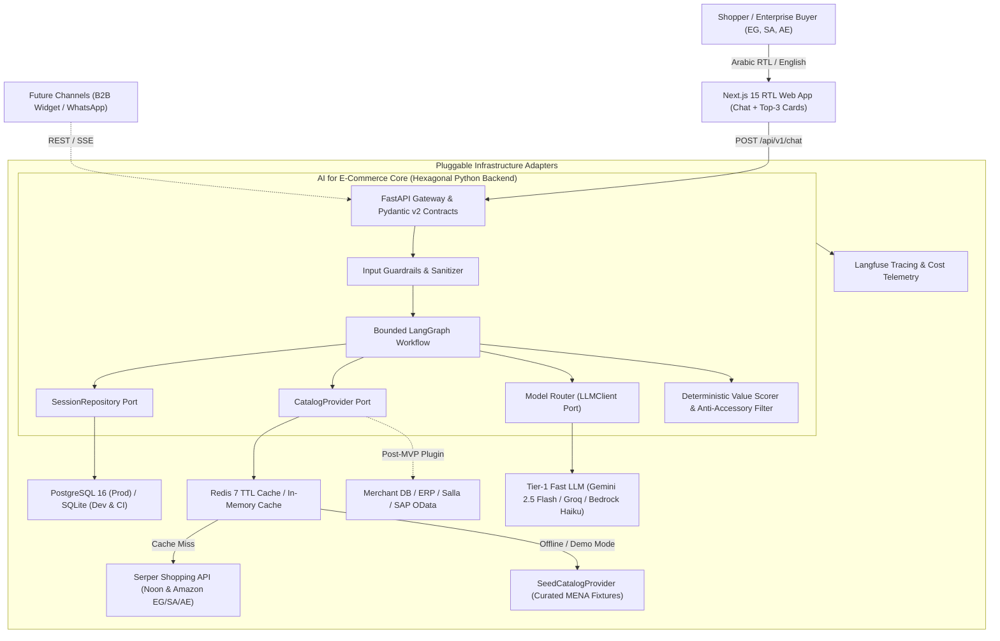
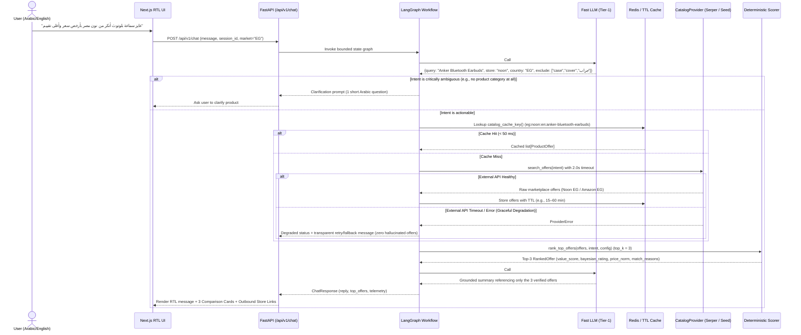

# System Architecture (HLD) — AI for E-Commerce

> Complements `spec/mission.md` and `spec/tech.md`. Designed for **minimum cost**, **low latency**, and **clean B2C-to-B2B extensibility**.

---

## 1. High-Level Component Diagram

---

## 2. End-to-End Request & Degradation Sequence

---

## 3. Deterministic Value Scoring Formula (`INV-03`)

To avoid both the **"Cheap Accessory Trap"** and the **"1-Review 5-Star Trap"** without spending LLM tokens on math:

1. **Hard Filtering Stage**:
   - Reject offers lacking a valid positive price or verified product URL.
   - Reject accessories when the user searched for a primary product (negative keyword list + configurable median-price floor, e.g., rejecting items priced `< 15%` of the candidate set's median price unless explicitly requested).
   - Apply user-stated `max_budget`, `min_rating`, and `store` (`noon` / `amazon`) filters.

2. **Bayesian Confidence-Adjusted Rating ($R_{\text{adj}}$)**:
   $$R_{\text{adj}} = \frac{v}{v + m} \cdot R + \frac{m}{v + m} \cdot C$$
   Where $R$ is the item's star rating ($0\text{–}5$), $v$ is its review count, $m$ is the configurable prior review threshold (default `m = 25`), and $C$ is the prior mean rating across candidates (default `C = 4.0`). A product with `4.8` stars across `600` reviews reliably outranks a `5.0` star listing with `1` review.

3. **Composite Value Score ($S_{\text{value}} \in [0, 100]$)**:
   $$P_{\text{norm}} = \frac{P_{\max} - P}{P_{\max} - P_{\min} + \epsilon}, \qquad R_{\text{norm}} = \frac{R_{\text{adj}}}{5.0}$$
   $$S_{\text{value}} = 100 \times \left( w_{\text{price}} \cdot P_{\text{norm}} + w_{\text{rating}} \cdot R_{\text{norm}} \right)$$
   Default balanced MVP weights: `w_price = 0.55`, `w_rating = 0.45` (configurable per request mode or B2B tenant profile). Ties break by higher review count $v$, then lower price $P$.

---

## 4. Model Routing & Cost Control Policy (`INV-04`)

| Task | Model Tier | Default Candidates | Token Budget | Fallback |
|:---|:---|:---|:---|:---|
| Structured Intent & Filter Extraction | **Tier-1 Ultra-Fast / Low-Cost** | `gemini-2.5-flash` / `llama-3.3-70b` (Groq) / `claude-3-5-haiku` (AWS Bedrock) | `<= 350` output tokens (strict JSON schema) | Rule-based keyword + regex parser |
| Top-3 Comparison Summary (Arabic/English) | **Tier-1 Ultra-Fast / Low-Cost** | Same Tier-1 model | `<= 300` output tokens | Deterministic Arabic/English template builder (0 tokens!) |
| Ranking, Price Math & Outlier Filtering | **Tier-0 Deterministic Python** | Pure Python (`domain/ranking.py`) | `0` tokens | N/A (in-process, `< 2 ms`) |

---

## 5. Architecture Decision Summary (ADRs)

- **ADR-01 (API-First Hexagonal Core)**: Decouples domain/agent logic from Next.js and Noon/Amazon adapters so the MVP serves B2C users immediately while remaining drop-in ready for B2B enterprise catalogs and WhatsApp/widget channels.
- **ADR-02 (Search/Shopping SERP API + TTL Cache over Direct Scraping)**: Eliminates anti-bot blocks, proxy expenses, legal/ToS friction, and `10s+` browser latency, cutting repeat search latency below `50 ms` via Redis caching.
- **ADR-03 (Deterministic Bayesian Value Score over LLM Ranking)**: Guarantees reproducible math, prevents 1-review gaming, saves ~80% of prompt tokens, and allows non-developer weight tuning.
- **ADR-04 (Bounded `LangGraph` over Open `ReAct` Agent)**: Caps latency and cost at `<= 2` fast LLM calls per turn while preserving conversational session state.
- **ADR-05 (Docker on AWS App Runner / ECS Fargate)**: Achieves serverless container economics on AWS (no idle `$73+/mo` EKS cluster fee, no Lambda streaming cold starts) while keeping 100% Docker portability for on-premise Gulf/Egyptian enterprise deployments.
