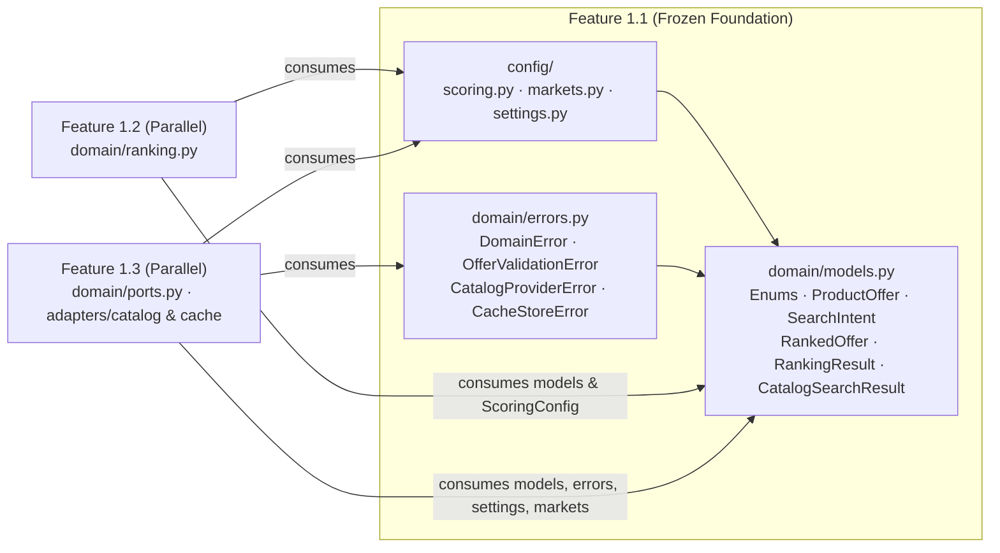

# Plan: Feature 1.1 — Backend Scaffold, Config & Regional Marketplace Domain Models

- **Roadmap ID**: Feature 1.1
- **Folder**: `spec/features/feature-101-backend-scaffold-domain-models/`
- **Phase branch**: `phase/1-core-foundation`
- **Size**: Medium (4 cohesive execution groups covering Python/`uv` package scaffold, typed configuration modules, domain errors/schemas with regional URL & currency validation, and unit tests)
- **Status**: Committed

---

## 1. Objective & Why
Deliver the foundational Python `3.11+` backend workspace, dependency/tooling configuration, typed runtime & market settings, domain exception hierarchy, and strictly validated marketplace domain schemas for **Egypt (`EG`)**, **Saudi Arabia (`SA`)**, and **the UAE (`AE`)**.

This serves [spec/mission.md](../../mission.md) (API-first B2C & B2B core with strict grounding and low-cost configurability) and [spec/roadmap.md](../../roadmap.md) (`Phase 1` -> `Feature 1.1`). By locking the shared contracts, tooling, and package layout upfront (`P7`), `Feature 1.2` (deterministic value ranking) and `Feature 1.3` (pluggable catalog & cache adapters) can execute in parallel with zero file overlap or contract drift.

---

## 2. Scope

### In scope
- **Python Package & Tooling Scaffold (`P7`)**:
  - `backend/pyproject.toml` configured for Python `>=3.11` (`src/` layout for `commerce_ai`), containing **all** Phase 1 runtime dependencies (`pydantic`, `pydantic-settings`, `httpx`, `redis`) and dev dependencies (`pytest`, `pytest-asyncio`, `fakeredis`, `ruff`, `mypy`), plus `[tool.pytest.ini_options]` (`asyncio_mode = "auto"`, registered `@pytest.mark.live` marker deselected by default in offline runs), `[tool.ruff]`, and `[tool.mypy]`.
  - Root `.gitignore` updated under `# Python` to append `.pytest_cache/`, `.ruff_cache/`, `.mypy_cache/`, and `*.egg-info/` while preserving all existing lines (`INV-01`).
  - Existing user-authored `backend/.env.example` and `frontend/.env.example` preserved verbatim (`INV-01`).
  - Complete Phase 1 `__init__.py` package tree (`commerce_ai/`, `config/`, `domain/`, `adapters/`, `adapters/catalog/`, `adapters/cache/`, `tests/`, `tests/unit/`, `tests/integration/`).
- **Typed Configuration (`commerce_ai.config`)**:
  - `config/scoring.py`: `ScoringConfig` with validated default weights, Bayesian priors, unrated prior, outlier guard ratios, and `top_k`.
  - `config/markets.py`: `MarketConfig` and `MARKET_REGISTRY` mapping `EG`, `SA`, and `AE` to canonical currencies, `serper_gl` codes, official Amazon & Noon regional URL rules, Google Shopping host rules, and regional merchant-attribution patterns.
  - `config/settings.py`: `AppSettings(BaseSettings)` loading `.env` with `SecretStr` protection (`INV-01`, `INV-09`).
- **Domain Errors & Models (`commerce_ai.domain`)**:
  - `domain/errors.py`: `DomainError`, `OfferValidationError`, `CatalogProviderError`, `CacheStoreError`.
  - `domain/models.py`: `CountryCode`, `CurrencyCode`, `StoreId`, `StoreFilter`, `CatalogSourceMode`, `ProductOffer` (with `P2` Decimal price, market-currency pairing, and regional URL / Google Shopping attribution validation), `SearchIntent` (with canonical `normalized_cache_key()`), `RankedOffer`, `RankingResult`, and `CatalogSearchResult`.
- **Unit Test Suite**:
  - `backend/tests/unit/test_config_and_models.py` covering config bounds, secret masking, market rules, Decimal price/currency enforcement, regional URL & Google Shopping attribution checks, cache key normalization, and hexagonal import boundaries.

### Out of scope (explicit exclusions)
- Deterministic ranking and anti-accessory/outlier filtering (`domain/ranking.py`, `tests/unit/test_ranking.py`) — owned by **Feature 1.2**.
- Domain ports (`domain/ports.py`) and catalog/cache adapters (`adapters/catalog/**`, `adapters/cache/**`) — owned by **Feature 1.3**.
- `LangGraph` workflow, `LLMClient` adapters, `FastAPI` routes/app factory, database session stores, and `Next.js` UI — deferred to **Phases 2–4**.
- Live network calls or real API keys in tests (`INV-07`).

---

## 3. Decisions

| # | Decision | Source | Rationale |
|:---|:---|:---|:---|
| D1 (`P2`) | `ProductOffer.price` uses Python `Decimal` (`> 0`, finite, quantized to `0.01`), strictly enforces `(country, currency)` pairing (`EG`->`EGP`, `SA`->`SAR`, `AE`->`AED`), and validates `url` as `https://` matching either official regional host/path (`EG`: `amazon.eg` or `noon.com/egypt*`; `SA`: `amazon.sa` or `noon.com/saudi*`; `AE`: `amazon.ae` or `noon.com/uae*`) OR a verified Google Shopping HTTPS link (`google.com/shopping/...` or regional `google.{com.eg,com.sa,ae}`) paired with explicit regional Noon/Amazon merchant attribution. Cross-country domains (`amazon.com` for `EG`) and unknown third-party sellers raise `OfferValidationError` / Pydantic `ValidationError`. | Human Interview Q2 + `INV-05` | Prevents hallucinated/foreign prices, floating-point rounding drift, and cross-market or third-party links from reaching shoppers. |
| D2 (`P7`) | Feature 1.1 initializes `backend/pyproject.toml` with **all** Phase 1 runtime/dev dependencies and tool settings (`asyncio_mode = "auto"`, `@pytest.mark.live` marker), preserves user-authored `backend/.env.example` & `frontend/.env.example`, updates `.gitignore` under `# Python`, and creates all Phase 1 `__init__.py` markers so parallel Features 1.2 and 1.3 never modify `pyproject.toml` or `__init__.py`. | Human Interview Q7 + `INV-02` | Eliminates merge conflicts and lockfile contention when Features 1.2 and 1.3 run concurrently in separate workspaces. |
| D3 | `AppSettings(BaseSettings)` uses `extra="ignore"`, wraps `serper_api_key` in `SecretStr | None = None`, safely strips inline `#` comments and surrounding whitespace on string env values, normalizes empty env strings to `None`, masks secrets in `repr()`/`str()` and diagnostic summaries, and loads `.env` via `pydantic-settings`. | `INV-01`, `INV-09` | Guarantees zero credential leaks in logs/tests while allowing `.env` files copied directly from the existing `backend/.env.example` (which contains Phase 2/4 vars and inline comments such as `CATALOG_MODE=auto                   # auto | seed | serper`) to load cleanly. |
| D4 | `ScoringConfig` stores all tunable ranking weights and guard thresholds (`price_weight=0.55`, `rating_weight=0.45`, `bayesian_prior_count=25`, `bayesian_prior_mean=4.0`, `unrated_prior_rating=3.4`, `price_floor_ratio=0.15`, `price_ceiling_ratio=3.0`, `min_candidates_for_outlier_guard=3`, `top_k=3`) and validates `price_weight + rating_weight == 1.0` (tolerance `1e-6`) and positive bounds. | `INV-03`, Phase 1 shared contract | Enables per-market or future B2B tuning via config without modifying ranking code and prevents invalid scoring math at startup. |
| D5 | `domain/` and `config/` depend exclusively on Python stdlib, `pydantic`, and `pydantic-settings` (zero imports of `httpx`, `redis`, or vendor SDKs). `OfferValidationError` inherits from `(DomainError, ValueError)`. | `INV-02`, Phase 1 shared contract | Preserves the hexagonal boundary (`INV-02`) and lets Pydantic validators raise `OfferValidationError` (producing `ValidationError` on model construction) while helper validators raise `OfferValidationError` directly. |
| D6 | `SearchIntent.normalized_cache_key()` formats canonical lowercase `"{country}:{store}:{slug}:{budget}:{min_rating}"` with `"none"` for omitted `max_budget`/`min_rating`, 2-decimal formatting for `max_budget`, and whitespace/punctuation-collapsed bilingual slugification (preserving Arabic & ASCII alphanumerics). | Phase 1 shared contract (`Feature 1.3` cache integration) | Guarantees deterministic cache hit rates regardless of input whitespace, letter casing, or trailing punctuation across Arabic and English queries. |
| D7 | For Google Shopping HTTPS URLs, `validate_regional_offer_url(..., merchant_attribution=...)` and `ProductOffer.model_validate(..., context={"merchant_attribution": ...})` enforce explicit regional Noon/Amazon merchant attribution (rejecting missing, cross-country, or third-party sellers), while raw `model_validate_json(...)` ALSO enforces regional merchant attribution unless trusted internal cache deserialization explicitly passes `context={"allow_verified_google_shopping_from_cache": True}`. Direct regional store URLs self-attribute via host/path. | `P2` + Feature 1.3 cache serialization compatibility | Prevents unattributed or third-party Google Shopping links via either Python construction or untrusted JSON payloads while enabling `CachedCatalogProvider` Redis JSON round-trips (`CatalogSearchResult.model_validate_json(..., context={"allow_verified_google_shopping_from_cache": True})`). |

---

## 4. Relevant Existing Architecture

- **[spec/tech.md](../../tech.md)**:
  - §1 Tech Stack: Python `3.11+`, `uv`, `Pydantic v2`, `pydantic-settings`, `httpx`, `redis`, `pytest`, `pytest-asyncio`, `ruff`, `mypy`.
  - §2 Architectural Invariants: `INV-01` (Zero Hardcoded Secrets), `INV-02` (Strict Ports & Adapters), `INV-03` (Deterministic Math & Configurable Scoring), `INV-05` (Zero Hallucinated Offers), `INV-07` (100% Offline Deterministic Test Suite), `INV-09` (Zero Payment or Sensitive PII Scope).
  - §3 Repository & Folder Conventions: `backend/pyproject.toml`, `backend/.env.example`, `backend/src/commerce_ai/{config,domain,adapters}`, `backend/tests/{unit,integration}`.
- **[spec/architecture.md](../../architecture.md)**:
  - §1 Hexagonal `CoreEngine` boundary isolating `domain/` and `config/` from infrastructure adapters.
  - §3 Deterministic Value Scoring inputs (`price_weight`, `rating_weight`, `bayesian_prior_count`, `bayesian_prior_mean`).
- **[spec/sdd-profile.md](../../sdd-profile.md)**:
  - Exact toolchain commands (`uv sync --directory backend --all-extras --dev`, `uv run --directory backend pytest ...`, `ruff check .`, `ruff format --check .`, `mypy src`).

---

## 5. Proposed Approach

### Exact Module Contracts

1. **`commerce_ai.config.scoring` (`scoring.py`)**:
   - `ScoringConfig(BaseModel)`:
     - `price_weight: float = 0.55`
     - `rating_weight: float = 0.45`
     - `bayesian_prior_count: int = 25`
     - `bayesian_prior_mean: float = 4.0`
     - `unrated_prior_rating: float = 3.4`
     - `price_floor_ratio: float = 0.15`
     - `price_ceiling_ratio: float = 3.0`
     - `min_candidates_for_outlier_guard: int = 3`
     - `top_k: int = 3`
   - Validates weights in `[0.0, 1.0]` summing to `1.0` (tolerance `1e-6`), `bayesian_prior_count > 0`, rating priors in `[0.0, 5.0]`, `0.0 < price_floor_ratio < 1.0`, `price_ceiling_ratio > 1.0`, `price_floor_ratio < price_ceiling_ratio`, `min_candidates_for_outlier_guard >= 1`, and `1 <= top_k <= 3`.

2. **`commerce_ai.config.markets` (`markets.py`)**:
   - `MarketConfig` (frozen model/dataclass) exposing `country: CountryCode`, `currency: CurrencyCode`, `serper_gl: str`, `amazon_domains: tuple[str, ...]`, `noon_host: str`, `noon_path_prefixes: tuple[str, ...]`, `google_shopping_domains: tuple[str, ...]`, and regional merchant-attribution patterns, plus `MARKET_REGISTRY: Mapping[CountryCode, MarketConfig]`:
     - `EG`: `currency=CurrencyCode.EGP`, `serper_gl="eg"`, Amazon domains `("amazon.eg", "www.amazon.eg")`, Noon host `"noon.com"` with path prefix `"/egypt"`, Google Shopping hosts `("google.com", "www.google.com", "google.com.eg", "www.google.com.eg")`, and regional merchant-attribution matcher (`Noon`: `"noon"`, `"noon egypt"`, `"noon.com"`; `Amazon`: `"amazon.eg"`, `"amazon egypt"`, rejecting foreign store labels such as `"amazon.com"` or `"amazon.sa"`).
     - `SA`: `currency=CurrencyCode.SAR`, `serper_gl="sa"`, Amazon domains `("amazon.sa", "www.amazon.sa")`, Noon host `"noon.com"` with path prefix `"/saudi"`, Google Shopping hosts `("google.com", "www.google.com", "google.com.sa", "www.google.com.sa")`, and corresponding `SA` merchant-attribution rules.
     - `AE`: `currency=CurrencyCode.AED`, `serper_gl="ae"`, Amazon domains `("amazon.ae", "www.amazon.ae")`, Noon host `"noon.com"` with path prefix `"/uae"`, Google Shopping hosts `("google.com", "www.google.com", "google.ae", "www.google.ae")`, and corresponding `AE` merchant-attribution rules.
   - Public URL & attribution validator in `commerce_ai.config.markets`: `validate_regional_offer_url(url: str, *, country: CountryCode, store: StoreId, merchant_attribution: str | None = None) -> str`, enforcing `P2` rules cleanly for both `ProductOffer` validation and `SerperShoppingProvider` ingestion in Feature 1.3.

3. **`commerce_ai.config.settings` (`settings.py`)**:
   - `AppSettings(BaseSettings)`:
     - `model_config = SettingsConfigDict(env_file=".env", env_file_encoding="utf-8", extra="ignore")`
     - `serper_api_key: SecretStr | None = None`
     - `redis_url: str | None = None`
     - `catalog_mode: Literal["auto", "seed", "serper"] = "auto"`
     - `cache_ttl_seconds: int = 1800` (`> 0`)
     - `serper_timeout_seconds: float = 2.0` (`> 0`)
     - `scoring: ScoringConfig = Field(default_factory=ScoringConfig)`
   - Blank string env values (`""` / whitespace) normalize to `None`; inline `#` comments and surrounding whitespace on string env values (e.g., `CATALOG_MODE=auto                   # auto | seed | serper` from `backend/.env.example`) are safely stripped before literal/URL parsing, and `extra="ignore"` ignores Phase 2/4 variables in `.env`; `repr()`/`str()` and helper summary mask `serper_api_key` and any password embedded in `redis_url` (`INV-01`).

4. **`commerce_ai.domain.errors` (`errors.py`)**:
   - `DomainError(Exception)`
   - `OfferValidationError(DomainError, ValueError)`
   - `CatalogProviderError(DomainError)` with constructor signature `CatalogProviderError(provider: str, retriable: bool, reason: str)` (no extra required `message` argument; formats `super().__init__(...)` from `provider`, `retriable`, `reason` and stores those exact attributes).
   - `CacheStoreError(DomainError)`

5. **`commerce_ai.domain.models` (`models.py`)**:
   - Enums (`StrEnum` with explicit uppercase member names):
     - `CountryCode`: `EG = "EG"`, `SA = "SA"`, `AE = "AE"`
     - `CurrencyCode`: `EGP = "EGP"`, `SAR = "SAR"`, `AED = "AED"`
     - `StoreId`: `NOON = "noon"`, `AMAZON = "amazon"`
     - `StoreFilter`: `NOON = "noon"`, `AMAZON = "amazon"`, `BOTH = "both"`
     - `CatalogSourceMode`: `SEED = "seed"`, `LIVE = "live"`
   - `ProductOffer`: `offer_id: str`, `title: str`, `price: Decimal`, `currency: CurrencyCode`, `store: StoreId`, `country: CountryCode`, `url: str` (validated strictly via `HttpUrl` after control-char/whitespace/backslash/traversal rejection, with no raw `str` fallback), `rating: float | None = None` (`0.0..5.0`), `review_count: int = 0` (`>= 0`), `image_url: str | None = None`, `in_stock: bool = True`. Validates positive finite `Decimal` quantized to `0.01`, strict `(country, currency)` pairing, credential-free `https://` `image_url` when set, `P2` regional store / Google Shopping attribution rules, and requires explicit `context={"allow_verified_google_shopping_from_cache": True}` (or `merchant_attribution`) for Google Shopping links even in `json` mode.
   - `SearchIntent`: `query: str`, `country: CountryCode`, `store: StoreFilter = StoreFilter.BOTH`, `max_budget: Decimal | None = None`, `min_rating: float | None = None`, `exclude_keywords: tuple[str, ...] = ()`, `include_accessories: bool = False`, `language: Literal["ar", "en"] = "ar"`, plus `normalized_cache_key() -> str` returning `"{country}:{store}:{slug}:{budget}:{min_rating}"`.
   - `RankedOffer`: `rank: int` (`1..3`), `offer: ProductOffer`, `value_score: float` (`0.0..100.0`), `price_norm: float` (`0.0..1.0`), `bayesian_rating: float` (`0.0..5.0`), `match_reasons: tuple[str, ...]`.
   - `RankingResult`: `ranked_offers: list[RankedOffer]`, `total_candidates: int`, `filtered_accessories_count: int`, `filtered_outliers_count: int`, `degraded_fewer_than_k: bool`.
   - `CatalogSearchResult`: `offers: list[ProductOffer]`, `source_mode: CatalogSourceMode`, `cache_hit: bool = False`.

---

## 6. Expected Files / Areas Affected

| Path | Change | Purpose |
|:---|:---|:---|
| `.gitignore` | Modify | Preserve all existing lines and append `.pytest_cache/`, `.ruff_cache/`, `.mypy_cache/`, `*.egg-info/` under `# Python` |
| `backend/pyproject.toml` | Create | Phase 1 runtime & dev dependencies, `src/` build layout, `pytest` (`asyncio_mode = "auto"`, `live` marker), `ruff`, and `mypy` config (`P7`) |
| `backend/.env.example` | Preserve / Verify | Keep user-authored template verbatim (`AppSettings` uses `extra="ignore"` and safely strips inline `#` comments/whitespace on string env values) (`INV-01`) |
| `frontend/.env.example` | Preserve | Keep existing user-authored frontend environment template untouched |
| `backend/uv.lock` | Create | Deterministic lockfile generated by `uv sync --directory backend --all-extras --dev` |
| `backend/src/commerce_ai/__init__.py` | Create | Top-level package marker (`P7`) |
| `backend/src/commerce_ai/config/__init__.py` | Create | Config package exports (`AppSettings`, `MarketConfig`, `MARKET_REGISTRY`, `ScoringConfig`) |
| `backend/src/commerce_ai/config/scoring.py` | Create | `ScoringConfig` with weights, priors, and outlier bounds (`INV-03`) |
| `backend/src/commerce_ai/config/markets.py` | Create | `MarketConfig`, `MARKET_REGISTRY`, and `P2` regional URL/attribution validation helpers |
| `backend/src/commerce_ai/config/settings.py` | Create | `AppSettings(BaseSettings)` with `.env` loading and secret masking (`INV-01`) |
| `backend/src/commerce_ai/domain/__init__.py` | Create | Domain package marker/exports (`P7` — untouched by Features 1.2 & 1.3) |
| `backend/src/commerce_ai/domain/errors.py` | Create | `DomainError`, `OfferValidationError`, `CatalogProviderError`, `CacheStoreError` |
| `backend/src/commerce_ai/domain/models.py` | Create | Enums, `ProductOffer`, `SearchIntent`, `RankedOffer`, `RankingResult`, `CatalogSearchResult` |
| `backend/src/commerce_ai/adapters/__init__.py` | Create | Adapters package marker (`P7`) |
| `backend/src/commerce_ai/adapters/catalog/__init__.py` | Create | Catalog adapters package marker (`P7`) |
| `backend/src/commerce_ai/adapters/cache/__init__.py` | Create | Cache adapters package marker (`P7`) |
| `backend/tests/__init__.py` | Create | Test package marker (`P7`) |
| `backend/tests/unit/__init__.py` | Create | Unit test package marker (`P7`) |
| `backend/tests/integration/__init__.py` | Create | Integration test package marker (`P7`) |
| `backend/tests/unit/test_config_and_models.py` | Create | Offline deterministic unit tests for config, errors, models, URLs, cache keys, and hexagonal imports |

---

## 7. Execution Groups

- **Group 1 — Package Scaffold, Dependencies & Tooling Config**: Update root `.gitignore` (preserving existing rules and appending `.pytest_cache/`, `.ruff_cache/`, `.mypy_cache/`, `*.egg-info/` under `# Python`), preserve existing `backend/.env.example` and `frontend/.env.example` verbatim, create `backend/pyproject.toml` and all Phase 1 `__init__.py` scaffold files (`P7`), then run `uv sync --directory backend --all-extras --dev` to lock dependencies and verify environment resolution.
- **Group 2 — Configuration Modules (`config/`)**: Implement `scoring.py` (`ScoringConfig`), `markets.py` (`MarketConfig`, `MARKET_REGISTRY`, regional URL/merchant-attribution verification), and `settings.py` (`AppSettings` with `.env` loading and credential masking).
- **Group 3 — Domain Errors & Schemas (`domain/`)**: Implement `errors.py` and `models.py` with all 5 enums, 5 models, `ProductOffer` Decimal/currency/URL validation (`P2`), and `SearchIntent.normalized_cache_key()`.
- **Group 4 — Unit Tests & Static Gates**: Implement `backend/tests/unit/test_config_and_models.py`, run `uv run --directory backend pytest -v`, `ruff check .`, `ruff format --check .`, and `mypy src` until all checks pass offline.

---

## 8. Risks & Trade-offs

| Risk / Trade-off | Impact | Mitigation |
|:---|:---|:---|
| Parallel Feature 1.2 or 1.3 drift on enum/model field names or `pyproject.toml` edits | Broken imports or merge conflicts at Phase 1 integration | Lock exact Phase 1 signatures in §5 and pre-create all `pyproject.toml` deps and `__init__.py` markers in Group 1 (`P7`). |
| Google Shopping URL variants (`google.com/shopping/...` vs `google.{com.eg,com.sa,ae}`) vs strict grounding | Rejecting valid Serper Shopping offers or accepting unverified sellers | Validate `https://` + regional Google host + shopping path + explicit Noon/Amazon merchant attribution when validating attributed offers, while keeping JSON cache round-trip compatibility (`D7`). |
| `Decimal` quantization edge case (`Decimal("0.001")` rounding down to `0.00`) or float precision noise | Zero-price offers slipping past `> 0` check or precision loss | Validate finiteness and enforce `price > Decimal("0.00")` **after** `quantize(Decimal("0.01"))`. |
| Credential exposure via `AppSettings` string/log formatting or accidental `.env` creation | `INV-01` secret leakage violation | Use `SecretStr`, mask `redis_url` userinfo in `repr()`/summaries, keep only variable names in `.env.example`, and verify via unit tests. |
| Missing `uv` wheel cache on completely disconnected machines during initial `uv sync` | Initial environment setup failure | Run `uv sync --directory backend --all-extras --dev` once in Group 1; keep all `pytest` runs 100% offline (`INV-07`). |

---

## 9. Open Questions
None — all design decisions (`P2`, `P7`) and Phase 1 contracts are resolved and approved at Phase Gate 1.
