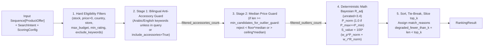

# Plan: Feature 1.2 — Deterministic Top-3 Value Scoring Engine & Anti-Accessory/Outlier Filter

- **Roadmap ID**: Feature 1.2
- **Folder**: `spec/features/feature-102-deterministic-value-ranking/`
- **Phase branch**: `phase/1-core-foundation`
- **Size**: Medium (3 execution groups covering multi-stage bilingual/statistical filtering, Bayesian + price-normalized Top-3 scoring math, and an exhaustive offline unit/edge-case suite within an isolated domain module)
- **Status**: Approved (Gate 1)

---

## 1. Objective & Why

Deliver the pure, deterministic Python ranking and filtering engine (`commerce_ai.domain.ranking`) that transforms raw marketplace `ProductOffer` candidates into up to `3` verified, best-value `RankedOffer` recommendations for a shopper's `SearchIntent`.

This feature directly serves:
- **Mission Goals (`spec/mission.md` §§1–2, §4)**: Eliminates the *"Cheap Accessory Trap"* (cables, cases, and screen protectors dominating low-price sorts) and the *"1-Review 5-Star Trap"* while executing in pure Python at zero LLM token cost and sub-2 ms latency.
- **Roadmap (`spec/roadmap.md` -> Phase 1, Feature 1.2)**: Implements the deterministic Top-3 Value Scoring engine and two-stage anti-accessory/outlier guard on top of Feature 1.1's domain models and `ScoringConfig`.
- **Architecture (`spec/architecture.md` §3, ADR-03)**: Enforces reproducible mathematical scoring (`INV-03`), strict hexagonal isolation (`INV-02`), strict offer grounding (`INV-05`), and honest partial-result degradation (`INV-08`).

---

## 2. Scope

### In scope
- Public domain entrypoint `rank_top_offers(offers: Sequence[ProductOffer], intent: SearchIntent, config: ScoringConfig | None = None) -> RankingResult` in `backend/src/commerce_ai/domain/ranking.py`.
- Hard eligibility filtering (`in_stock`, positive `price`, `country`, `store`, `max_budget`, `min_rating` excluding unrated/zero-review items when set, and `exclude_keywords`).
- **Stage 1 (`P4`)**: Intent-aware bilingual (Arabic & English) anti-accessory keyword filter running before statistical price outlier checks, tracking `filtered_accessories_count`.
- **Stage 2 (`P4`)**: Statistical median price floor (`< price_floor_ratio * median`) and upper anomaly (`> price_ceiling_ratio * median`, unless accommodated by `max_budget`) guard active when `len(candidates) >= config.min_candidates_for_outlier_guard`, tracking `filtered_outliers_count`.
- **Bayesian Rating & Composite Value Score (`INV-03`, `P3`)**: Confidence-adjusted Bayesian rating for reviewed offers, conservative `ScoringConfig.unrated_prior_rating` (`3.4`) fallback for `rating=None` or `review_count=0` offers when `min_rating` is `None`, price normalization with `P_norm = 1.0` when `P_max == P_min`, weighted `S_value` in `[0.0, 100.0]`, deterministic rounding, tie-breaking, deterministic `match_reasons`, and honest `degraded_fewer_than_k` reporting.
- Exhaustive offline unit and edge-case test suite in `backend/tests/unit/test_ranking.py`.

### Out of scope (explicit exclusions)
- **Disjoint File Partition (`P7`)**: Feature 1.2 MUST NOT modify `backend/pyproject.toml`, `backend/src/commerce_ai/domain/__init__.py`, `backend/src/commerce_ai/domain/models.py`, `backend/src/commerce_ai/domain/errors.py`, `backend/src/commerce_ai/config/*`, `backend/src/commerce_ai/domain/ports.py`, or any `backend/src/commerce_ai/adapters/**` files (owned separately by Features 1.1 and 1.3).
- Catalog retrieval, caching, HTTP calls, or seed data loading (Feature 1.3).
- LLM natural-language intent extraction, clarification prompts, or Arabic/English explanation generation (Phase 2).
- FastAPI HTTP endpoints, Langfuse tracing, golden eval suites (`tests/evals`), or Next.js UI rendering (Phases 2–4).
- Writing application code or committing to git before Phase Gate 1 approval.

---

## 3. Decisions

| # | Decision | Source | Rationale |
|:---|:---|:---|:---|
| D1 | **Conservative Unrated / Zero-Review Prior (`P3`)**: When `offer.rating is None` or `offer.review_count == 0` and `intent.min_rating is None`, assign `bayesian_rating = config.unrated_prior_rating` (`3.4` by default, strictly below `bayesian_prior_mean = 4.0`) directly instead of applying `(m / (v + m)) * C`. When `intent.min_rating` is set, exclude unrated/zero-review offers. | Human Interview Q3 (`P3`) + `INV-03` | Direct formula substitution at `v = 0` would yield `C = 4.0`, letting unrated items outscore `3.8`-star reviewed products. Assigning `3.4` keeps unrated offers eligible as fallback candidates while ensuring well-reviewed products reliably win. |
| D2 | **Single-Candidate & Equal-Price Normalization (`P3`)**: When `P_max == P_min` among surviving candidates (including `len(candidates) == 1`), set `P_norm = 1.0`. | Human Interview Q3 (`P3`) + `INV-03` | Refines `spec/architecture.md` §3's `+ ε` denominator guard so single-item or equal-price pools produce exact `1.0` normalization rather than `0.0 / ε = 0.0` score distortion. |
| D3 | **Stage 1 Intent-Aware Bilingual Anti-Accessory Filter (`P4`)**: Run keyword rejection FIRST (before median pricing) against English (`case`, `cover`, `protector`, `cable`, `cord`, `charger`, `adapter`, `strap`, `holder`, `mount`, `skin`, `sleeve`) and Arabic (`جراب`, `كفر`, `حافظة`, `شاحن`, `اسكرينة`, `حماية شاشة`, `وصلة`, `كابل`, `سلك`, `حامل`, `سوار`) terms, bypassed per matched term when present in `SearchIntent.query` or globally when `SearchIntent.include_accessories` is `True`. | Human Interview Q4 (`P4`) + `INV-03` | Filtering accessories before computing median price prevents cheap accessories from collapsing the median. Boundary-aware English token matching and Arabic orthographic normalization avoid false positives on primary devices (e.g., `"record"`, `"showcase"`). |
| D4 | **Stage 2 Statistical Median Price Outlier Guard (`P4`)**: Run SECOND on post-Stage-1 candidates when `len(candidates) >= config.min_candidates_for_outlier_guard` (default `3`). Reject `price < config.price_floor_ratio * median` (default `0.15`) and `price > config.price_ceiling_ratio * median` (default `3.0`, bypassed when `intent.max_budget` is set since Step A already enforces `price <= max_budget`). | Human Interview Q4 (`P4`) + `INV-03` | Catches unlabeled cheap spare parts below `15%` of median and `3x+` scalper/bundle outliers that compress `P_norm` for normal listings, while respecting explicit high-budget searches (`max_budget`) and small pools (`< 3` items). |
| D5 | **Deterministic Rounding & Tie-Break Cascade**: Round `price_norm` and `bayesian_rating` to `4` decimal places and `value_score` to `2` decimal places (`[0.0, 100.0]`), then sort by `(-value_score, -offer.review_count, offer.price, offer.offer_id)`. | `spec/architecture.md` §3 + `INV-03` | Sorting on deterministically rounded `value_score` guarantees displayed scores strictly match item ranks (`1..k`), while `review_count` -> `price` -> `offer_id` makes ties 100% reproducible. |
| D6 | **Structured `match_reasons` Taxonomy**: Assign deterministic reason tokens (`best_overall_value`, `lowest_price`, `top_bayesian_rating`, `high_review_confidence`, `within_budget`, `unrated_fallback`, `strong_value_runner_up`). | `spec/mission.md` §7 + `INV-05` | Provides grounded, machine-readable justification tags for downstream Arabic/English explanation templates and UI cards without LLM invention. |
| D7 | **Disjoint File Partition (`P7`)**: Feature 1.2 creates strictly `backend/src/commerce_ai/domain/ranking.py` and `backend/tests/unit/test_ranking.py`, leaving `pyproject.toml` and `domain/__init__.py` untouched. | Human Interview Q7 (`P7`) + `INV-02` | Enables zero-conflict parallel implementation alongside Feature 1.3 once Feature 1.1 merges/lands. |

---

## 4. Relevant Existing Architecture

Feature 1.2 builds directly on the shared Phase 1 contracts established by Feature 1.1 (`spec/features/feature-101-backend-scaffold-domain-models/`):

- **Domain Models & Enums (`commerce_ai.domain.models`)**:
  - `StoreFilter`: `noon`, `amazon`, `both`
  - `ProductOffer`: `offer_id: str`, `title: str`, `price: Decimal`, `currency: CurrencyCode`, `store: StoreId`, `country: CountryCode`, `url: HttpUrl | str`, `rating: float | None = None`, `review_count: int = 0`, `image_url: str | None = None`, `in_stock: bool = True`
  - `SearchIntent`: `query: str`, `country: CountryCode`, `store: StoreFilter = StoreFilter.BOTH`, `max_budget: Decimal | None = None`, `min_rating: float | None = None`, `exclude_keywords: tuple[str, ...] = ()`, `include_accessories: bool = False`, `language: Literal["ar", "en"] = "ar"`
  - `RankedOffer`: `rank: int`, `offer: ProductOffer`, `value_score: float`, `price_norm: float`, `bayesian_rating: float`, `match_reasons: tuple[str, ...]`
  - `RankingResult`: `ranked_offers: list[RankedOffer]`, `total_candidates: int`, `filtered_accessories_count: int`, `filtered_outliers_count: int`, `degraded_fewer_than_k: bool`
- **Configuration (`commerce_ai.config` / `commerce_ai.config.scoring`)**:
  - `ScoringConfig`: `price_weight: float = 0.55`, `rating_weight: float = 0.45`, `bayesian_prior_count: int = 25`, `bayesian_prior_mean: float = 4.0`, `unrated_prior_rating: float = 3.4`, `price_floor_ratio: float = 0.15`, `price_ceiling_ratio: float = 3.0`, `min_candidates_for_outlier_guard: int = 3`, `top_k: int = 3`
- **Public Ranking Entrypoint (`commerce_ai.domain.ranking`)**:
  ```python
  def rank_top_offers(
      offers: Sequence[ProductOffer],
      intent: SearchIntent,
      config: ScoringConfig | None = None,
  ) -> RankingResult: ...
  ```
- **Invariants Applied**:
  - `INV-02`: `domain/ranking.py` imports only Python stdlib, `commerce_ai.domain.models`, and `commerce_ai.config`—zero vendor SDKs or adapter modules.
  - `INV-03`: All price normalization, filtering, and Bayesian value scoring execute in pure deterministic Python using `ScoringConfig`.
  - `INV-05`: Returned `RankedOffer.offer` instances preserve original `ProductOffer` data untouched; missing candidates are never fabricated.
  - `INV-07`: Unit suite runs 100% offline with zero network calls or secrets.
  - `INV-08`: Fewer than `config.top_k` qualifying candidates (`0–2`) return gracefully with `degraded_fewer_than_k=True`.

---

## 5. Proposed Approach

`rank_top_offers` runs a linear, side-effect-free pipeline over the input `offers` sequence:



### Pipeline Stages & Boundary Rules
1. **Text Normalization Helper**: Case-folds English text, normalizes Arabic Alef (`أ/إ/آ -> ا`), Teh Marbuta (`ة -> ه`), and Alef Maksura (`ى -> ي`), strips Arabic diacritics/tatweel, and matches English accessory tokens on word boundaries (including simple plural `s`) and Arabic keywords across optional `ال` prefixes so primary devices are not falsely dropped.
2. **Hard Eligibility Filtering**: Enforces `in_stock is True`, `price > 0`, `country == intent.country`, `store == intent.store` (when not `both`), `price <= intent.max_budget` (when set), `rating is not None and review_count > 0 and rating >= intent.min_rating` (when `min_rating` is set), and absence of `intent.exclude_keywords` in the normalized title.
3. **Stage 1 Anti-Accessory Filter (`P4`)**: Skipped when `intent.include_accessories` is `True`. Otherwise, rejects any offer whose normalized title contains a bilingual accessory keyword not present in the normalized `intent.query`, incrementing `filtered_accessories_count`.
4. **Stage 2 Median Price Outlier Guard (`P4`)**: Activated only when `len(post_stage1) >= config.min_candidates_for_outlier_guard`. Computes `Decimal` median via `statistics.median`, rejects `price < Decimal(str(config.price_floor_ratio)) * median`, and when `intent.max_budget is None` also rejects `price > Decimal(str(config.price_ceiling_ratio)) * median`, incrementing `filtered_outliers_count`.
5. **Scoring, Tie-Breaking & Provenance**: Computes `bayesian_rating`, `price_norm`, and `value_score` for surviving offers; sorts deterministically; selects up to `config.top_k` offers; attaches grounded `match_reasons`; and returns `RankingResult` with `total_candidates = len(offers)` and `degraded_fewer_than_k = len(ranked_offers) < config.top_k`.

---

## 6. Expected Files / Areas Affected

| Path | Change (Create / Modify / Delete) | Purpose |
|:---|:---|:---|
| `backend/src/commerce_ai/domain/ranking.py` | Create | Pure deterministic multi-stage filtering, Bayesian value scoring, tie-breaking, and `rank_top_offers` entrypoint |
| `backend/tests/unit/test_ranking.py` | Create | Comprehensive offline unit and edge-case tests covering P3, P4, INV-02, INV-03, INV-05, INV-07, and INV-08 |

> **Strict Partition Notice (`P7`)**: Feature 1.2 MUST NOT modify `backend/pyproject.toml` or `backend/src/commerce_ai/domain/__init__.py` (both pre-configured by Feature 1.1).

---

## 7. Execution Groups

- **Group 1 — Bilingual Text Normalization & Multi-Stage Filtering Pipeline**:
  Implement `backend/src/commerce_ai/domain/ranking.py` helpers for Arabic/English normalization, hard eligibility filters, Stage 1 bilingual anti-accessory filtering (`filtered_accessories_count`), and Stage 2 statistical median price outlier filtering (`filtered_outliers_count`), with unit tests covering hard filters, bilingual accessory traps, positive accessory queries, and floor/ceiling outlier cases.
- **Group 2 — Bayesian Rating, Price Normalization, Scoring, Tie-Breaking & Match Reasons**:
  Complete `rank_top_offers` scoring math (`unrated_prior_rating = 3.4`, Bayesian $R_{\text{adj}}$, `P_norm = 1.0` when $P_{\max} == P_{\min}$, `S_value`, deterministic rounding, tie-breaking, `match_reasons`, and `degraded_fewer_than_k`), expanding `backend/tests/unit/test_ranking.py` to cover Bayesian 1-review traps, unrated handling, configurable weights, tie-breaking, and partial/empty pools.
- **Group 3 — Boundary Verification, Regression & Static Quality Gates**:
  Add AST/import boundary assertions (`INV-02`) and latency/determinism checks (`INV-07`), then run `pytest`, `ruff check .`, `ruff format --check .`, and `mypy src` cleanly against `spec/sdd-profile.md` commands.

---

## 8. Risks & Trade-offs

| Risk / Trade-off | Impact | Mitigation |
|:---|:---|:---|
| **Over-broad English/Arabic substring matching on accessory keywords** (e.g., `"cord"` inside `"record"`, `"case"` inside `"showcase"`) | False rejection of valid primary products | Match English accessory keywords using regex word boundaries (allowing optional plural `s`) and apply lightweight Arabic orthographic normalization with token boundaries rather than raw substring scanning. |
| **Small candidate pools (`< 3` items) distorting statistical median** | Rejecting legitimate variation between 2 remaining offers (e.g., standard vs. Pro model) | Gate Stage 2 strictly on `len(remaining) >= config.min_candidates_for_outlier_guard` (default `3`) per `P4`. |
| **Unintended filtering of legitimate high-tier listings when user explicitly sets a high `max_budget`** | User's valid high-budget option dropped by `3.0 * median` | Bypass the upper `price_ceiling_ratio * median` rejection whenever `intent.max_budget` is set (since Step A already enforces `offer.price <= intent.max_budget`). |
| **Floating-point comparison drift near exact score ties or `Decimal` median boundaries** | Non-deterministic tie order across items | Perform median/floor/ceiling comparisons in `Decimal`, apply deterministic rounding (`round(..., 2)` for `value_score`, `round(..., 4)` for `price_norm`/`bayesian_rating`), and break ties deterministically via `(-value_score, -review_count, price, offer_id)`. |

---

## 9. Open Questions

None — all Feature 1.2 design decisions (`P3`, `P4`, `P7`, and shared Phase 1 contracts) were resolved during the Phase 1 human interview and constitution definition.
