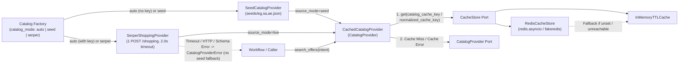

# Plan: Feature 1.3 — Pluggable Catalog Layer & TTL Caching

- **Roadmap ID**: Feature 1.3
- **Folder**: `spec/features/feature-103-pluggable-catalog-and-cache/`
- **Phase branch**: `phase/1-core-foundation`
- **Size**: Medium (4 cohesive execution groups spanning domain ports, dual cache stores with automatic fallback, bilingual seed datasets + provider, single-call Serper Shopping adapter, and cached decorator/factory integration)
- **Status**: Committed

---

## 1. Objective & Why

Feature 1.3 delivers the pluggable catalog retrieval and TTL caching infrastructure for **AI for E-Commerce**, fulfilling Phase 1 (`spec/roadmap.md` -> Phase 1, Feature 1.3) and serving the mission goals in `spec/mission.md` (§1, §4, §5, §6):

1. **Zero-Latency Repeat Queries & Low API Cost**: Caching normalized search intents in `RedisCacheStore` (with automatic `InMemoryTTLCache` fallback) eliminates redundant external HTTP requests on cache hits and helps achieve the MVP `<= 300 ms` repeat latency and `<= $0.002` per-uncached-query cost targets.
2. **Sanctioned, Single-Call Live Marketplace Retrieval (`SerperShoppingProvider`)**: Fetches live regional `Noon` and `Amazon` (`EG`, `SA`, `AE`) offers using strictly **1** async `POST https://google.serper.dev/shopping` call per cache miss (`~$0.001`), without fragile headless scraping or CAPTCHA bypass (`INV-06`).
3. **100% Offline Deterministic Development & CI (`SeedCatalogProvider`)**: Provides curated, versioned bilingual Arabic/English marketplace seed catalogs for Egypt (`EG`), Saudi Arabia (`SA`), and the UAE (`AE`) containing deliberate ranking traps (accessories, `5.0`-star `1`-review items, unrated items, and `4x` scalper outliers) so Feature 1.2 ranking, Phase 2 agent flows, and Phase 4 evals execute deterministically offline (`INV-07`).
4. **Enterprise B2B Extensibility**: Defining pure `CatalogProvider` and `CacheStore` protocols in `commerce_ai.domain.ports` isolates the domain core from vendor SDKs (`INV-02`), enabling future merchant ERP/Salla/Odoo connectors without touching ranking or agent logic.

---

## 2. Scope

### In scope
- **Domain Ports (`commerce_ai.domain.ports`)**: Define pure `typing.Protocol` contracts for `CatalogProvider` (`search_offers`) and `CacheStore` (`get`, `set`, `delete`).
- **Cache Adapters (`commerce_ai.adapters.cache`)**:
  - `InMemoryTTLCache`: Async-safe in-process TTL cache using monotonic time (`time.monotonic()`).
  - `RedisCacheStore`: Async `redis.asyncio` cache store verified 100% offline via `fakeredis` (supporting injected Redis client or `REDIS_URL`), wrapping Redis errors into `CacheStoreError` without leaking URL credentials.
  - Cache factory: Resolves `RedisCacheStore` when `AppSettings.redis_url` is set and reachable, automatically falling back to `InMemoryTTLCache` when `REDIS_URL` is unset or unreachable.
- **Seed Catalog Adapter & Regional Datasets (`commerce_ai.adapters.catalog`)**:
  - Versioned JSON seed catalogs (`seeds/eg.json`, `seeds/sa.json`, `seeds/ae.json`) spanning 5+ categories across `Noon` and `Amazon` with bilingual Arabic/English titles/tags and deliberate test traps.
  - `SeedCatalogProvider`: Loads and validates seed entries into `ProductOffer`, matches bilingual queries, filters by `country` and `store`, and returns `CatalogSearchResult(..., source_mode=CatalogSourceMode.SEED)`.
- **Live Serper Shopping Adapter (`commerce_ai.adapters.catalog.serper_provider`)**:
  - `SerperShoppingProvider`: Sends strictly 1 async `POST https://google.serper.dev/shopping` call (`num=40`, `gl` in `eg`/`sa`/`ae`, `hl` in `ar`/`en`, store hint for `noon`/`amazon`, timeout `AppSettings.serper_timeout_seconds` = `2.0s`), parses offers deterministically, enforces `P2` regional Noon/Amazon URL/attribution checks, returns `CatalogSourceMode.LIVE`, and raises `CatalogProviderError` on timeout, HTTP error, or malformed response.
- **Cached Wrapper & Catalog Factory (`commerce_ai.adapters.catalog`)**:
  - `CachedCatalogProvider`: Wraps any `CatalogProvider` + `CacheStore`, keying on `intent.normalized_cache_key()` (Phase 1 baseline), returning `cache_hit=True` on hits, caching valid results on miss, never caching `CatalogProviderError` failures, and degrading gracefully to the inner provider if cache operations fail. **[Phase 2 Feature 2.1 Amendment — Code implementation scheduled in Phase 2 Feature 2.1]**: migrate cache key lookup/storage to `intent.catalog_cache_key()` (`"{country}:{store}:{language}:{slug}"` with Arabic orthographic folding so downstream `max_budget`/`min_rating` refinements reuse cached offers) and add per-key single-flight request coalescing (`asyncio.Lock` + `_in_flight: dict[str, asyncio.Task[CatalogSearchResult]]` keyed by `cache_key`) inside `search_offers()`, cleaning up `_in_flight` in `finally` and never caching `CatalogProviderError`.
  - Provider factory: Resolves `SeedCatalogProvider` or `SerperShoppingProvider` according to `AppSettings.catalog_mode` (`"auto"` | `"seed"` | `"serper"`, default `"auto"`) and `SERPER_API_KEY`, optionally wrapping with `CachedCatalogProvider`, with zero silent fallback to seed data when live Serper fails.
- **Offline Unit & Integration Tests**: Comprehensive tests using `InMemoryTTLCache`, `fakeredis`, `SeedCatalogProvider`, and `httpx.MockTransport` (plus optional `@pytest.mark.live` exclusion from default offline runs).

### Out of scope (explicit exclusions)
- **Modifying Feature 1.1 or Feature 1.2 Files (`P7`)**: Feature 1.3 MUST NOT modify `backend/pyproject.toml`, `backend/src/commerce_ai/domain/__init__.py` (or any package `__init__.py` scaffolded by Feature 1.1), `backend/src/commerce_ai/config/`, `backend/src/commerce_ai/domain/models.py`, `backend/src/commerce_ai/domain/errors.py`, or `backend/src/commerce_ai/domain/ranking.py`.
- **Ranking, Anti-Accessory Filtering, and Bayesian Math**: Owned by Feature 1.2 (`domain/ranking.py`). `SeedCatalogProvider` intentionally preserves matching trap items so `rank_top_offers` can filter and score them.
- **Headless Browser Scraping or Anti-Bot Bypass**: Strictly prohibited (`INV-06`).
- **LangGraph Nodes, LLM Clients, Session Persistence, and FastAPI Endpoints**: Deferred to Phase 2 (Features 2.1–2.3).
- **Live Network Calls in Default CI / Pytest**: Default test runs execute 100% offline (`INV-07`).

---

## 3. Decisions

| # | Decision | Source | Rationale |
|:---|:---|:---|:---|
| **P1** | **Dual Cache Layer with Automatic Fallback**: Implement `InMemoryTTLCache` (default offline/local) and async `RedisCacheStore` (`redis.asyncio`), tested 100% offline via `fakeredis` with automatic fallback to `InMemoryTTLCache` when `REDIS_URL` is unset or unreachable. | Human Interview Q1, `INV-07`, `INV-08` | Provides Redis 7 production readiness while guaranteeing zero-Docker local development and offline CI execution without crashes when Redis is unavailable. |
| **P2** | **Regional Store URL & Merchant Attribution Alignment**: Accept only `https://` official regional Noon/Amazon links (`EG`: `amazon.eg` or `noon.com/egypt*`; `SA`: `amazon.sa` or `noon.com/saudi*`; `AE`: `amazon.ae` or `noon.com/uae*`) or Google Shopping HTTPS links (`google.com/shopping/...` or `google.{com.eg,com.sa,ae}`) when merchant attribution explicitly identifies that regional Noon/Amazon store; reject cross-country (`amazon.com`) and third-party sellers. | Human Interview Q2, `INV-05`, Feature 1.1 contract | Serper Shopping payloads frequently surface Google Shopping redirect URLs alongside `source` merchant strings; aligning parsing with Feature 1.1 `ProductOffer` validation avoids false rejections while blocking unsupported sellers and cross-border domains. |
| **P5** | **Single-Call `SerperShoppingProvider` Cost Cap**: Send strictly 1 async `POST https://google.serper.dev/shopping` call per cache miss (`num=40`, `gl` mapped to `eg`/`sa`/`ae`, `hl` mapped to `ar`/`en`, store hint when `store` is `"noon"` or `"amazon"`, timeout `AppSettings.serper_timeout_seconds` = `2.0s`), capping search cost at `~$0.001 <= $0.002`. Raise `CatalogProviderError` on timeout/HTTP error/malformed payload. | Human Interview Q5, `spec/mission.md` §4, `INV-07`, `INV-08` | Eliminates multi-page fan-out cost inflation and bounds tail latency while allowing deterministic offline HTTP testing via `httpx.MockTransport` (with any optional live test isolated under `@pytest.mark.live`). |
| **P6** | **Rich Bilingual `SeedCatalogProvider` & Honest Runtime Mode**: Ship versioned JSON fixtures (`eg.json`, `sa.json`, `ae.json`) across 5+ categories on Noon & Amazon with bilingual Arabic/English keywords/titles and deliberate ranking traps. Support `CatalogMode` (`auto` \| `seed` \| `serper`, default `auto`): `auto` picks `SeedCatalogProvider` (`source_mode="seed"`) when `SERPER_API_KEY` is empty and `SerperShoppingProvider` (`source_mode="live"`) when configured; runtime live failures raise `CatalogProviderError` without silent seed fallback. | Human Interview Q6, `INV-05`, `INV-07`, `INV-08` | Guarantees honest provenance (`seed` vs `live`) so callers and end users are never misled with synthetic catalog items during a live search outage, while providing rich offline test fixtures. |
| **P7** | **Disjoint File Partition for Parallel Execution**: Limit Feature 1.3 strictly to `domain/ports.py`, `adapters/catalog/**`, `adapters/cache/**`, and its own unit/integration tests; never touch `pyproject.toml`, `__init__.py` scaffolds, or `domain/ranking.py`. | Human Interview Q7, `INV-02` | Enables Feature 1.2 and Feature 1.3 to be implemented in parallel across isolated workspaces immediately after Feature 1.1 without merge conflicts. |
| **D1** | **Cache Key & Non-Failure Caching Policy**: `CachedCatalogProvider` reads and writes serialized `CatalogSearchResult` JSON directly under `intent.normalized_cache_key()` (Phase 1 baseline), preserves `source_mode`, toggles `cache_hit=True` on hits, never caches `CatalogProviderError` failures, and degrades to the underlying provider on `CacheStoreError` or corrupted cache entries. **[Phase 2 Feature 2.1 Amendment — Code implementation scheduled in Phase 2 Feature 2.1]**: switch `CachedCatalogProvider.search_offers()` to `intent.catalog_cache_key()` (`"{country}:{store}:{language}:{slug}"` with Arabic folding) and coalesce concurrent misses per key via `asyncio.Lock` + `_in_flight: dict[str, asyncio.Task[CatalogSearchResult]]` (`finally` cleanup). | Feature 1.3 brief + Phase 2 Interview A1 (`P1`), `INV-04`, `INV-08` | Ensures cache keys avoid Arabic/language collisions and decouples upstream catalog caching from downstream ranking filters while preventing cold-cache stampedes on `$0.001` Serper calls and keeping errors uncached. |
| **D2** | **No-Modify Seed Packaging Path**: Load seed JSON files via `Path(__file__).resolve().parent / "seeds" / f"{country.value.lower()}.json"` rather than modifying `backend/pyproject.toml`. | `P7` partition constraint | Keeps seed resolution deterministic across editable `uv sync` environments and source runs without breaking the disjoint file boundary with Feature 1.1. |

---

## 4. Relevant Existing Architecture

Feature 1.3 builds directly upon Feature 1.1 contracts and supplies verified candidates to Feature 1.2 (`spec/tech.md` §2–§3, `spec/architecture.md` §1–§2):

### Upstream Contracts Consumed from Feature 1.1 (Read-Only Dependencies)
- **Enums (`StrEnum` in `commerce_ai.domain.models`)**:
  - `CountryCode` (`EG = "EG"`, `SA = "SA"`, `AE = "AE"`)
  - `CurrencyCode` (`EGP = "EGP"`, `SAR = "SAR"`, `AED = "AED"`)
  - `StoreId` (`NOON = "noon"`, `AMAZON = "amazon"`)
  - `StoreFilter` (`NOON = "noon"`, `AMAZON = "amazon"`, `BOTH = "both"`)
  - `CatalogSourceMode` (`SEED = "seed"`, `LIVE = "live"`)
- **Domain Entities (`commerce_ai.domain.models`)**:
  - `ProductOffer(offer_id: str, title: str, price: Decimal, currency: CurrencyCode, store: StoreId, country: CountryCode, url: HttpUrl | str, rating: float | None = None, review_count: int = 0, image_url: str | None = None, in_stock: bool = True)` — supports `ProductOffer.model_validate(..., context={"merchant_attribution": ...})` for `P2` Google Shopping attribution checks
  - `SearchIntent(query: str, country: CountryCode, store: StoreFilter = StoreFilter.BOTH, max_budget: Decimal | None = None, min_rating: float | None = None, exclude_keywords: tuple[str, ...] = (), include_accessories: bool = False, language: Literal["ar", "en"] = "ar")` exposing `normalized_cache_key() -> str` (`"{country}:{store}:{slug}:{budget}:{min_rating}"` in Phase 1; **[Phase 2 Feature 2.1 Amendment — Scheduled in Feature 2.1]**: Arabic folding `أ/إ/آ/ٱ -> ا`, `ة -> ه`, `ى -> ي`, `catalog_cache_key() -> str` as `"{country}:{store}:{language}:{slug}"`, and updated `normalized_cache_key()` with `language`)
  - `CatalogSearchResult(offers: list[ProductOffer], source_mode: CatalogSourceMode, cache_hit: bool = False)`
- **Domain Errors (`commerce_ai.domain.errors`)**:
  - `DomainError`, `OfferValidationError`, `CatalogProviderError(provider: str, retriable: bool, reason: str)`, `CacheStoreError`
- **Configuration (`commerce_ai.config`)**:
  - `MarketConfig` (`currency: CurrencyCode`, `serper_gl: str`, allowed regional domains/paths & merchant attribution rules), `MARKET_REGISTRY`, and `validate_regional_offer_url(url: str, *, country: CountryCode, store: StoreId, merchant_attribution: str | None = None) -> str` (`markets.py`)
  - `AppSettings(BaseSettings)` (`settings.py`): `serper_api_key: SecretStr | None = None`, `redis_url: str | None = None`, `catalog_mode: Literal["auto", "seed", "serper"] = "auto"`, `cache_ttl_seconds: int = 1800`, `serper_timeout_seconds: float = 2.0`.

### Architectural Invariants Enforced
- `INV-01` (Zero Hardcoded Secrets): `SERPER_API_KEY` and `REDIS_URL` credentials are never hardcoded, logged, or embedded in exception messages.
- `INV-02` (Strict Ports & Adapters): `domain/ports.py` contains only `Protocol` interfaces referencing domain models; `httpx`, `redis`, and file I/O stay inside `adapters/`.
- `INV-05` (Zero Hallucinated Offers): Every returned `ProductOffer` originates from validated seed JSON or verified regional Serper entries; malformed items are skipped rather than filled with guesses, and live outages never impersonate live data using seed items.
- `INV-06` (Sanctioned Data Acquisition Only): Live searches use the commercial Serper Shopping REST endpoint (`https://google.serper.dev/shopping`), never browser automation or scraping.
- `INV-07` (100% Offline Deterministic Test Suite): All unit and integration tests run offline via `InMemoryTTLCache`, `fakeredis`, `SeedCatalogProvider`, and `httpx.MockTransport`.
- `INV-08` (Graceful Degradation): Unreachable Redis falls back to `InMemoryTTLCache`; cache read/write errors fall through to the underlying `CatalogProvider`; live Serper errors raise typed `CatalogProviderError` for bounded workflow handling.
- `INV-09` (Zero Payment or Sensitive PII Scope): No credentials, user PII, or payment details enter cache keys or offer records; outbound URLs remain strictly `https://`.

---

## 5. Proposed Approach



### Component Design & Boundaries

1. **Hexagonal Ports (`backend/src/commerce_ai/domain/ports.py`)**:
   - `CatalogProvider(Protocol)`:
     ```python
     class CatalogProvider(Protocol):
         async def search_offers(self, intent: SearchIntent) -> CatalogSearchResult: ...
     ```
   - `CacheStore(Protocol)`:
     ```python
     class CacheStore(Protocol):
         async def get(self, key: str) -> str | None: ...
         async def set(self, key: str, value: str, ttl_seconds: int) -> None: ...
         async def delete(self, key: str) -> None: ...
     ```
   - Annotated `@runtime_checkable` (optional or standard structural typing) while importing strictly from `typing` and `commerce_ai.domain.models`.

2. **Cache Layer (`backend/src/commerce_ai/adapters/cache/`)**:
   - `memory.py` (`InMemoryTTLCache`): Stores `(value, expires_at_monotonic)` guarded by an `asyncio.Lock` (or safe single-loop coroutine access) with injectable monotonic clock callable for deterministic instant TTL expiry testing. Expired entries are evicted lazily on `get()` and purged cleanly on `delete()`.
   - `redis_store.py` (`RedisCacheStore`): Accepts either an existing `redis.asyncio.Redis` instance (enabling `fakeredis.aioredis.FakeRedis` in offline tests) or a `redis_url: str` (`decode_responses=True`). Uses `await client.get(key)`, `await client.set(key, value, ex=ttl_seconds)`, and `await client.delete(key)`. Wraps `RedisError` / connection failures in `CacheStoreError` with redacted messages (`INV-01`).
   - `factory.py`: Async factory helper (e.g., `create_cache_store(settings: AppSettings, redis_client: Redis | None = None) -> CacheStore`) plus a synchronous helper where appropriate. When `redis_client` is injected or `settings.redis_url` is set, verifies connectivity via `ping()` (with short timeout) and returns `RedisCacheStore`; if `redis_url` is empty/unset or `ping()` fails, logs a sanitized warning (stripping credentials from `redis_url`) and returns `InMemoryTTLCache` (`P1`, `INV-08`).

3. **Bilingual Regional Seed Catalog (`backend/src/commerce_ai/adapters/catalog/`)**:
   - `seeds/eg.json`, `seeds/sa.json`, `seeds/ae.json`: Versioned JSON schema (`version`, `country`, `currency`, `items`) with rich coverage across **5+ categories** (e.g., `earbuds_audio`, `smartphones`, `laptops_tablets`, `smartwatches`, `home_appliances`) split across both `noon` and `amazon`. Each entry has bilingual Arabic/English `title`, `keywords`, valid `P2` regional HTTPS `url`, `price`, `rating`, `review_count`, `in_stock`, and optional `image_url`. Every country dataset embeds explicit test traps:
     - Accessory traps matching popular device queries (e.g., `"جراب حماية سيليكون لسماعة أنكر ساوندكور"`, `"Anker Soundcore Protective Silicone Case"`, `"اسكرينة زجاج آيفون 15"`, `"Apple Watch Strap"`, `"كابل شحن سريع لابتوب"`).
     - `5.0`-star `1`-review low-confidence trap alongside well-reviewed (`4.7`/`4.8` with `400+` reviews) primary products.
     - Unrated / `0`-review eligible items (`rating: null`, `review_count: 0`).
     - `4x` overpriced scalper/bundle outlier alongside normal market prices.
   - `seed_provider.py` (`SeedCatalogProvider`): Loads and validates seed files into `ProductOffer` objects on initialization (or cached per-instance load), normalizes Arabic & English text (case folding, whitespace normalization, Arabic alef/teh-marbuta/diacritic folding) to match `intent.query` tokens against offer titles and seed `keywords`, filters strictly by `intent.country` and `intent.store` (`both` vs `noon` vs `amazon`), retains matching trap items for Feature 1.2 ranking, and returns `CatalogSearchResult(offers=..., source_mode=CatalogSourceMode.SEED, cache_hit=False)`.

4. **Single-Call `SerperShoppingProvider` (`backend/src/commerce_ai/adapters/catalog/serper_provider.py`)**:
   - Accepts `api_key: SecretStr`, `timeout_seconds: float = 2.0`, and optional `client: httpx.AsyncClient | None` (allowing `httpx.MockTransport` injection in tests).
   - Builds **1** async `POST https://google.serper.dev/shopping` request per `search_offers(intent)`:
     - Headers: `{"X-API-KEY": self._api_key.get_secret_value(), "Content-Type": "application/json"}` (API key never logged or placed in error messages).
     - Query `q`: `intent.query` plus `" noon"` when `intent.store == StoreFilter.NOON` or `" amazon"` when `intent.store == StoreFilter.AMAZON`.
     - Country `gl`: `MARKET_REGISTRY[intent.country].serper_gl` (`"eg"`, `"sa"`, `"ae"`).
     - Language `hl`: `intent.language` (`"ar"` or `"en"`).
     - Page size `num`: `40`.
     - Timeout: `timeout_seconds` (`AppSettings.serper_timeout_seconds`, default `2.0s`).
   - Deterministically parses `"shopping"` array:
     - Extracts price via currency-aware numeric regex (handling Arabic/English digits, commas, `"EGP"`, `"SAR"`, `"AED"`, `"ج.م"`, `"ر.س"`, `"د.إ"`) quantized to `Decimal("0.01")`.
     - Determines candidate store (`StoreId.NOON` vs `StoreId.AMAZON`) from normalized URL host/path and Serper `source` (`merchant_attribution`), verifying alignment with `intent.country` (`MARKET_REGISTRY[intent.country]`) and `intent.store`.
     - Enforces `P2` URL & Google Shopping attribution directly through Feature 1.1's `commerce_ai.config.markets.validate_regional_offer_url(url, country=intent.country, store=store, merchant_attribution=merchant_attribution)` and constructs/validates each offer via `ProductOffer.model_validate(..., context={"merchant_attribution": merchant_attribution})`; unattributed Google Shopping links, cross-country domains (`amazon.com`), and unknown third-party sellers raise `OfferValidationError` / `ValidationError` and are cleanly skipped.
     - Skips malformed individual items without fabricating defaults (`INV-05`) and returns `CatalogSearchResult(offers=valid_offers, source_mode=CatalogSourceMode.LIVE, cache_hit=False)`.
   - On `httpx.TimeoutException`, `httpx.TransportError`, non-2xx HTTP status, or malformed JSON / non-list `"shopping"`, raises `CatalogProviderError(provider="serper", retriable=..., reason=...)` (`retriable=True` for timeouts, transport errors, `429`, `5xx`; `retriable=False` for `4xx` client/auth errors and malformed payloads). Never falls back to `SeedCatalogProvider` (`P6`).

5. **`CachedCatalogProvider` & Catalog Factory (`cached_provider.py`, `factory.py`)**:
   - `CachedCatalogProvider(provider: CatalogProvider, cache: CacheStore, ttl_seconds: int = 1800)`:
     - Computes `key = intent.normalized_cache_key()` (Phase 1 baseline; **[Phase 2 Feature 2.1 Amendment — Code implementation scheduled in Phase 2 Feature 2.1]**: compute `cache_key = intent.catalog_cache_key()` so upstream catalog entries key on `"{country}:{store}:{language}:{slug}"` independent of downstream `max_budget`/`min_rating` filters, and guard concurrent cold-cache misses with per-key single-flight coalescing using `asyncio.Lock` + `_in_flight: dict[str, asyncio.Task[CatalogSearchResult]]` cleaned up in `finally`).
     - Attempts `raw = await self._cache.get(key)`. If `raw` parses as `CatalogSearchResult`, returns `cached.model_copy(update={"cache_hit": True})`.
     - If `get()` raises `CacheStoreError` or `raw` fails JSON/Pydantic validation, logs a sanitized warning and treats it as a cache miss.
     - Calls `result = await self._provider.search_offers(intent)` (coalesced across concurrent callers sharing `cache_key` once Phase 2 Feature 2.1 lands). Any `CatalogProviderError` propagates immediately to all waiting callers without writing to cache.
     - On success, attempts `await self._cache.set(key, result.model_copy(update={"cache_hit": False}).model_dump_json(), ttl_seconds=self._ttl_seconds)`. Swallows/logs `CacheStoreError` gracefully so the valid result is still returned (`cache_hit=False`).
   - `factory.py`: Selects the concrete `CatalogProvider` based on `AppSettings.catalog_mode` (`"auto"` | `"seed"` | `"serper"`):
     - `"seed"` -> `SeedCatalogProvider`
     - `"auto"` with missing/blank `serper_api_key` -> `SeedCatalogProvider`
     - `"auto"` with configured `serper_api_key` -> `SerperShoppingProvider`
     - `"serper"` with configured `serper_api_key` -> `SerperShoppingProvider`
     - `"serper"` with missing/blank `serper_api_key` -> raises `CatalogProviderError(provider="serper", retriable=False, reason="SERPER_API_KEY is required when catalog_mode is 'serper'")`
     - Optionally wraps the selected provider in `CachedCatalogProvider` using the resolved `CacheStore` and `settings.cache_ttl_seconds`.

---

## 6. Expected Files / Areas Affected

| Path | Change (Create / Modify / Delete) | Purpose |
|:---|:---|:---|
| `backend/src/commerce_ai/domain/ports.py` | Create | Pure `CatalogProvider` and `CacheStore` `Protocol` definitions (`INV-02`) |
| `backend/src/commerce_ai/adapters/cache/memory.py` | Create | `InMemoryTTLCache` implementing `CacheStore` with monotonic TTL expiry |
| `backend/src/commerce_ai/adapters/cache/redis_store.py` | Create | Async `RedisCacheStore` (`redis.asyncio`) implementing `CacheStore` with `CacheStoreError` wrapping |
| `backend/src/commerce_ai/adapters/cache/factory.py` | Create | Cache factory selecting `RedisCacheStore` or automatically falling back to `InMemoryTTLCache` (`P1`) |
| `backend/src/commerce_ai/adapters/catalog/seeds/eg.json` | Create | Curated bilingual `EG` (`EGP`) seed catalog across 5+ categories (`Noon` & `Amazon`) + ranking traps |
| `backend/src/commerce_ai/adapters/catalog/seeds/sa.json` | Create | Curated bilingual `SA` (`SAR`) seed catalog across 5+ categories (`Noon` & `Amazon`) + ranking traps |
| `backend/src/commerce_ai/adapters/catalog/seeds/ae.json` | Create | Curated bilingual `AE` (`AED`) seed catalog across 5+ categories (`Noon` & `Amazon`) + ranking traps |
| `backend/src/commerce_ai/adapters/catalog/seed_provider.py` | Create | `SeedCatalogProvider` matching bilingual Arabic/English queries and returning `CatalogSourceMode.SEED` |
| `backend/src/commerce_ai/adapters/catalog/serper_provider.py` | Create | Single-call `SerperShoppingProvider` (`POST /shopping`, `num=40`, `2.0s` timeout, `P2` filtering) |
| `backend/src/commerce_ai/adapters/catalog/cached_provider.py` | Create | `CachedCatalogProvider` decorator keyed by `intent.normalized_cache_key()` with resilient error handling |
| `backend/src/commerce_ai/adapters/catalog/factory.py` | Create | Honest `CatalogMode` (`auto` \| `seed` \| `serper`) provider factory without silent live->seed fallback |
| `backend/tests/unit/test_cache_stores.py` | Create | Offline unit & edge tests for `InMemoryTTLCache`, `RedisCacheStore` (`fakeredis`), and cache factory fallback |
| `backend/tests/unit/test_catalog_seed.py` | Create | Unit tests for `SeedCatalogProvider`, bilingual matching, 5+ categories, `P2` URLs, and ranking traps |
| `backend/tests/unit/test_catalog_serper.py` | Create | Offline `httpx.MockTransport` unit & error tests for `SerperShoppingProvider` (cost cap, `P2`, `INV-01`, `INV-08`) |
| `backend/tests/integration/test_cached_catalog.py` | Create | Offline integration tests for `CachedCatalogProvider` + cache stores + providers + factory end-to-end |

> **Partition Guard (`P7`)**: Feature 1.3 MUST NOT create or modify `backend/pyproject.toml`, `backend/src/commerce_ai/domain/__init__.py`, any package `__init__.py` scaffolded by Feature 1.1, or `backend/src/commerce_ai/domain/ranking.py`.

---

## 7. Execution Groups

- **Group 1 — Domain Ports & Dual Cache Layer**:
  Create `domain/ports.py`, `adapters/cache/memory.py`, `adapters/cache/redis_store.py`, `adapters/cache/factory.py`, and `tests/unit/test_cache_stores.py`. Verify `InMemoryTTLCache`, `fakeredis`-backed `RedisCacheStore`, credential redaction, and unreachable-Redis fallback.
- **Group 2 — Bilingual Regional Seed Catalog**:
  Author `adapters/catalog/seeds/{eg,sa,ae}.json` and `adapters/catalog/seed_provider.py` with `tests/unit/test_catalog_seed.py`. Verify 5+ categories across Noon & Amazon in each market, Arabic/English query matching, strict `ProductOffer` validation, and presence of all deliberate ranking traps.
- **Group 3 — Single-Call Serper Shopping Provider**:
  Create `adapters/catalog/serper_provider.py` and `tests/unit/test_catalog_serper.py`. Verify strictly 1 `POST /shopping` request (`num=40`, `gl`/`hl`, store hint, `2.0s` timeout) via `httpx.MockTransport`, regional Noon/Amazon attribution & `P2` URL checks, secret redaction, and typed `CatalogProviderError` handling.
- **Group 4 — Cached Catalog Wrapper, Provider Factory & Integration Suite**:
  Create `adapters/catalog/cached_provider.py`, `adapters/catalog/factory.py`, and `tests/integration/test_cached_catalog.py`. Verify cache miss/hit lifecycle with `SeedCatalogProvider` + `InMemoryTTLCache` and `SerperShoppingProvider` + `fakeredis`, graceful cache-error degradation, non-caching of `CatalogProviderError`, honest `CatalogMode` selection, and run full `pytest` / `ruff` / `mypy` gates.

---

## 8. Risks & Trade-offs

| Risk / Trade-off | Impact | Mitigation |
|:---|:---|:---|
| **Serper Shopping URL Variability** | Serper frequently returns `google.com/shopping/...` redirect links or regional Google links with merchant name in `source` rather than direct `amazon.*` / `noon.com` URLs. | Align parser strictly with `P2` dual rule: accept official regional host/path OR Google Shopping HTTPS URL when merchant attribution explicitly identifies regional `Noon`/`Amazon`, while blocking unknown sellers and cross-country domains (`amazon.com`). |
| **Arabic Text Matching & Diacritic Variants** | Users type un-normalized Arabic (`آيفون`/`ايفون`, `سماعة`/`سماعه`, hamza/tashkeel differences) that miss naive substring matching in `SeedCatalogProvider`. | Apply lightweight deterministic Arabic normalization (alef forms, teh-marbuta/heh, alef-maksura, diacritics removal) + curated bilingual `keywords` in seed JSON entries. |
| **Strict Cost Cap vs Empty Store Hints** | Appending `"noon"` or `"amazon"` too rigidly or issuing multiple fallback queries violates the `<= $0.002` cost cap (`P5`). | Issue strictly 1 `POST /shopping` (`num=40`) call with store hint only when `intent.store` is explicitly `noon` or `amazon`, and filter parsed offers deterministically in Python. |
| **Redis Outage or Misconfiguration** | Requiring live Redis in local dev or CI breaks `INV-07`; crashing on a bad `REDIS_URL` breaks `INV-08`. | Test `RedisCacheStore` offline via `fakeredis`; verify `ping()` in cache factory with sanitized warning + automatic fallback to `InMemoryTTLCache`; degrade gracefully on mid-request `CacheStoreError`. |
| **Live Failure Honesty (`P6`)** | Falling back silently from live `SerperShoppingProvider` to `SeedCatalogProvider` would show synthetic prices as `CatalogSourceMode.LIVE` (`INV-05`). | Forbid runtime `live -> seed` fallback; raise typed `CatalogProviderError` so Phase 2 workflow surfaces an honest degraded message to the shopper. |

---

## 9. Open Questions

- None. All architectural, cache fallback, Serper cost-cap, seed-fixture, and file-partition decisions (`P1`, `P2`, `P5`, `P6`, `P7`) are resolved in the Phase 1 constitution and human interview answers.
