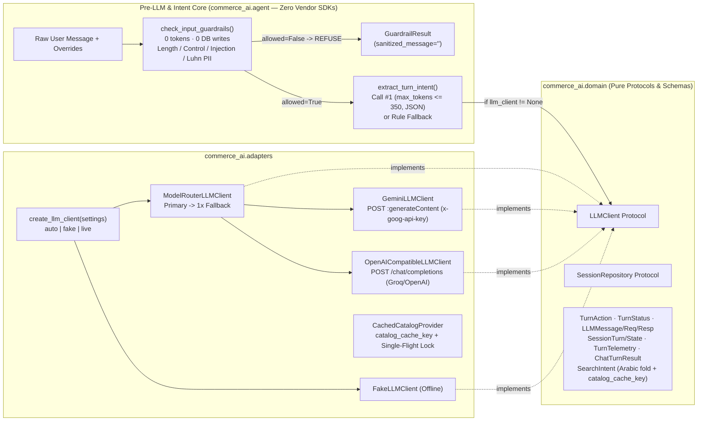

# Plan: Feature 2.1 — LLM Routing, Guardrails & Bilingual Intent Extraction

- **Roadmap ID**: Feature 2.1
- **Folder**: `spec/features/feature-201-llm-routing-guardrails-intent/`
- **Phase branch**: `phase/2-agent-and-api`
- **Size**: Medium (5 cohesive execution groups covering upfront Phase 2 dependency/package scaffolding, folded Phase 1 settings/cache/domain hardening & Phase 2 contracts, lightweight async `httpx` LLM routing, zero-token pre-LLM guardrails + bilingual intent extraction, and 100% offline deterministic unit/integration tests)
- **Status**: Approved (Gate 1)

---

## 1. Objective & Why

Feature 2.1 establishes the shared Phase 2 domain/config foundation, resolves the three Phase 1 cache/settings hardening follow-ups from [spec/backlog/2026-11-15-phase1-cache-and-settings-followups.md](../../backlog/2026-11-15-phase1-cache-and-settings-followups.md), and delivers the pluggable multi-provider `LLMClient` routing layer, zero-token pre-LLM safety guardrails, and bilingual (`ar`/`en`) structured intent extraction with deterministic rule-based fallback.

This serves [spec/mission.md](../../mission.md) (§4–§7: `<= $0.002` per uncached query, `<= 300 ms` repeat responses, native Arabic/English dialect handling, zero payment/PII scope), [spec/architecture.md](../../architecture.md) (§1, §2, §4: hexagonal core, Call #1 `<= 350` output tokens with deterministic fallback), and [spec/roadmap.md](../../roadmap.md) (`Phase 2` → `Feature 2.1`). By locking all Phase 2 dependencies, `__init__.py` scaffolds, `AppSettings`, domain models/errors/ports, and `P1` backlog fixes upfront (`P7`), **Feature 2.2** (`LangGraph` workflow + session persistence) and **Feature 2.3** (`FastAPI` REST service) can proceed cleanly without file contention or contract drift.

---

## 2. Scope

### In scope
- **Upfront Phase 2 Package Scaffold & Dependencies (`P7`)**:
  - Update `backend/pyproject.toml` and `backend/uv.lock` to declare ALL Phase 2 runtime dependencies upfront (`fastapi>=0.115,<1.0`, `uvicorn[standard]>=0.32,<1.0`, `langgraph>=0.2,<1.0`, `sqlalchemy>=2.0,<3.0`, `aiosqlite>=0.20,<1.0`, `asyncpg>=0.30,<1.0`) while preserving Phase 1 dependencies, `addopts = ["-m", "not live"]`, `asyncio_mode = "auto"`, `ruff`, and strict `mypy`, and keeping zero heavy LLM SDKs (`litellm`, `google-genai`, `openai`, `groq`, `boto3`).
  - Create lightweight package `__init__.py` markers (`commerce_ai/agent/__init__.py`, `commerce_ai/adapters/llm/__init__.py`, `commerce_ai/adapters/session/__init__.py`, `commerce_ai/api/__init__.py`) without eager imports of Feature 2.2/2.3 modules.
- **Folded Phase 1 Hardening Backlog & Phase 2 Contracts (`P1`)**:
  - `config/settings.py` (`AppSettings`): add all Phase 2 operational, LLM, guardrail, session, CORS, and rate-limit fields; strip inline `#` comments and parse comma-separated or JSON `cors_allowed_origins` cleanly; add `@field_serializer("redis_url", "database_url", when_used="always")` calling `redact_url_password(...)` for `model_dump()` and `model_dump_json()` (while preserving raw `str | None`/`str` attribute access and masking `database_url` in `__repr_args__()`), and expand `safe_summary()`.
  - `domain/models.py`: apply Arabic orthographic folding (`أ/إ/آ/ٱ -> ا`, `ة -> ه`, `ى -> ي`) in `SearchIntent` slug normalization; add `SearchIntent.catalog_cache_key() -> str` (`"{country}:{store}:{language}:{slug}"`); update `SearchIntent.normalized_cache_key() -> str` (`"{country}:{store}:{language}:{slug}:{budget}:{min_rating}"`); add `TurnAction`, `TurnStatus`, `LLMMessage`, `LLMRequest`, `LLMResponse`, `SessionTurn`, `SessionState`, `TurnTelemetry`, and `ChatTurnResult`.
  - `domain/errors.py`: add `LLMProviderError(provider: str, retriable: bool, reason: str)` and `SessionStoreError(DomainError)`.
  - `domain/ports.py`: add `@runtime_checkable` protocols `LLMClient` and `SessionRepository` (`INV-02` zero vendor imports).
  - `adapters/catalog/cached_provider.py`: switch cache key lookup/write to `intent.catalog_cache_key()` and add per-key single-flight coalescing (`asyncio.Lock` + `_in_flight` task registry, cleaned up in `finally`, never caching `CatalogProviderError`).
- **Lightweight Async `httpx` Multi-Provider `LLMClient` & Routing (`P2`, `adapters/llm/`)**:
  - `GeminiLLMClient` (`gemini.py`), `OpenAICompatibleLLMClient` (`openai_compat.py`), `ModelRouterLLMClient` (`router.py`), `FakeLLMClient` (`fake.py`), and `create_llm_client` (`factory.py`).
- **Zero-Token Pre-LLM Guardrails & Bilingual Intent Extraction (`P3`, `agent/`)**:
  - `check_input_guardrails` + `GuardrailResult` (`agent/guardrails.py`).
  - `extract_turn_intent` + `IntentExtractionResult` (`agent/intent.py`) supporting LLM Call #1 (`<= 350` output tokens, JSON mode) + deterministic Arabic/English rule-based fallback (`INV-08`), Arabic-Indic numerals, country/store/budget/rating extraction, accessory awareness, `COMPARE`/`CLARIFY`/`OFF_TOPIC` classification, and `prior_intent` delta merging.
- **Offline Deterministic Tests + Opt-In Live Smoke (`P8`)**:
  - Update `tests/unit/test_config_and_models.py`, `tests/integration/test_cached_catalog.py`, and `tests/integration/test_phase1_e2e.py` (updating Phase 1 Redis TTL/cache-key assertions to `intent.catalog_cache_key()`).
  - Add `tests/unit/test_llm_clients.py`, `tests/unit/test_guardrails_and_intent.py`, and `@pytest.mark.live` `tests/integration/test_live_llm_smoke.py`.

### Out of scope (explicit exclusions)
- **Session Persistence Adapters (`adapters/session/{memory,sqlalchemy_repo,factory}.py`) & `LangGraph` Workflow (`agent/{prompts,templates,graph}.py`)**: Owned exclusively by **Feature 2.2**.
- **FastAPI Entrypoint (`main.py`) & API Routers/Middleware (`api/{schemas,dependencies,middleware,errors,routes}.py`)**: Owned exclusively by **Feature 2.3**.
- **Phase 2 End-to-End Integration Suite (`tests/integration/test_phase2_e2e.py`)**: Reserved for Phase Integration (`PI.1`).
- **Modifications to Feature 1.2/1.3 Unrelated Modules**: Must NOT edit `domain/ranking.py`, `adapters/catalog/seed_provider.py`, `adapters/catalog/serper_provider.py`, `adapters/cache/*`, or `spec/sdd-profile.md` Sensitive Areas (`infra/aws/**`, `.github/workflows/**`, `config/security*`, `migrations/**`).
- **Frontend UI (`frontend/`)**: Deferred to **Phase 3**.
- **Default Live Network Calls (`INV-07`)**: Live LLM smoke tests remain strictly `@pytest.mark.live` and deselected by default.

---

## 3. Decisions

| # | Decision | Source | Rationale |
|:---|:---|:---|:---|
| **P1** | **Folded Phase 1 Hardening into Feature 2.1**: Fold all 3 items from `2026-11-15-phase1-cache-and-settings-followups.md` into Feature 2.1: (1) `@field_serializer("redis_url", "database_url", when_used="always")` on `AppSettings` calling `redact_url_password(...)` while preserving raw string attributes; (2) Arabic orthographic folding (`أ/إ/آ/ٱ -> ا`, `ة -> ه`, `ى -> ي`) + `SearchIntent.catalog_cache_key()` (`{country}:{store}:{language}:{slug}`) + updated `SearchIntent.normalized_cache_key()` (`{country}:{store}:{language}:{slug}:{budget}:{min_rating}`); (3) per-key single-flight coalescing (`asyncio.Lock` + `_in_flight`) in `CachedCatalogProvider.search_offers()`. | Phase 2 Interview + `INV-01`, `INV-04`, `INV-08` | Fixes secret serialization leaks, prevents Arabic spelling variants and `"ar"`/`"en"` language collisions from bypassing or poisoning cache, allows budget/rating follow-up refinements to reuse cached catalog offers with 0 extra Serper calls, and stops concurrent cold-cache stampedes before FastAPI launches. |
| **P2** | **Lightweight Async `httpx` LLM Clients (`No LiteLLM`)**: Implement `GeminiLLMClient` (`x-goog-api-key` header, never query string) and `OpenAICompatibleLLMClient` (Groq/OpenAI/custom base URLs) directly over `httpx.AsyncClient`, routed by `ModelRouterLLMClient` (1 primary + at most 1 fallback), alongside `FakeLLMClient` and `create_llm_client`. | Phase 2 Interview + `INV-01`, `INV-02`, `INV-04`, `INV-07` | Eliminates `litellm` and heavy vendor SDK bloat, keeps transport explicit and testable via `httpx.MockTransport`, guarantees header-based auth redaction, and supports future on-premise `vLLM`/`Ollama` URLs seamlessly. |
| **P3** | **Zero-Token Pre-LLM Guardrails & Bilingual Intent + Rule Fallback**: Enforce input bounds, control-char checks, Arabic/English prompt-injection blocks, and Luhn/pattern payment & PII blocks (`INV-09`) in pure Python (`0` tokens, `0` DB writes) before `parse`, then run bounded Call #1 (`<= 350` output tokens, JSON mode) with automatic deterministic Arabic/English rule-based fallback (`INV-08`). | Phase 2 Interview + `INV-04`, `INV-08`, `INV-09` | Prevents wasted LLM spend and PII persistence on abusive/sensitive payloads and guarantees 100% functional bilingual intent parsing offline or during LLM outages. |
| **P7** | **Upfront Dependencies & Disjoint File Ownership**: Feature 2.1 locks all Phase 2 dependencies in `backend/pyproject.toml` / `backend/uv.lock`, creates all Phase 2 package `__init__.py` scaffolds (`agent/`, `adapters/llm/`, `adapters/session/`, `api/`), and locks all Phase 2 `config/settings.py` & `domain/` contracts upfront so Features 2.2 and 2.3 run cleanly without touching shared manifests or domain definitions. | Phase 2 Interview + `INV-02` | Eliminates lockfile contention and cross-branch merge conflicts across Features 2.1 → 2.2 ∥ 2.3. |
| **D1** | **`CORS_ALLOWED_ORIGINS` Dual Parsing**: Parse `AppSettings.cors_allowed_origins` from either plain comma-separated strings (e.g., `CORS_ALLOWED_ORIGINS=http://localhost:3000` in `backend/.env.example`) or JSON arrays (`["http://localhost:3000"]`), stripping inline `#` comments and blank entries. | `backend/.env.example` compatibility + `P1` | `pydantic-settings` defaults to JSON decoding on `list[str]` and would fail on `backend/.env.example`'s unquoted comma-separated value without explicit pre-parsing. |
| **D2** | **Single-Flight Cancellation & Error Isolation**: Wrap shared `_in_flight` task awaits in `CachedCatalogProvider.search_offers()` with `asyncio.shield(...)` (or equivalent non-propagating await), guard map insertion/removal with `self._lock` in `try/finally`, and never write `CatalogProviderError` results to `CacheStore`. | `P1` backlog item #3 + `INV-08` | Prevents one cancelled HTTP caller from aborting an active upstream fetch shared by concurrent callers, and ensures failed Serper requests never poison subsequent retries. |
| **D3** | **Cross-Feature `F2.1 -> F2.2` Interface Lock**: Lock `GuardrailResult(allowed, sanitized_message, reason_code, language)`, `IntentExtractionResult(action, intent, language, clarification_question, used_rule_fallback, llm_calls_used, degraded_reason)`, `SessionRepository.save_session(self, state: SessionState, ttl_seconds: int = 86400) -> None`, and `aclose()` lifecycle hooks on live LLM adapter classes. | Phase 2 Swarm Alignment (`phase-overview.md`) | Gives Feature 2.2 (`graph.py`, `adapters/session/`) and Feature 2.3 (`main.py`) exact, unambiguous signatures and types. |

---

## 4. Relevant Existing Architecture

- **[spec/tech.md](../../tech.md)**:
  - §2 Architectural Invariants: `INV-01` (Zero Hardcoded Secrets), `INV-02` (Strict Ports & Adapters), `INV-04` (Bounded Execution `<= 2` LLM calls, `max_tokens`, timeouts), `INV-05` (Zero Hallucinated Offers — preserved on `SearchIntent`/`ProductOffer`/`ChatTurnResult`), `INV-07` (100% Offline Deterministic Test Suite), `INV-08` (Graceful Degradation), `INV-09` (Zero Payment or Sensitive PII Scope).
- **[spec/architecture.md](../../architecture.md)**:
  - §1 Hexagonal `CoreEngine` & `Adapters` boundary; §4 Model Routing & Cost Control Policy (`<= 350` output tokens for intent extraction, rule-based fallback).
- **[spec/phases/phase-2-agent-and-api/phase-overview.md](../../phases/phase-2-agent-and-api/phase-overview.md)**:
  - Shared `P1`–`P8` decisions and Phase 2 interface contracts consumed downstream by Features 2.2 and 2.3.
- **[spec/sdd-profile.md](../../sdd-profile.md)**:
  - Canonical verification commands (`uv sync`, `uv run --directory backend pytest ...`, `ruff check .`, `ruff format --check .`, `mypy src`) and deep-review lenses.
- **Existing Phase 1 Modules Consumed / Extended**:
  - `backend/src/commerce_ai/config/settings.py` (`AppSettings`, `redact_url_password`, `_strip_inline_comment`)
  - `backend/src/commerce_ai/domain/{models,errors,ports}.py` (`CountryCode`, `StoreFilter`, `CatalogSourceMode`, `RankedOffer`, `RankingResult`, `SearchIntent`, `CatalogSearchResult`, `DomainError`, `CatalogProvider`, `CacheStore`)
  - `backend/src/commerce_ai/adapters/catalog/cached_provider.py` (`CachedCatalogProvider`)

---

## 5. Proposed Approach

### Exact Module & Signature Contracts

1. **`commerce_ai.config.settings` (`settings.py`)**:
   - New fields on `AppSettings(BaseSettings)`:
     - `app_env: Literal["development", "staging", "production"] = "development"`
     - `log_level: Literal["DEBUG", "INFO", "WARNING", "ERROR"] = "INFO"`
     - `gemini_api_key: SecretStr | None = None`
     - `groq_api_key: SecretStr | None = None`
     - `openai_api_key: SecretStr | None = None`
     - `llm_mode: Literal["auto", "fake", "live"] = "auto"`
     - `explain_mode: Literal["auto", "llm", "template"] = "auto"`
     - `llm_primary_model: str = "gemini/gemini-2.5-flash"`
     - `llm_fallback_model: str | None = "groq/llama-3.3-70b-versatile"`
     - `llm_timeout_seconds: float = Field(default=8.0, gt=0.0, allow_inf_nan=False)`
     - `guardrail_max_chars: int = Field(default=1000, ge=50, le=4000)`
     - `database_url: str = "sqlite+aiosqlite:///./commerce_ai.db"`
     - `session_ttl_seconds: int = Field(default=86400, gt=0)`
     - `session_max_turns: int = Field(default=10, ge=2, le=50)`
     - `cors_allowed_origins: list[str] = Field(default_factory=lambda: ["http://localhost:3000"])` (`Annotated[list[str], NoDecode]` or custom before-validator parsing comma-separated strings, JSON arrays, or `list[str]` while stripping inline `#` comments)
     - `rate_limit_rpm: int = Field(default=60, ge=0)`
   - Validators & Redaction:
     - Clean inline `#` comments and outer whitespace across scalar/secret/URL/list env inputs; normalize blank `gemini_api_key`, `groq_api_key`, `openai_api_key`, `llm_fallback_model` to `None`; reject blank `database_url` or `llm_primary_model`.
     - `@field_serializer("redis_url", "database_url", when_used="always")` calls `redact_url_password(...)` so `model_dump()` and `model_dump_json()` mask passwords consistently with `repr()`, `str()`, and `safe_summary()`, while keeping raw `settings.redis_url` (`str | None`) and `settings.database_url` (`str`) attributes intact for internal factories.
     - `__repr_args__()` redacts `database_url` alongside `redis_url`; `safe_summary()` reports `"***"` for set secrets (`gemini_api_key`, `groq_api_key`, `openai_api_key`, `serper_api_key`), redacted `redis_url`/`database_url`, and all Phase 2 settings.

2. **`commerce_ai.domain.errors` (`errors.py`)**:
   - `LLMProviderError(DomainError)`: `def __init__(self, provider: str, retriable: bool, reason: str) -> None` storing `self.provider`, `self.retriable`, `self.reason` and formatting `super().__init__(f"[{provider}] (retriable={retriable}): {reason}")`.
   - `SessionStoreError(DomainError)`: raised on database/session persistence failures.

3. **`commerce_ai.domain.models` (`models.py`)**:
   - `SearchIntent`:
     - Slugification applies `NFKC`, `.lower()`, Arabic diacritics/tatweel removal, and Arabic orthographic folding (`أ/إ/آ/ٱ -> ا`, `ة -> ه`, `ى -> ي`) prior to non-alnum-Arabic hyphenation.
     - `catalog_cache_key(self) -> str`: `"{country}:{store}:{language}:{slug}"` (lowercase).
     - `normalized_cache_key(self) -> str`: `"{country}:{store}:{language}:{slug}:{budget}:{min_rating}"` (lowercase).
   - Enums (`StrEnum`):
     - `TurnAction`: `SEARCH = "search"`, `COMPARE = "compare"`, `CLARIFY = "clarify"`, `OFF_TOPIC = "off_topic"`, `REFUSE = "refuse"`
     - `TurnStatus`: `OK = "ok"`, `CLARIFY = "clarify"`, `OFF_TOPIC = "off_topic"`, `REFUSED = "refused"`, `DEGRADED = "degraded"`
   - Models (`ConfigDict(extra="forbid")`):
     - `LLMMessage(role: Literal["system", "user", "assistant"], content: str)`
     - `LLMRequest(messages: tuple[LLMMessage, ...], max_tokens: int = Field(default=350, ge=1, le=1024), temperature: float = Field(default=0.0, ge=0.0, le=1.0, allow_inf_nan=False), json_mode: bool = False, json_schema: dict[str, Any] | None = None, task_name: str = "general")`
     - `LLMResponse(content: str, provider: str, model: str, input_tokens: int = Field(default=0, ge=0), output_tokens: int = Field(default=0, ge=0), latency_ms: float = Field(default=0.0, ge=0.0, allow_inf_nan=False), used_fallback_model: bool = False)`
     - `SessionTurn(role: Literal["user", "assistant"], content: str, action: TurnAction | None = None, created_at_iso: str)`
     - `SessionState(session_id: str, market: CountryCode = CountryCode.EG, last_intent: SearchIntent | None = None, last_ranked_offers: list[RankedOffer] = Field(default_factory=list), turns: list[SessionTurn] = Field(default_factory=list), updated_at_epoch: float = Field(default=0.0, ge=0.0))`
     - `TurnTelemetry(llm_calls: int = Field(default=0, ge=0, le=2), catalog_called: bool = False, catalog_cache_hit: bool = False, catalog_source_mode: CatalogSourceMode | None = None, used_rule_intent_fallback: bool = False, used_template_summary: bool = False, degraded_reason: str | None = None, latency_ms: float = Field(default=0.0, ge=0.0, allow_inf_nan=False))`
     - `ChatTurnResult(session_id: str, status: TurnStatus, reply: str, action: TurnAction, active_intent: SearchIntent | None = None, top_offers: list[RankedOffer] = Field(default_factory=list), ranking_result: RankingResult | None = None, telemetry: TurnTelemetry)`

4. **`commerce_ai.domain.ports` (`ports.py`)**:
   - `@runtime_checkable class LLMClient(Protocol)`: `async def complete(self, request: LLMRequest) -> LLMResponse: ...`
   - `@runtime_checkable class SessionRepository(Protocol)`: `get_session(self, session_id: str) -> SessionState | None`, `save_session(self, state: SessionState, ttl_seconds: int = 86400) -> None`, `delete_session(self, session_id: str) -> None`.

5. **`commerce_ai.adapters.catalog.cached_provider` (`cached_provider.py`)**:
   - `CachedCatalogProvider.search_offers(intent)`:
     - Computes `cache_key = intent.catalog_cache_key()`.
     - Reads cache first (degrading cleanly on `CacheStoreError` / corrupt JSON).
     - On cache miss, acquires `self._lock` (`asyncio.Lock`) to look up or create an `asyncio.Task` inside `self._in_flight[cache_key]` running the upstream `self._provider.search_offers(intent)` + non-error `self._cache.set(...)`.
     - Concurrent callers await `asyncio.shield(task)` so individual caller cancellation does not abort the shared fetch; `finally` removes `cache_key` from `self._in_flight` under `self._lock` only if it matches the active task.
     - `CatalogProviderError` is never written to `self._cache` and propagates to awaiting callers.

6. **`commerce_ai.adapters.llm` (`gemini.py`, `openai_compat.py`, `router.py`, `fake.py`, `factory.py`)**:
   - `GeminiLLMClient`: `POST {base_url}/models/{model_id}:generateContent` (`https://generativelanguage.googleapis.com/v1beta`), `x-goog-api-key` header (never query param), `systemInstruction` + `contents`, `generationConfig` (`maxOutputTokens`, `temperature`, `responseMimeType="application/json"` when `json_mode=True`), `llm_timeout_seconds`, secret-redacted `LLMProviderError`, optional `aclose()`.
   - `OpenAICompatibleLLMClient`: `POST {base_url}/chat/completions` (`groq` -> `https://api.groq.com/openai/v1`, `openai` -> `https://api.openai.com/v1`, configurable `base_url`), `Authorization: Bearer ...`, `response_format={"type": "json_object"}` when `json_mode=True`, `max_tokens`, `temperature`, `llm_timeout_seconds`, secret-redacted `LLMProviderError`, optional `aclose()`.
   - `ModelRouterLLMClient`: calls `primary.complete(request)`; on `LLMProviderError`, calls `fallback.complete(request)` at most once and sets `used_fallback_model=True`; counts as 1 logical LLM step (`INV-04`); delegates `aclose()`.
   - `FakeLLMClient`: deterministic 100% offline `LLMClient` supporting scripted response/exception queues or callable handler, tracking `requests` and `call_count`, plus no-op `aclose()`.
   - `create_llm_client(settings: AppSettings, *, http_client: httpx.AsyncClient | None = None) -> LLMClient | None`: handles `"fake"`, `"auto"`, and `"live"` modes across `"gemini/..."`, `"groq/..."`, and `"openai/..."` specs; raises `LLMProviderError(provider="llm", retriable=False, reason=...)` in `"live"` mode when no valid key/provider is configured.

7. **`commerce_ai.agent` (`guardrails.py`, `intent.py`)**:
   - `GuardrailResult(allowed: bool, sanitized_message: str = "", reason_code: str | None = None, language: Literal["ar", "en"] = "ar")` and `check_input_guardrails(message: str, *, max_chars: int = 1000) -> GuardrailResult`.
   - `IntentExtractionResult(action: TurnAction, intent: SearchIntent | None = None, language: Literal["ar", "en"] = "ar", clarification_question: str | None = None, used_rule_fallback: bool = False, llm_calls_used: int = 0, degraded_reason: str | None = None)` and `async def extract_turn_intent(message: str, *, default_country: CountryCode, store_override: StoreFilter | None = None, max_budget_override: Decimal | None = None, language_hint: Literal["ar", "en"] | None = None, prior_intent: SearchIntent | None = None, recent_turns: Sequence[SessionTurn] = (), has_saved_offers: bool = False, llm_client: LLMClient | None = None) -> IntentExtractionResult`.

---

## 6. Expected Files / Areas Affected

| Path | Change | Purpose |
|:---|:---|:---|
| `backend/pyproject.toml` | Modify | Declare all Phase 2 runtime dependencies upfront (`fastapi`, `uvicorn[standard]`, `langgraph`, `sqlalchemy`, `aiosqlite`, `asyncpg`) (`P7`) |
| `backend/uv.lock` | Modify | Lock Phase 2 dependencies deterministically (`uv sync --directory backend --all-extras --dev`) |
| `backend/src/commerce_ai/agent/__init__.py` | Create | Package scaffold for Phase 2 agent (`P7`) |
| `backend/src/commerce_ai/adapters/llm/__init__.py` | Create | Package scaffold & exports for LLM adapters (`P7`) |
| `backend/src/commerce_ai/adapters/session/__init__.py` | Create | Package scaffold for Phase 2 session adapters (`P7`) |
| `backend/src/commerce_ai/api/__init__.py` | Create | Package scaffold for Phase 2 FastAPI layer (`P7`) |
| `backend/src/commerce_ai/config/settings.py` | Modify | Add Phase 2 settings, CORS parsing, `@field_serializer` URL redaction (`P1`), and updated `safe_summary()` |
| `backend/src/commerce_ai/domain/errors.py` | Modify | Add `LLMProviderError` and `SessionStoreError` |
| `backend/src/commerce_ai/domain/models.py` | Modify | Add Arabic orthographic folding, `catalog_cache_key()`, updated `normalized_cache_key()`, and Phase 2 enums/models |
| `backend/src/commerce_ai/domain/ports.py` | Modify | Add `@runtime_checkable` `LLMClient` and `SessionRepository` protocols |
| `backend/src/commerce_ai/adapters/catalog/cached_provider.py` | Modify | Migrate cache keys to `intent.catalog_cache_key()` and add single-flight request coalescing (`P1`) |
| `backend/src/commerce_ai/adapters/llm/gemini.py` | Create | Async `httpx` `GeminiLLMClient` (`x-goog-api-key` header, JSON mode, secret redaction) |
| `backend/src/commerce_ai/adapters/llm/openai_compat.py` | Create | Async `httpx` `OpenAICompatibleLLMClient` (Groq/OpenAI/custom base URLs, Bearer auth) |
| `backend/src/commerce_ai/adapters/llm/router.py` | Create | `ModelRouterLLMClient` (primary + single fallback on `LLMProviderError`) |
| `backend/src/commerce_ai/adapters/llm/fake.py` | Create | Deterministic offline `FakeLLMClient` with request inspection |
| `backend/src/commerce_ai/adapters/llm/factory.py` | Create | `create_llm_client` factory (`auto` / `fake` / `live`) |
| `backend/src/commerce_ai/agent/guardrails.py` | Create | Zero-token pre-LLM safety, injection, and Luhn/PII input guardrails |
| `backend/src/commerce_ai/agent/intent.py` | Create | Bounded Call #1 bilingual intent extraction + rule-based fallback & delta merge |
| `backend/tests/unit/test_config_and_models.py` | Modify | Cover Phase 2 settings/serialization redaction, folded cache keys, new models/errors/ports, and boundary checks |
| `backend/tests/integration/test_cached_catalog.py` | Modify | Update key assertions to `catalog_cache_key()` and verify budget reuse + single-flight coalescing |
| `backend/tests/integration/test_phase1_e2e.py` | Modify | Update Redis TTL and cache-key assertions from `normalized_cache_key()` to `catalog_cache_key()` |
| `backend/tests/unit/test_llm_clients.py` | Create | Offline `httpx.MockTransport` tests for Gemini/Groq/OpenAI, header security, failover, `FakeLLMClient`, and factory |
| `backend/tests/unit/test_guardrails_and_intent.py` | Create | Offline tests for Luhn/CVV/PII/injection guardrails, Arabic/English rule fallback, LLM JSON extraction, and delta merging |
| `backend/tests/integration/test_live_llm_smoke.py` | Create | Opt-in `@pytest.mark.live` smoke test deselected by default |

---

## 7. Execution Groups

- **Group 1 — Upfront Phase 2 Dependencies & Package Scaffolds (`P7`)**: Update `backend/pyproject.toml`, run `uv sync --directory backend --all-extras --dev` to update `backend/uv.lock`, and create the four empty/docstring-only `__init__.py` scaffolds (`agent/`, `adapters/llm/`, `adapters/session/`, `api/`).
- **Group 2 — Folded Phase 1 Hardening & Phase 2 Domain/Config Contracts (`P1`)**: Update `config/settings.py`, `domain/errors.py`, `domain/models.py`, `domain/ports.py`, and `adapters/catalog/cached_provider.py`, plus update `tests/unit/test_config_and_models.py`, `tests/integration/test_cached_catalog.py`, and `tests/integration/test_phase1_e2e.py` so existing + new hardening contracts pass.
- **Group 3 — Async `httpx` Multi-Provider `LLMClient` & Routing (`P2`)**: Implement `adapters/llm/{gemini.py,openai_compat.py,router.py,fake.py,factory.py}`, export cleanly in `adapters/llm/__init__.py`, and verify with `tests/unit/test_llm_clients.py`.
- **Group 4 — Zero-Token Pre-LLM Guardrails & Bilingual Intent Extraction (`P3`)**: Implement `agent/guardrails.py` and `agent/intent.py`, and verify with `tests/unit/test_guardrails_and_intent.py`.
- **Group 5 — Opt-In Live Smoke, Full Offline Regression & Static Gates (`P8`)**: Add `tests/integration/test_live_llm_smoke.py` (`@pytest.mark.live`), run the complete offline `pytest` suite (`-m "not live"`), `uv lock --check`, `ruff check .`, `ruff format --check .`, and `mypy src`.

---

## 8. Risks & Trade-offs

| Risk / Trade-off | Impact | Mitigation |
|:---|:---|:---|
| Updating `SearchIntent.normalized_cache_key()` and migrating `CachedCatalogProvider` to `catalog_cache_key()` breaks Phase 1 key assertions in `test_config_and_models.py`, `test_cached_catalog.py`, and `test_phase1_e2e.py` | Existing unit/integration tests fail unless updated together | Update `SearchIntent`, `CachedCatalogProvider`, and the Phase 1 key/TTL assertions in `test_config_and_models.py`, `test_cached_catalog.py`, and `test_phase1_e2e.py` together within Group 2 in the same Feature 2.1 commit (`P1`). |
| `pydantic-settings` defaults to JSON decoding on `list[str]` and crashes on unquoted `CORS_ALLOWED_ORIGINS=http://localhost:3000` in `backend/.env.example` | Startup failure when `.env` is copied from `.env.example` | Use `Annotated[list[str], NoDecode]` (or pre-validator) accepting CSV strings, JSON arrays, and Python lists while stripping inline `#` comments (`D1`). |
| Cancelled concurrent request aborting shared single-flight `asyncio.Task` in `CachedCatalogProvider` | Legitimate peer callers receive `CancelledError` mid-fetch | Await shared `_in_flight` tasks through `asyncio.shield(...)` and clean `_in_flight` under `self._lock` in `finally` (`D2`). |
| Luhn/digit PII guardrail accidentally rejecting legitimate SKU/model numbers or budget figures | False refusal of valid shopping queries | Require 13–19 digits passing Luhn checksum (or explicit payment-card keywords) for card rejection; permit normal prices, budgets, and short model codes (`R12`). |
| LLM JSON responses wrapped in markdown fences or missing fields during follow-up turns | Brittle intent parsing or spurious `500` errors | Strip markdown fences, validate strictly via Pydantic, merge `prior_intent` deltas carefully, and fall back seamlessly to the deterministic bilingual rule parser (`INV-08`). |

---

## 9. Open Questions
None — all Phase 2 shared decisions (`P1`–`P8`), `F2.1 -> F2.2` signatures, and validation contracts are resolved and locked for Phase Gate 1.
