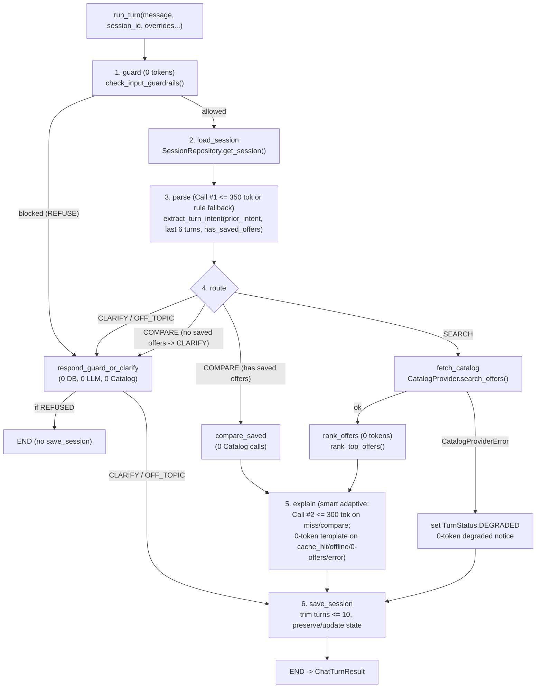

# Plan: Feature 2.2 — Bounded LangGraph Shopping Agent Workflow & Async Session Memory

- **Roadmap ID**: Feature 2.2
- **Folder**: `spec/features/feature-202-langgraph-workflow-and-session/`
- **Phase branch**: `phase/2-agent-and-api`
- **Size**: Medium (4 cohesive execution groups spanning async memory & SQLAlchemy session persistence with automatic fallback, grounded prompts & zero-token bilingual templates, the bounded `LangGraph` workflow `ShoppingAssistantWorkflow`, and offline deterministic unit/integration suites)
- **Status**: Committed

---

## 1. Objective & Why

Feature 2.2 delivers the core conversational shopping orchestrator (`commerce_ai.agent.graph`), grounded explanation/template layers (`commerce_ai.agent.prompts`, `commerce_ai.agent.templates`), and async session persistence adapters (`commerce_ai.adapters.session`) for **AI for E-Commerce**, fulfilling `Phase 2 -> Feature 2.2` in [spec/roadmap.md](../../roadmap.md) and the Phase 2 architecture in [spec/phases/phase-2-agent-and-api/phase-overview.md](../../phases/phase-2-agent-and-api/phase-overview.md).

Specifically, this feature advances [spec/mission.md](../../mission.md) (§1, §4, §5, §6, §7) and [spec/architecture.md](../../architecture.md) (§1, §2, §4):
1. **Bounded Cost & Low Latency (`INV-04`, `< 300 ms` Cached P95)**: Replaces open-ended ReAct agent loops with a deterministic `LangGraph` `StateGraph` (`llm_calls <= 2`), routing cache hits, offline executions, zero-offer queries, and error fallbacks to zero-token bilingual (`ar`/`en`) templates.
2. **Multi-Turn Conversational Refinements & Zero-Catalog Comparisons (`P4`)**: Persists bounded `SessionState` (`last_intent`, `last_ranked_offers`, and up to `session_max_turns = 10` compact turns) so shoppers can refine budget, store, or country naturally and run side-by-side comparisons against saved offers with zero redundant catalog calls.
3. **Strict Grounding, PII Safety & Honest Degradation (`INV-05`, `INV-08`, `INV-09`)**: Short-circuits guardrail-blocked messages before any DB read/write or LLM call, keeps `top_offers` strictly unmodified from `rank_top_offers` / saved state, degrades cleanly on `CatalogProviderError`, `LLMProviderError`, and `SessionStoreError`, and automatically falls back from `SQLAlchemySessionRepository` (`sqlite+aiosqlite` / `postgresql+asyncpg`) to `InMemorySessionStore` on database failures.

---

## 2. Scope

### In scope
- **Session Persistence Adapters (`backend/src/commerce_ai/adapters/session/`)**:
  - `memory.py` (`InMemorySessionStore`): Async-safe bounded LRU (`collections.OrderedDict`, `max_sessions=1024`) with monotonic TTL (`session_ttl_seconds = 86400`), turn window trimming (`session_max_turns = 10`), defensive copy isolation, and idempotent deletion.
  - `sqlalchemy_repo.py` (`SQLAlchemySessionRepository`): Async `SQLAlchemy 2.0` (`AsyncEngine`, `async_sessionmaker`) supporting both `sqlite+aiosqlite` (default local/CI) and `postgresql+asyncpg` (Docker/AWS). Defines the `commerce_sessions` table (`session_id`, `market`, `payload_json`, `expires_at_epoch`, `updated_at_epoch`), provides `async def initialize(self) -> None` using `Base.metadata.create_all` during lifespan startup (zero `backend/migrations/**` files) and `async def close(self) -> None`, preserves verified Google Shopping URLs across JSON round-trips, and masks DB URL credentials via `redact_url_password` in all logs and `SessionStoreError` messages (`INV-01`).
  - `factory.py` (`create_session_repository(settings: AppSettings)` & `ResilientSessionRepository`): Synchronous factory returning a `SessionRepository` wrapper that delegates to `SQLAlchemySessionRepository` and automatically falls back to `InMemorySessionStore` if DB URL construction, `initialize()`, or runtime DB I/O fails (`INV-08`), exposing non-secret `backend_name` and `is_degraded` attributes for Feature 2.3 `/health`.
- **Grounded Prompts & Zero-Token Bilingual Templates (`backend/src/commerce_ai/agent/`)**:
  - `prompts.py`: Builds grounded Call #2 `LLMRequest` payloads (`max_tokens <= 300`) embedding strictly verified `RankedOffer` facts (`rank`, `offer_id`, `title`, `price`, `currency`, `store`, `rating`, `review_count`, `value_score`, `bayesian_rating`, `match_reasons`, `url`) delimited as untrusted marketplace data with explicit anti-hallucination instructions (`INV-05`).
  - `templates.py`: Zero-token deterministic Arabic (`ar`) and English (`en`) template builders covering Top-K recommendations, 0-offer empty notice (`INV-08`), partial `< top_k` (`degraded_fewer_than_k=True`) honest notice (`INV-08`), saved-offers side-by-side comparison (`COMPARE` fallback), `CLARIFY` questions (including missing saved offers for `COMPARE`), `OFF_TOPIC` redirects, `REFUSED` guardrail responses (`INV-09`), and `DEGRADED` catalog outage notices (`INV-08`).
- **Bounded `LangGraph` Shopping Assistant Workflow (`backend/src/commerce_ai/agent/graph.py`)**:
  - `ShoppingAssistantWorkflow`: Port-injected orchestrator (`settings`, `catalog_provider`, `session_repository`, `llm_client=None`, `scoring_config=None`) compiling a `LangGraph` `StateGraph` (`guard -> load_session -> parse -> route -> [respond_guard_or_clarify | fetch_catalog -> rank_offers -> explain | compare_saved -> explain] -> save_session -> END`) and exposing `async def run_turn(...) -> ChatTurnResult`.
  - Enforces `llm_calls <= 2` (`INV-04`), pre-DB/pre-LLM guardrail short-circuiting (`INV-09`), multi-turn session merging (`prior_intent`, last `6` compact turns, `has_saved_offers`), zero-catalog `COMPARE` execution, smart adaptive `explain` (`explain_mode`: `"auto" | "llm" | "template"`), and graceful `CatalogProviderError`, `LLMProviderError`, and `SessionStoreError` handling (`INV-08`).
- **100% Offline Deterministic Tests (`P8`)**:
  - `backend/tests/unit/test_session_stores.py`
  - `backend/tests/unit/test_agent_graph.py`
  - `backend/tests/integration/test_langgraph_session.py`

### Out of scope (explicit exclusions)
- **Disjoint File Partition (`P7`)**: Feature 2.2 MUST NOT create or modify `backend/pyproject.toml`, `backend/uv.lock`, any `__init__.py` scaffolds (`commerce_ai/agent/__init__.py`, `commerce_ai/adapters/session/__init__.py`, etc.), `config/settings.py`, `domain/models.py`, `domain/errors.py`, `domain/ports.py`, `adapters/catalog/**`, `adapters/cache/**`, `adapters/llm/**`, `agent/guardrails.py`, or `agent/intent.py` (owned by Phase 1 & Feature 2.1).
- **FastAPI Service & Phase Integration Tests (`P7`)**: Feature 2.2 MUST NOT create or modify `backend/src/commerce_ai/main.py`, `backend/src/commerce_ai/api/**`, `tests/unit/test_api_middleware_and_schemas.py`, `tests/integration/test_fastapi_endpoints.py` (Feature 2.3), or `tests/integration/test_phase2_e2e.py` (Step 7 Phase Integration).
- **Sensitive Areas (`spec/sdd-profile.md`)**: ZERO `backend/migrations/**` Alembic migration files (`commerce_sessions` auto-creates via `Base.metadata.create_all`), zero edits to `config/security*`, `.github/workflows/**`, or `infra/aws/**`.
- **Frontend UI & Phase 4 Observability/Evals**: Next.js RTL interface (Phase 3), Langfuse tracing, and `backend/tests/evals/` golden dataset (Phase 4).

---

## 3. Decisions

| # | Decision | Source | Rationale |
|:---|:---|:---|:---|
| **D1** | **Pre-DB / Pre-LLM Guardrail Short-Circuit (`INV-09`, `P3`)**: When `guard` rejects a message (`allowed=False`), route directly from `guard -> respond_guard_or_clarify -> END`, bypassing `load_session`, `parse`, `fetch_catalog`, and `save_session`. | Phase 2 `P3` + `INV-09` | Ensures prompt-injection attempts and sensitive payment/PII payloads (card numbers, CVV, passwords, national IDs) incur zero tokens and are never read into or written onto `SessionRepository`, leaving any prior valid session history completely clean. |
| **D2** | **Smart Adaptive `explain` Policy (`P4`, `INV-04`)**: In `explain_mode="auto"`, execute Call #2 (`max_tokens <= 300`) ONLY when `llm_client is not None`, `len(offers) > 0`, NO `llm_provider_error:` occurred in Call #1 (`degraded_reasons`), and `(action == TurnAction.COMPARE or not catalog_cache_hit)`. Always fall back to `templates.py` (`used_template_summary=True`, `0` tokens) on catalog cache hits, `llm_client is None`, `0` offers, `"template"` mode, Call #1 `LLMProviderError`, or Call #2 `LLMProviderError`/empty text. Enforce `llm_calls < 2` before attempting Call #2 even in `"llm"` mode. | Phase 2 `P4` + `spec/mission.md` §6 + `INV-04`, `INV-08` | Preserves `< 300 ms` repeat/refinement latency, avoids firing a doomed Call #2 during Call #1 provider outages, and keeps cost bounded to `<= 2` LLM calls. |
| **D3** | **Multi-Turn Refinement & State Preservation (`P4`)**: Load `prior_intent=state.last_intent`, up to the last `6` compact `SessionTurn` records, and `has_saved_offers=bool(state.last_ranked_offers)` into `extract_turn_intent`. Update `last_intent` and `last_ranked_offers` only on successful `SEARCH`; preserve prior `last_intent` and `last_ranked_offers` intact across `COMPARE`, `CLARIFY`, `OFF_TOPIC`, and `DEGRADED` catalog outage turns; trim `turns` to `settings.session_max_turns` (`10`). | Phase 2 `P4` + `INV-08` | Allows follow-ups (*"أرخص تحت ٢٠٠٠"*, *"بدّل للسعودية"*, *"قارن بين الأول والثاني"*) to stay coherent across turns without letting a transient catalog outage or off-topic remark erase previously verified offers. |
| **D4** | **Strict Offer Grounding & Google Shopping Session Round-Trip (`INV-05`)**: Keep `ChatTurnResult.top_offers` strictly equal to unmodified `rank_top_offers` outputs (for `SEARCH`) or `state.last_ranked_offers` (for `COMPARE`). Deserialize persisted `SessionState` JSON in `SQLAlchemySessionRepository` with `context={"allow_verified_google_shopping_from_cache": True}`. | `INV-05` + Feature 1.1 `ProductOffer` contract | Guarantees Call #2 prose can never alter prices, ratings, or URLs, while ensuring verified Google Shopping HTTPS links saved in `last_ranked_offers` survive SQLite/PostgreSQL JSON round-trips cleanly. |
| **D5** | **`SQLAlchemy 2.0` Async `commerce_sessions` Without `migrations/**` (`P5`)**: Define `commerce_sessions` ORM table via `DeclarativeBase` and auto-create schema idempotently in `await repo.initialize()` (`Base.metadata.create_all`), with injectable `wall_clock` for deterministic TTL testing and `redact_url_password` sanitization on every log and `SessionStoreError` (`INV-01`). | Phase 2 `P5` + `spec/sdd-profile.md` + `INV-01` | Delivers production PostgreSQL + local SQLite persistence without triggering `backend/migrations/**` sensitive-area rules or leaking DB passwords on connection errors. |
| **D6** | **Sync-Constructed `ResilientSessionRepository` Wrapper (`P5`, `P6`, `INV-08`)**: `create_session_repository(settings)` returns a `ResilientSessionRepository` synchronously (for `FastAPI` `create_app()`), exposing `initialize()`, `close()`, `backend_name: Literal["sqlite", "postgresql", "memory"]`, and `is_degraded: bool`, transparently failing over to `InMemorySessionStore` on invalid DB URLs, `initialize()` failure, or runtime `SessionStoreError`. | Phase 2 `P5` + `P6` + `INV-08` | Allows `FastAPI` lifespan startup to initialize async DB tables safely while ensuring broken or unreachable DBs degrade gracefully to in-memory sessions rather than crashing API requests. |
| **D7** | **Disjoint File Partition (`P7`)**: Restrict Feature 2.2 strictly to `adapters/session/{memory,sqlalchemy_repo,factory}.py`, `agent/{prompts,templates,graph}.py`, and Feature 2.2 unit/integration tests. | Phase 2 `P7` + `INV-02` | Enables zero-conflict parallel implementation alongside Feature 2.3 once Feature 2.1 commits on `phase/2-agent-and-api`. |

---

## 4. Relevant Existing Architecture

Feature 2.2 consumes locked contracts from Phase 1 (Features 1.1–1.3) and Feature 2.1 (`spec/features/feature-201-llm-routing-guardrails-intent/`) without modifying them:

### Upstream Contracts Consumed (Read-Only)
- **Configuration (`commerce_ai.config.settings`, `commerce_ai.config.scoring`)**:
  - `AppSettings`: `explain_mode: Literal["auto", "llm", "template"] = "auto"`, `guardrail_max_chars: int = 1000`, `database_url: str = "sqlite+aiosqlite:///./commerce_ai.db"`, `session_ttl_seconds: int = 86400`, `session_max_turns: int = 10`, `scoring: ScoringConfig`.
  - `redact_url_password(url: str | None) -> str | None` for credential scrubbing (`INV-01`).
  - `ScoringConfig` (`commerce_ai.config.scoring`).
- **Domain Errors (`commerce_ai.domain.errors`)**:
  - `DomainError`, `CatalogProviderError(provider, retriable, reason)`, `LLMProviderError(provider, retriable, reason)`, `SessionStoreError(DomainError)`.
- **Domain Models (`commerce_ai.domain.models`)**:
  - `CountryCode`, `StoreFilter`, `CatalogSourceMode`, `ProductOffer`, `SearchIntent` (including `catalog_cache_key()` and `normalized_cache_key()`), `RankedOffer`, `RankingResult`, `CatalogSearchResult`.
  - `TurnAction` (`SEARCH`, `COMPARE`, `CLARIFY`, `OFF_TOPIC`, `REFUSE`) and `TurnStatus` (`OK`, `CLARIFY`, `OFF_TOPIC`, `REFUSED`, `DEGRADED`).
  - `LLMMessage`, `LLMRequest`, `LLMResponse`.
  - `SessionTurn`, `SessionState`, `TurnTelemetry`, `ChatTurnResult`.
- **Domain Ports & Ranking (`commerce_ai.domain.ports`, `commerce_ai.domain.ranking`)**:
  - `CatalogProvider`: `async def search_offers(self, intent: SearchIntent) -> CatalogSearchResult`
  - `LLMClient`: `async def complete(self, request: LLMRequest) -> LLMResponse`
  - `SessionRepository`: `get_session(self, session_id: str) -> SessionState | None`, `save_session(self, state: SessionState, ttl_seconds: int = 86400) -> None`, `delete_session(self, session_id: str) -> None`.
  - `rank_top_offers(offers: Sequence[ProductOffer], intent: SearchIntent, config: ScoringConfig | None = None) -> RankingResult`.
- **Agent Guardrails & Intent (`commerce_ai.agent.guardrails`, `commerce_ai.agent.intent` — Feature 2.1)**:
  - `GuardrailResult` (`allowed`, `sanitized_message`, `reason_code`, `language`) and `check_input_guardrails(message: str, *, max_chars: int = 1000) -> GuardrailResult`.
  - `IntentExtractionResult` (`action`, `intent`, `language`, `clarification_question`, `used_rule_fallback`, `llm_calls_used`, `degraded_reason`) and `extract_turn_intent(...) -> IntentExtractionResult`.
- **Dependencies & Scaffolds (`backend/pyproject.toml`, `__init__.py`)**:
  - `langgraph`, `sqlalchemy[asyncio]`, `aiosqlite`, `asyncpg`, `agent/__init__.py`, and `adapters/session/__init__.py` pre-declared in Feature 2.1 (`P7`).

### Invariants Enforced
- `INV-01`: Zero credentials in logs or `SessionStoreError` messages (`redact_url_password`).
- `INV-02`: `commerce_ai.agent.{prompts,templates,graph}` import zero vendor HTTP/DB/LLM SDKs or `commerce_ai.adapters.*`, communicating strictly via `CatalogProvider`, `LLMClient`, and `SessionRepository`.
- `INV-03`: All price/rating filtering and Top-K ranking stay strictly inside `rank_top_offers` (`0` LLM math).
- `INV-04`: `ShoppingAssistantWorkflow` enforces `llm_calls <= 2` (`<= 350` tokens Call #1, `<= 300` tokens Call #2 skipped on cache hits/offline/0 offers).
- `INV-05`: `top_offers` come unmodified from `rank_top_offers` / `state.last_ranked_offers`; `prompts.py` and `templates.py` cite only verified `RankedOffer` attributes.
- `INV-07`: All Feature 2.2 unit and integration tests pass 100% offline in `< 30 s`.
- `INV-08`: Automatic `SQLAlchemySessionRepository -> InMemorySessionStore` fallback, Call #2 `LLMProviderError -> templates.py` fallback, `CatalogProviderError -> TurnStatus.DEGRADED`, `SessionStoreError` tolerance, and honest `0–2` partial notices.
- `INV-09`: Guardrail-blocked messages short-circuit with zero persistence into `SessionRepository` and zero LLM transmission.

---

## 5. Proposed Approach

### Module Contracts

1. **`commerce_ai.adapters.session.memory` (`InMemorySessionStore`)**:
   - `InMemorySessionStore(clock: Callable[[], float] | None = None, max_sessions: int = 1024, max_turns: int = 10)`:
     - Validates `max_sessions > 0` and `max_turns >= 2`.
     - Uses `collections.OrderedDict` + `asyncio.Lock` for coroutine-safe LRU eviction (pruning expired sessions before LRU `popitem(last=False)`), monotonic TTL checks, `max_turns` trimming on save, defensive deep-copying on read/write, and optional no-op `initialize()` / `close()`.
2. **`commerce_ai.adapters.session.sqlalchemy_repo` (`SQLAlchemySessionRepository`)**:
   - `SQLAlchemySessionRepository(database_url: str, max_turns: int = 10, echo: bool = False, wall_clock: Callable[[], float] | None = None, cleanup_interval_seconds: float = 60.0)`:
     - Defines `commerce_sessions` table (`session_id` PK `String(128)`, `market` `String(8)`, `payload_json` `Text`, `expires_at_epoch` `Float` indexed, `updated_at_epoch` `Float`).
     - Supports `sqlite+aiosqlite` (`StaticPool` when `:memory:`, `connect_args={"timeout": 3.0}`, plus `PRAGMA journal_mode=WAL` when file-backed and `PRAGMA busy_timeout=5000` on engine connect) and `postgresql+asyncpg` (`connect_args={"timeout": 2.0, "command_timeout": 5.0}`).
     - Exposes `async def initialize() -> None` (`Base.metadata.create_all`), `async def close() -> None` (`engine.dispose()`), `get_session`, `save_session` (using dialect-native atomic upsert `ON CONFLICT (session_id) DO UPDATE` plus throttled expired-row cleanup at most once per `60.0s`), and `delete_session`.
     - Deserializes `SessionState.model_validate_json(payload_json, context={"allow_verified_google_shopping_from_cache": True})` catching `(ValidationError, InvalidOperation, ValueError)`, and scrubs credentials via `redact_url_password` + aligned query/secret token replacement before raising `SessionStoreError` (`INV-01`).
3. **`commerce_ai.adapters.session.factory` (`ResilientSessionRepository`, `create_session_repository`)**:
   - `create_session_repository(settings: AppSettings) -> ResilientSessionRepository`:
     - Sync factory inspecting `settings.database_url` (`"sqlite"` for `sqlite+...`, `"postgresql"` for `postgresql+...`) and constructing `ResilientSessionRepository(..., recovery_cooldown_seconds=30.0, clock=None)` around `SQLAlchemySessionRepository` and fallback `InMemorySessionStore(max_turns=settings.session_max_turns)`.
     - Exposes `initialize()`, `close()`, `get_session()`, `save_session()`, `delete_session()`, `backend_name: Literal["sqlite", "postgresql", "memory"]`, and `is_degraded: bool`. On startup `initialize()` failure, safely closes `self._primary` and permanently degrades to `InMemorySessionStore`. On runtime `SessionStoreError` (excluding non-transient per-row corrupt/data errors), degrades with a `30.0s` cooldown (serving immediately from memory while `is_degraded=True`, then probing `_primary` after cooldown and clearing `is_degraded` on recovery) (`INV-08`).
4. **`commerce_ai.agent.prompts` (`prompts.py`)**:
   - `build_explanation_request(offers: Sequence[RankedOffer], *, intent: SearchIntent | None, action: TurnAction, language: Literal["ar", "en"], degraded_fewer_than_k: bool = False, max_tokens: int = 300) -> LLMRequest`:
     - Clamps `max_tokens = min(max(1, max_tokens), 300)`, serializes strictly verified `RankedOffer` facts (`rank`, `offer_id`, `title`, `price`, `currency`, `store`, `rating`, `review_count`, `value_score`, `bayesian_rating`, `match_reasons`, `url`), isolates offer titles inside structured data tags against indirect prompt injection, and instructs concise bilingual Trusted Advisor output (`INV-05`).
5. **`commerce_ai.agent.templates` (`templates.py`)**:
   - Deterministic 0-token builders for `ar` and `en`:
     - `render_offers_summary(offers, *, language, degraded_fewer_than_k=False, intent=None) -> str` (handles `0` empty notice, `1–2` honest partial notice + verified bullets, and full Top-3 summary)
     - `render_comparison_summary(offers, *, language) -> str`
     - `render_clarification_message(*, language, question=None, missing_saved_offers_for_compare=False) -> str`
     - `render_off_topic_message(*, language) -> str`
     - `render_refused_message(*, language, reason_code=None) -> str`
     - `render_degraded_catalog_message(*, language, retriable=True) -> str`
6. **`commerce_ai.agent.graph` (`ShoppingAssistantWorkflow`)**:
   - Constructor: `(settings: AppSettings, catalog_provider: CatalogProvider, session_repository: SessionRepository, llm_client: LLMClient | None = None, scoring_config: ScoringConfig | None = None)`.
   - Compiles `LangGraph` `StateGraph` once at construction time using a typed `TypedDict` graph state.
   - Entrypoint: `async def run_turn(*, message: str, session_id: str | None = None, default_country: CountryCode = CountryCode.EG, store_override: StoreFilter | None = None, max_budget_override: Decimal | None = None, language_hint: Literal["ar", "en"] | None = None) -> ChatTurnResult`.
   - Enforces `llm_calls <= 2`, smart adaptive `explain`, unmodified `top_offers`, `SessionStoreError` resilience, and clean `TurnTelemetry` accounting.

---

## 6. Expected Files / Areas Affected

| Path | Change (Create / Modify / Delete) | Purpose |
|:---|:---|:---|
| `backend/src/commerce_ai/adapters/session/memory.py` | Create | `InMemorySessionStore` implementing `SessionRepository` with bounded LRU, monotonic TTL, and turn trimming |
| `backend/src/commerce_ai/adapters/session/sqlalchemy_repo.py` | Create | Async `SQLAlchemy 2.0` `SQLAlchemySessionRepository` (`sqlite+aiosqlite` / `postgresql+asyncpg`), `commerce_sessions` table, `initialize()`/`close()`, and credential masking |
| `backend/src/commerce_ai/adapters/session/factory.py` | Create | `ResilientSessionRepository` and `create_session_repository(settings)` with automatic `InMemorySessionStore` fallback |
| `backend/src/commerce_ai/agent/prompts.py` | Create | Grounded Call #2 `LLMRequest` builder (`<= 300` tokens) citing verified `RankedOffer` facts (`INV-05`) |
| `backend/src/commerce_ai/agent/templates.py` | Create | Zero-token Arabic/English deterministic builders for Top-K, 0-offer, `< top_k` partial, `COMPARE`, `CLARIFY`, `OFF_TOPIC`, `REFUSED`, and `DEGRADED` |
| `backend/src/commerce_ai/agent/graph.py` | Create | `ShoppingAssistantWorkflow` compiled `LangGraph` `StateGraph` (`run_turn`, `<= 2` LLM calls, smart adaptive `explain`, graceful degradation) |
| `backend/tests/unit/test_session_stores.py` | Create | Offline unit & error tests for `InMemorySessionStore`, `SQLAlchemySessionRepository`, credential redaction (`INV-01`), and factory fallback (`INV-08`) |
| `backend/tests/unit/test_agent_graph.py` | Create | Offline unit & edge tests for `prompts`, `templates`, `guard` short-circuit, `<= 2` LLM calls, adaptive `explain`, `COMPARE`, grounding, and AST hexagonal checks |
| `backend/tests/integration/test_langgraph_session.py` | Create | Multi-turn offline integration suite (`ShoppingAssistantWorkflow` + `SeedCatalogProvider` + `CachedCatalogProvider` + `SQLAlchemySessionRepository` + `FakeLLMClient` / no-LLM) |

> **Partition Guard (`P7`)**: Feature 2.2 MUST NOT touch `backend/pyproject.toml`, `backend/uv.lock`, `__init__.py` scaffolds, `config/`, `domain/`, `adapters/{catalog,cache,llm}/`, `agent/{guardrails,intent}.py`, `main.py`, `api/`, or `tests/integration/test_phase2_e2e.py`.

---

## 7. Execution Groups

- **Group 1 — Async Session Persistence & Fallback (`adapters/session/`)**:
  Implement `memory.py`, `sqlalchemy_repo.py`, `factory.py`, and `tests/unit/test_session_stores.py`; verify LRU/TTL/trimming, `sqlite+aiosqlite` schema auto-creation & Google Shopping JSON round-trip, credential masking (`INV-01`), and automatic DB-to-memory fallback (`INV-08`).
- **Group 2 — Grounded Prompts & Bilingual Templates (`agent/{prompts,templates}.py`)**:
  Implement `prompts.py` (`build_explanation_request`, `max_tokens <= 300`) and `templates.py` (all 8 `ar`/`en` zero-token template paths) with unit verification of grounded fields and zero fabricated offers (`INV-05`).
- **Group 3 — Bounded `LangGraph` Workflow (`agent/graph.py`)**:
  Implement `ShoppingAssistantWorkflow` and `tests/unit/test_agent_graph.py`; verify node topology, pre-DB/pre-LLM guardrail short-circuit (`INV-09`), `<= 2` LLM calls (`INV-04`), smart adaptive `explain` modes, `COMPARE` zero-catalog execution, `CatalogProviderError`/`LLMProviderError`/`SessionStoreError` graceful degradation (`INV-08`), and AST hexagonal boundaries (`INV-02`).
- **Group 4 — Multi-Turn Integration Suite & Quality Gates**:
  Implement `tests/integration/test_langgraph_session.py` covering multi-turn search → cached budget refinement → country switch → compare → guardrail refusal (SQLite intact) + offline `llm_client=None` mode + `< 300 ms` cached latency check, then run `pytest`, `ruff check .`, `ruff format --check .`, `mypy src`, and `uv lock --check`.

---

## 8. Risks & Trade-offs

| Risk / Trade-off | Impact | Mitigation |
|:---|:---|:---|
| **SQLite `:memory:` connection pooling dropping ephemeral tables across sessions** | Tests using `sqlite+aiosqlite:///:memory:` could lose `commerce_sessions` between `initialize()` and queries | Use `sqlalchemy.pool.StaticPool` when `:memory:` SQLite URL is configured, while using standard async pooling for file-backed SQLite and `postgresql+asyncpg` |
| **Mid-conversation DB outage splitting history across SQLAlchemy and `InMemorySessionStore`** | Switching to fallback store loses prior persisted DB turns on an outage | Log sanitized warning, flip `is_degraded=True`, and keep the API resilient via `InMemorySessionStore` rather than returning HTTP 500 (`INV-08`); primary DB remains durable across restarts when healthy |
| **Google Shopping HTTPS URLs in `SessionState.last_ranked_offers` failing re-validation on load** | `ProductOffer` rejects Google Shopping URLs parsed from JSON without cache context | Explicitly pass `context={"allow_verified_google_shopping_from_cache": True}` inside `SQLAlchemySessionRepository.get_session()` when deserializing trusted DB rows |
| **Indirect prompt injection embedded in marketplace product titles during Call #2** | Malicious seller title could attempt to alter LLM summary prices or instructions | Delimit offer facts inside structured JSON data tags with explicit system grounding rules, and keep `ChatTurnResult.top_offers` strictly unmodified from `rank_top_offers` (`INV-05`) |
| **Strict `mypy` errors with `LangGraph` `StateGraph` generic types** | `mypy src` strict mode could reject untyped graph state dictionaries | Define an explicit `TypedDict` state schema and isolate any thin `LangGraph` type stubs cleanly within `agent/graph.py` so `mypy src` passes with zero errors |

---

## 9. Open Questions

None — all Feature 2.2 architectural, session-persistence, workflow-routing, and smart-explain decisions (`P4`, `P5`, `P7`, `P8`, and shared Phase 2 contracts) are resolved in [spec/phases/phase-2-agent-and-api/phase-overview.md](../../phases/phase-2-agent-and-api/phase-overview.md) and [spec/tech.md](../../tech.md).
