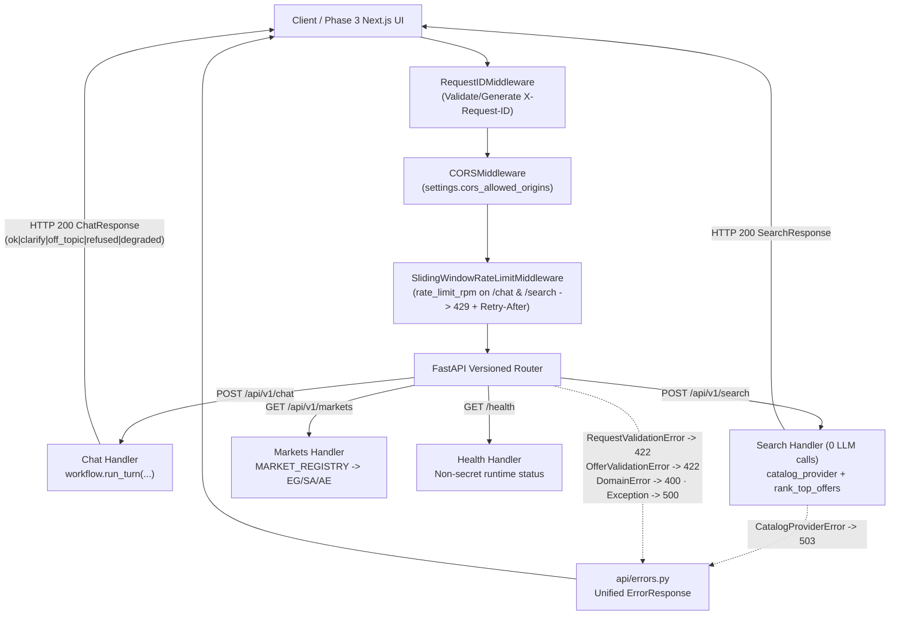

# Plan: Feature 2.3 — Versioned FastAPI Service, Middleware & API Contracts

- **Roadmap ID**: Feature 2.3
- **Folder**: `spec/features/feature-203-fastapi-service-and-contracts/`
- **Phase branch**: `phase/2-agent-and-api`
- **Size**: Medium (4 cohesive execution groups spanning versioned Pydantic v2 API contracts & typed dependencies, middleware & unified `ErrorResponse` handlers, FastAPI app factory/lifespan & REST routes, and offline deterministic `ASGITransport` unit/integration tests)
- **Status**: Committed

---

## 1. Objective & Why

Feature 2.3 exposes the deterministic Top-3 Value Scoring engine (Phase 1) and the bounded `LangGraph` shopping assistant workflow (Features 2.1–2.2) over a versioned, production-ready `FastAPI` REST service (`OpenAPI 3.1`), serving [spec/mission.md](../../mission.md) (§1 API-first B2C & B2B core, §4/§6 `<= 300 ms` repeat latency and `<= $0.002` cost target, §7 honest degradation) and [spec/roadmap.md](../../roadmap.md) (`Phase 2` -> `Feature 2.3`).

Specifically, this feature delivers:
1. **Clean Versioned REST Contracts (`OpenAPI 3.1`)**: Strongly typed Pydantic v2 request/response DTOs for `POST /api/v1/chat`, `POST /api/v1/search`, `GET /api/v1/markets`, and `GET /health`, plus a unified `ErrorResponse` envelope ready for Phase 3 `Next.js` TypeScript client generation and B2B integrations.
2. **Operational Hardening**: Request-ID tracing (`X-Request-ID`), origin-restricted `CORSMiddleware`, sliding-window per-client rate limiting (`429` + `Retry-After`), secret-free `/health` readiness reporting (`INV-01`), and sanitized error masking (`INV-01`, `INV-08`).
3. **Zero-LLM Direct Search Path (`POST /api/v1/search`)**: Allows structured market/store/budget queries to bypass LLM intent extraction (`0` LLM calls, `INV-04`) and return deterministically ranked Top-3 offers directly from `CatalogProvider` + `rank_top_offers`.
4. **100% Offline Deterministic HTTP Verification (`INV-07`, `P8`)**: Every endpoint, middleware, lifespan transition, and error envelope is tested in-process via `httpx.AsyncClient(transport=ASGITransport(app=app))` without live network calls or external API keys.

---

## 2. Scope

### In scope
- **Application Factory & Lifespan (`backend/src/commerce_ai/main.py`)**:
  - `create_app(settings: AppSettings | None = None, *, catalog_provider: CatalogProvider | None = None, llm_client: LLMClient | None = None, session_repository: SessionRepository | None = None, workflow: ShoppingAssistantWorkflow | None = None) -> FastAPI` wiring `AppSettings`, `CacheStore` (`create_cache_store`), `CatalogProvider` (`create_catalog_provider`), `LLMClient` (`create_llm_client`), `SessionRepository` (`create_session_repository`), and `ShoppingAssistantWorkflow` into `app.state`.
  - Async `lifespan` initializing `CacheStore` and `SQLAlchemySessionRepository` (`await repo.initialize()` if present, falling back safely to `InMemorySessionStore` on DB error per `INV-08`), and cleanly closing internally owned resources (`aclose()` / `close()`) on shutdown.
  - OpenAPI 3.1 metadata (`title`, `version="0.1.0"`, clean tags and response component schemas ready for Phase 3 `Next.js` TypeScript client generation).
  - Module-level `app = create_app()` for `uvicorn commerce_ai.main:app`.
- **Versioned API Contracts (`backend/src/commerce_ai/api/schemas.py`)**:
  - Strict Pydantic v2 DTOs: `ChatRequest`, `ChatResponse`, `SearchRequest`, `SearchResponse`, `MarketStoreSchema`, `MarketInfoSchema`, `MarketsResponse`, `HealthResponse`, and `ErrorResponse`.
- **Typed FastAPI Dependencies (`backend/src/commerce_ai/api/dependencies.py`)**:
  - `get_settings`, `get_workflow`, `get_catalog_provider`, and `get_request_id` reading `request.app.state` / `request.state`.
- **Middleware (`backend/src/commerce_ai/api/middleware.py`)**:
  - Request-ID middleware (`X-Request-ID` validation/generation, `request.state.request_id` binding, and response header emission).
  - `CORSMiddleware` configured from `settings.cors_allowed_origins`.
  - Sliding-window per-client in-memory rate limiter (`settings.rate_limit_rpm`, default `60`, `0` disables) keyed safely by client IP / `X-Forwarded-For`, covering `/api/v1/chat` and `/api/v1/search` while exempting `/health` and `/api/v1/markets`, returning HTTP `429` with `Retry-After` and `ErrorResponse(error_code="rate_limit_exceeded", ...)`.
- **Unified Exception Handling (`backend/src/commerce_ai/api/errors.py`)**:
  - Consistent `ErrorResponse` handlers for `RequestValidationError` (`422`), `CatalogProviderError` (`503`), `OfferValidationError` (`422`), `DomainError` (`400`), defensive `LLMProviderError` (`503`), and unhandled `Exception` (`500` generic safe message) with zero raw stack traces or secret URLs (`INV-01`).
- **Versioned Routes (`backend/src/commerce_ai/api/routes.py`)**:
  - `POST /api/v1/chat`, `POST /api/v1/search`, `GET /api/v1/markets`, and `GET /health`.
- **Offline Deterministic Unit & Integration Tests (`P8`)**:
  - `backend/tests/unit/test_api_middleware_and_schemas.py`
  - `backend/tests/integration/test_fastapi_endpoints.py`

### Out of scope (explicit exclusions)
- **Disjoint File Partition (`P7`)**: Feature 2.3 MUST NOT create or modify `backend/pyproject.toml`, `backend/uv.lock`, any package `__init__.py` scaffold (`commerce_ai/api/__init__.py`, etc.), `config/`, `domain/`, `adapters/`, or `agent/` (owned by Features 2.1 and 2.2), nor `backend/tests/integration/test_phase2_e2e.py` (reserved for Step 7 Phase Integration `PI.1`).
- **Sensitive Areas (`spec/sdd-profile.md`)**: Must NOT touch `infra/aws/**`, `.github/workflows/**`, `config/security*`, or `migrations/**`.
- **End-User Authentication, Payments & Frontend UI**: No user login/JWT/cookies, no checkout/payment endpoints (`INV-09`), and no `Next.js` UI components (`Phase 3`).
- **Live Network Calls in Default CI**: No external HTTP or paid LLM/Serper calls in `pytest` (`INV-07`).

---

## 3. Decisions

| # | Decision | Source | Rationale |
| :--- | :--- | :--- | :--- |
| **D1 (`P6`)** | **`ChatRequest` vs `SearchRequest` Validation Boundary**: `ChatRequest` enforces `extra="forbid"` and strict Pydantic validation on structural fields (`country: CountryCode = CountryCode.EG`, `store: StoreFilter \| None = None`, `max_budget: Decimal \| None = None` finite `> 0`, `language: Literal["ar", "en"] \| None = None`, `session_id: str \| None = None` `1..128` non-blank without control chars), while accepting raw `message: str` without Pydantic `min_length`/`max_length` rejection. Structurally invalid payloads (missing `message`, wrong types, unknown keys, negative `max_budget`, bad `country`) return HTTP `422` `ErrorResponse(error_code="validation_error")`, whereas empty/whitespace, oversized (`> settings.guardrail_max_chars`), prompt-injection, and payment/PII messages proceed to `workflow.run_turn(...)` and return HTTP `200` `ChatResponse(status="refused", action="refuse")`. Conversely, `SearchRequest` (which bypasses the agent guardrail node) enforces `query: str` (`min_length=1`, `max_length=500`, non-blank after strip), `max_budget > 0`, `min_rating` in `[0.0, 5.0]`, and `extra="forbid"` at the Pydantic `422` layer. | `P6` + Feature 2.3 brief | Prevents FastAPI from short-circuiting guardrail test cases into raw `422` errors when `ChatRequest.message` triggers `guardrails.py` (`empty_message`, `max_length_exceeded`, injection, PII), while still enforcing strict schema safety on structured filters and direct `/api/v1/search` requests. |
| **D2 (`P6`)** | **Endpoint Failure Semantics (`/api/v1/chat` vs `/api/v1/search`)**: `POST /api/v1/chat` always returns HTTP `200` `ChatResponse` across all `TurnStatus` outcomes (`ok`, `clarify`, `off_topic`, `refused`, `degraded`); upstream `CatalogProviderError` is handled inside `ShoppingAssistantWorkflow` as `status=TurnStatus.DEGRADED` with `top_offers=[]` (`INV-08`). `POST /api/v1/search` performs `0` LLM calls (`INV-04`), calls `catalog_provider.search_offers(intent)` and `rank_top_offers(..., settings.scoring)`, and lets `CatalogProviderError` map via `api/errors.py` to HTTP `503` `ErrorResponse(error_code="catalog_unavailable", retriable=exc.retriable)`. | `P6` + `INV-04`, `INV-08` | Preserves conversational continuity in chat UI (`TurnStatus.DEGRADED` banner with session intact) while giving programmatic/direct search callers standard HTTP `503` retry semantics (`retriable`). |
| **D3 (`P6`)** | **Middleware Execution Stack (`RequestID` -> `CORS` -> `RateLimiter`)**: Register `SlidingWindowRateLimitMiddleware` first, `CORSMiddleware` second, and `RequestIDMiddleware` last in FastAPI (`add_middleware` is LIFO), making `RequestIDMiddleware` outermost on requests. `RequestIDMiddleware` accepts safe ASCII `X-Request-ID` headers (`^[A-Za-z0-9._:-]{1,128}$`) or generates a UUID4, sets `request.state.request_id`, and stamps `X-Request-ID` onto every response; `CORSMiddleware` configures `settings.cors_allowed_origins` and exposes `["X-Request-ID", "Retry-After"]` (`allow_credentials=False`). | `P6` + `INV-09` | Guarantees `request.state.request_id` is populated before rate limiting, routing, or error handlers execute, and ensures CORS and `X-Request-ID` headers appear on `422`, `429`, `500`, and `503` responses as well as `200` responses. |
| **D4 (`P6`)** | **Safe In-Memory Sliding-Window Rate Limiter**: Enforce `settings.rate_limit_rpm` (default `60`, `0` disables) over a `60.0`-second sliding window with an injectable monotonic `clock: Callable[[], float]` (for zero-sleep deterministic tests), an `asyncio.Lock`, and bounded `OrderedDict` per-client buckets (`max_clients=10_000` LRU eviction). Extract client keys safely by taking the first valid IP from `X-Forwarded-For` verified via `ipaddress.ip_address(...)`, falling back to `request.client.host` (or `"unknown"`). Enforce only on `/api/v1/chat` and `/api/v1/search` (exempting `/health`, `/api/v1/markets`, `/openapi.json`, `/docs`, `/redoc`, and `OPTIONS`), returning HTTP `429` with `Retry-After` (`1..60`) and `ErrorResponse(error_code="rate_limit_exceeded", retriable=True)`. | `P6` + `INV-07` | Prevents key-injection and memory exhaustion from forged `X-Forwarded-For` strings, keeps health/market/CORS endpoints responsive under traffic spikes, and enables instant deterministic unit testing without `time.sleep`. |
| **D5 (`P6`, `INV-01`, `INV-08`)** | **`create_app` Eager State + Async `lifespan` Upgrade & Secret-Free `/health`**: `create_app(...)` eagerly initializes `app.state` with synchronous defaults (`AppSettings`, `InMemoryTTLCache`, `create_catalog_provider`, `create_llm_client`, `create_session_repository`, `ShoppingAssistantWorkflow`) honoring any caller-injected mocks/providers so both lifespan-managed ASGI runners and direct `ASGITransport(app=app)` tests work cleanly. Async `lifespan` upgrades `CacheStore` via `await create_cache_store(settings)` (when `catalog_provider` was not injected), initializes `session_repository` (`await repo.initialize()` if present, catching `SessionStoreError`/DB errors and falling back to `InMemorySessionStore(max_turns=settings.session_max_turns)` while updating `workflow` if not caller-injected), and closes only internally owned resources (`aclose()` / `close()`) on shutdown. `GET /health` reports `status: Literal["ok", "degraded"]` (`"degraded"` when a configured Redis or SQL backend fell back to memory), `app_env`, `catalog_mode`, `llm_mode`, `cache_backend` (`"redis" \| "memory" \| "custom"`), `session_backend` (`"sqlite" \| "postgresql" \| "memory" \| "custom"`), and `version="0.1.0"` — zero secrets or URLs. | `P6` + Feature 2.2 `ResilientSessionRepository` alignment | Prevents startup crashes on transient Redis/DB unavailability (`INV-08`), avoids leaking caller-injected test fixtures on shutdown, and guarantees `/health` never exposes credentials or raw connection strings (`INV-01`). |
| **D6 (`P6`, `INV-01`)** | **Unified `ErrorResponse` Sanitization**: `api/errors.py` registers handlers for `RequestValidationError` (`422`, `validation_error`), `CatalogProviderError` (`503`, `catalog_unavailable`), `OfferValidationError` (`422`, `offer_validation_error`), `DomainError` (`400`, `domain_error`), defensive `LLMProviderError` (`503`, `llm_unavailable`), and `Exception` (`500`, `internal_error`). Messages are scrubbed with `redact_url_password` + secret pattern masking (`500` always emits a static generic message), never exposing stack traces, API keys, or DB/Redis credentials. | `P6` + `INV-01` | Ensures every HTTP failure (including FastAPI validation and unexpected crashes) produces a predictable typed JSON contract for Phase 3 UI without leaking internal secrets or traces. |
| **D7 (`P7`, `P8`)** | **Disjoint File Scope & Offline `ASGITransport` Testing**: Author only `main.py`, `api/{schemas,dependencies,middleware,errors,routes}.py`, `tests/unit/test_api_middleware_and_schemas.py`, and `tests/integration/test_fastapi_endpoints.py`. All tests run 100% offline via `httpx.AsyncClient(transport=ASGITransport(app=app))` with `SeedCatalogProvider`, `InMemoryTTLCache`, `FakeLLMClient`, and temporary `sqlite+aiosqlite`. | `P7`, `P8`, `INV-07` | Guarantees zero merge conflicts with Features 2.1/2.2 and keeps the full test suite deterministic and sub-30s in offline CI. |

---

## 4. Relevant Existing Architecture

Feature 2.3 sits at the HTTP boundary of the hexagonal architecture defined in [spec/architecture.md](../../architecture.md) (§1–§2) and [spec/tech.md](../../tech.md) (§1–§3), consuming read-only contracts from Phase 1 and Features 2.1–2.2:

### Upstream Contracts Consumed (Read-Only)
- **Configuration (`commerce_ai.config`)**:
  - `AppSettings` (`settings.py`): `app_env`, `log_level`, `catalog_mode`, `llm_mode`, `explain_mode`, `guardrail_max_chars`, `session_ttl_seconds`, `session_max_turns`, `cors_allowed_origins`, `rate_limit_rpm`, `redis_url`, `database_url`, `scoring`, plus `redact_url_password`.
  - `MARKET_REGISTRY`, `MarketConfig` (`markets.py`): regional currencies (`EGP`/`SAR`/`AED`), `serper_gl`, and Noon/Amazon domains for `EG`, `SA`, `AE`.
- **Domain (`commerce_ai.domain`)**:
  - Models (`models.py`): `CountryCode`, `CurrencyCode`, `StoreId`, `StoreFilter`, `CatalogSourceMode`, `SearchIntent`, `RankedOffer`, `RankingResult`, `TurnAction`, `TurnStatus`, `TurnTelemetry`, `ChatTurnResult`.
  - Errors (`errors.py`): `DomainError`, `OfferValidationError`, `CatalogProviderError(provider, retriable, reason)`, `LLMProviderError(provider, retriable, reason)`, `SessionStoreError`.
  - Ports (`ports.py`): `CatalogProvider`, `CacheStore`, `LLMClient`, `SessionRepository`.
  - Ranking (`ranking.py`): `rank_top_offers(offers, intent, config)`.
- **Adapters & Agent (`commerce_ai.adapters`, `commerce_ai.agent`)**:
  - `create_cache_store(settings)` (`adapters/cache/factory.py`), `InMemoryTTLCache`, `RedisCacheStore`.
  - `create_catalog_provider(settings, cache=..., http_client=...)` (`adapters/catalog/factory.py`).
  - `create_llm_client(settings, http_client=...)` (`adapters/llm/factory.py`).
  - `create_session_repository(settings)` (`adapters/session/factory.py`), `InMemorySessionStore`, `SQLAlchemySessionRepository`.
  - `ShoppingAssistantWorkflow(settings=..., catalog_provider=..., session_repository=..., llm_client=..., scoring_config=...)` (`agent/graph.py`) with `run_turn(message=..., session_id=..., default_country=..., store_override=..., max_budget_override=..., language_hint=...) -> ChatTurnResult`.

### Invariants Enforced
- `INV-01` (Zero Hardcoded Secrets): `/health`, `ErrorResponse`, logs, and OpenAPI schemas never emit API keys, `REDIS_URL`/`DATABASE_URL` passwords, or raw connection strings.
- `INV-02` (Hexagonal Boundary): `api/` and `main.py` interact through domain ports (`CatalogProvider`, `LLMClient`, `SessionRepository`, `CacheStore`), `ShoppingAssistantWorkflow`, and adapter factories without embedding vendor SDK HTTP/SQL logic in routes.
- `INV-04` (Bounded Agent Execution): `POST /api/v1/search` runs `0` LLM calls; `POST /api/v1/chat` delegates to bounded `ShoppingAssistantWorkflow` (`<= 2` LLM calls).
- `INV-05` (Zero Hallucinated Offers): API routes pass `RankedOffer` and `RankingResult` verbatim from `rank_top_offers` / `ShoppingAssistantWorkflow` without mutating prices, ratings, review counts, or URLs.
- `INV-07` (100% Offline Deterministic Tests): Unit and integration suites run completely offline with `ASGITransport`.
- `INV-08` (Graceful Degradation): DB initialization errors during lifespan degrade to `InMemorySessionStore`; `CatalogProviderError` degrades to `ChatResponse(status="degraded")` in `/api/v1/chat` and structured `503` `ErrorResponse` in `/api/v1/search`.
- `INV-09` (Zero Payment or Sensitive PII Scope): Guardrail-blocked PII/payment payloads sent to `/api/v1/chat` produce `ChatResponse(status="refused")` without logging or persisting sensitive inputs.

---

## 5. Proposed Approach

### Exact Module Contracts

1. **`backend/src/commerce_ai/api/schemas.py`**:
   - **`ChatRequest(BaseModel)`** (`extra="forbid"`):
     - `message: str` (accepted as raw `str` so empty/whitespace, `> guardrail_max_chars`, injection, and PII inputs reach `workflow.run_turn(...)` -> `ChatResponse(status="refused")`; missing/non-string triggers `422`).
     - `session_id: str | None = Field(default=None, min_length=1, max_length=128)` (rejects whitespace-only or ASCII control characters).
     - `country: CountryCode = CountryCode.EG`
     - `store: StoreFilter | None = None`
     - `max_budget: Decimal | None = Field(default=None, gt=Decimal("0"), allow_inf_nan=False)`
     - `language: Literal["ar", "en"] | None = None`
   - **`ChatResponse(BaseModel)`**:
     - `session_id: str`
     - `status: TurnStatus`
     - `reply: str`
     - `action: TurnAction`
     - `active_intent: SearchIntent | None = None`
     - `top_offers: list[RankedOffer] = Field(default_factory=list)`
     - `ranking_result: RankingResult | None = None`
     - `telemetry: TurnTelemetry`
     - `request_id: str`
   - **`SearchRequest(BaseModel)`** (`extra="forbid"`):
     - `query: str = Field(min_length=1, max_length=500)` (trimmed non-empty validation; whitespace-only raises `ValidationError` -> `422`).
     - `country: CountryCode = CountryCode.EG`
     - `store: StoreFilter = StoreFilter.BOTH`
     - `max_budget: Decimal | None = Field(default=None, gt=Decimal("0"), allow_inf_nan=False)`
     - `min_rating: float | None = Field(default=None, ge=0.0, le=5.0, allow_inf_nan=False)`
     - `include_accessories: bool = False`
     - `language: Literal["ar", "en"] = "ar"`
   - **`SearchResponse(BaseModel)`**:
     - `intent: SearchIntent`
     - `ranking_result: RankingResult`
     - `source_mode: CatalogSourceMode`
     - `cache_hit: bool`
     - `latency_ms: float = Field(ge=0.0, allow_inf_nan=False)`
     - `request_id: str`
   - **`MarketStoreSchema` / `MarketInfoSchema` / `MarketsResponse`**:
     - `MarketStoreSchema`: `store_id: StoreId`, `label_en: str`, `label_ar: str`, `primary_domain: str`.
     - `MarketInfoSchema`: `country: CountryCode`, `currency: CurrencyCode`, `name_en: str`, `name_ar: str`, `currency_label_en: str`, `currency_label_ar: str`, `serper_gl: str`, `stores: list[MarketStoreSchema]`.
     - `MarketsResponse`: `markets: list[MarketInfoSchema]`, `default_country: CountryCode = CountryCode.EG`, `default_store: StoreFilter = StoreFilter.BOTH`, `request_id: str`.
   - **`HealthResponse(BaseModel)`**:
     - `status: Literal["ok", "degraded"]`
     - `app_env: str`
     - `catalog_mode: str`
     - `llm_mode: str`
     - `cache_backend: str`
     - `session_backend: str`
     - `version: str`
   - **`ErrorResponse(BaseModel)`**:
     - `error_code: str`
     - `message: str`
     - `retriable: bool = False`
     - `request_id: str`
     - `details: list[dict[str, Any]] | None = None`

2. **`backend/src/commerce_ai/api/dependencies.py`**:
   - `get_settings(request: Request) -> AppSettings`
   - `get_workflow(request: Request) -> ShoppingAssistantWorkflow`
   - `get_catalog_provider(request: Request) -> CatalogProvider`
   - `get_request_id(request: Request) -> str`

3. **`backend/src/commerce_ai/api/middleware.py`**:
   - `RequestIDMiddleware`: validates incoming `X-Request-ID` (`^[A-Za-z0-9._:-]{1,128}$`) or generates UUID4, binds `request.state.request_id`, attaches `X-Request-ID` on every HTTP response.
   - `SlidingWindowRateLimiter` & `SlidingWindowRateLimitMiddleware`: 60s sliding window with `asyncio.Lock`, bounded `OrderedDict` buckets, injectable `clock`, safe IP extraction from validated `X-Forwarded-For` or `request.client.host`, enforced on `/api/v1/chat` & `/api/v1/search` (`rate_limit_rpm > 0`), exempting `/health` & `/api/v1/markets`, returning HTTP `429` with `Retry-After` and `ErrorResponse(error_code="rate_limit_exceeded", retriable=True, ...)`.
   - `configure_middleware(app: FastAPI, settings: AppSettings, *, clock: Callable[[], float] | None = None) -> None`: configures `UnhandledExceptionMiddleware` (innermost, inside CORS), `SlidingWindowRateLimitMiddleware`, `CORSMiddleware` (`allow_origins=settings.cors_allowed_origins`, `allow_methods=["GET", "POST", "OPTIONS"]`, `allow_headers=["Content-Type", "X-Request-ID", "Accept"]`, `expose_headers=["X-Request-ID", "Retry-After"]`, `allow_credentials=False`), and `RequestIDMiddleware` in exact outer-to-inner order (`D3`).

4. **`backend/src/commerce_ai/api/errors.py`**:
   - Registers unified FastAPI exception handlers returning `ErrorResponse` JSON (`X-Request-ID` preserved/attached, `INV-01` secret scrubbing), plus `UnhandledExceptionMiddleware` inside `CORSMiddleware` so unhandled `500` errors retain CORS and `X-Request-ID` headers (`D3`):
     - `RequestValidationError` -> HTTP `422` (`error_code="validation_error"`, `retriable=False`, sanitized field `loc`/`msg`/`type` details).
     - `CatalogProviderError` -> HTTP `503` (`error_code="catalog_unavailable"`, `retriable=exc.retriable`).
     - `OfferValidationError` -> HTTP `422` (`error_code="offer_validation_error"`, `retriable=False`).
     - `DomainError` -> HTTP `400` (`error_code="domain_error"`, `retriable=False`).
     - `LLMProviderError` (defensive guard if raised directly) -> HTTP `503` (`error_code="llm_unavailable"`, `retriable=exc.retriable`).
     - `Exception` -> HTTP `500` (`error_code="internal_error"`, `retriable=False`, static safe message `"An unexpected internal error occurred."`).

5. **`backend/src/commerce_ai/api/routes.py`**:
   - `POST /api/v1/chat` (`response_model=ChatResponse`, tag `chat`)
   - `POST /api/v1/search` (`response_model=SearchResponse`, tag `search`)
   - `GET /api/v1/markets` (`response_model=MarketsResponse`, tag `markets`)
   - `GET /health` (`response_model=HealthResponse`, tag `system`)
   - OpenAPI `responses` metadata documenting `ErrorResponse` on `422`, `429`, `503`, and `500` where applicable.

6. **`backend/src/commerce_ai/main.py`**:
   - `create_app(settings: AppSettings | None = None, *, catalog_provider: CatalogProvider | None = None, llm_client: LLMClient | None = None, session_repository: SessionRepository | None = None, workflow: ShoppingAssistantWorkflow | None = None) -> FastAPI`
   - Wires `app.state` (`settings`, `cache_store`, `catalog_provider`, `llm_client`, `session_repository`, `workflow`, ownership/degraded flags).
   - Async `lifespan(app: FastAPI)` resolves `await create_cache_store(settings)` (unless `catalog_provider` was injected), runs `await repo.initialize()` if present (catching errors, logging redacted warning `INV-01`, and falling back safely to `InMemorySessionStore(max_turns=settings.session_max_turns)` per `INV-08` while refreshing owned `workflow`), and closes internally owned resources (`aclose()` / `close()`) on shutdown.
   - Configures OpenAPI 3.1 (`title="AI for E-Commerce API"`, `version="0.1.0"`, clean tags).
   - Exposes `app = create_app()`.

---

## 6. Expected Files / Areas Affected

| Path | Change (Create / Modify / Delete) | Purpose |
| :--- | :--- | :--- |
| `backend/src/commerce_ai/api/schemas.py` | Create | Strict Pydantic v2 request/response DTOs and `ErrorResponse` contract |
| `backend/src/commerce_ai/api/dependencies.py` | Create | Typed FastAPI `Depends` accessors reading `app.state` and `request.state` |
| `backend/src/commerce_ai/api/middleware.py` | Create | `RequestIDMiddleware`, `CORSMiddleware` wiring, and `SlidingWindowRateLimitMiddleware` |
| `backend/src/commerce_ai/api/errors.py` | Create | Unified exception handlers emitting sanitized `ErrorResponse` JSON |
| `backend/src/commerce_ai/api/routes.py` | Create | Versioned `/api/v1/chat`, `/api/v1/search`, `/api/v1/markets`, and `/health` handlers |
| `backend/src/commerce_ai/main.py` | Create | `create_app(...)`, async `lifespan`, OpenAPI 3.1 metadata, and module-level `app` |
| `backend/tests/unit/test_api_middleware_and_schemas.py` | Create | Offline unit & edge tests for middleware, rate limiter, error masking, `/health`, and DTO bounds |
| `backend/tests/integration/test_fastapi_endpoints.py` | Create | Offline `ASGITransport` integration tests for all routes, multi-turn chat, OpenAPI 3.1, `422`/`429`/`503` |

> **Partition Guard (`P7`)**: Feature 2.3 MUST NOT create or modify `backend/pyproject.toml`, `backend/uv.lock`, any `__init__.py` scaffold (`commerce_ai/api/__init__.py`, etc.), `config/`, `domain/`, `adapters/`, `agent/`, or `backend/tests/integration/test_phase2_e2e.py`.

---

## 7. Execution Groups

- **Group 1 — API Contracts & Typed Dependencies (`api/schemas.py`, `api/dependencies.py`)**:
  Implement all Pydantic v2 request/response DTOs (`ChatRequest`, `ChatResponse`, `SearchRequest`, `SearchResponse`, `MarketStoreSchema`, `MarketInfoSchema`, `MarketsResponse`, `HealthResponse`, `ErrorResponse`) with exact `ChatRequest` vs `SearchRequest` boundary rules (`D1`), plus typed `Depends` accessors.
- **Group 2 — Middleware, Rate Limiter & Unified Error Handling (`api/middleware.py`, `api/errors.py`)**:
  Implement `RequestIDMiddleware`, `CORSMiddleware` configuration, `SlidingWindowRateLimitMiddleware` (`429` + `Retry-After` + `/health`/`/api/v1/markets` exemption), and sanitized `ErrorResponse` exception handlers, verified with `backend/tests/unit/test_api_middleware_and_schemas.py`.
- **Group 3 — Routes, Application Factory & Lifespan (`api/routes.py`, `main.py`)**:
  Implement `POST /api/v1/chat`, `POST /api/v1/search` (`0` LLM calls), `GET /api/v1/markets`, `GET /health`, `create_app(...)`, async `lifespan` initialization/DB-fallback/resource cleanup, OpenAPI 3.1 metadata, and module-level `app`.
- **Group 4 — HTTP Integration Tests & Quality Gates (`tests/integration/test_fastapi_endpoints.py`)**:
  Implement offline `ASGITransport` integration tests across all endpoints, Arabic/English multi-turn chat flows, cache hit `< 300 ms` latency, guardrail refusal, degraded catalog/DB fallback, `422`/`429`/`503`/`500` envelopes, and `/openapi.json` schema verification, then run `pytest`, `ruff check .`, `ruff format --check .`, `mypy src`, and Tier 7 ASGI verification.

---

## 8. Risks & Trade-offs

| Risk / Trade-off | Impact | Mitigation |
| :--- | :--- | :--- |
| **Ambiguity between FastAPI `422` validation and workflow guardrail `refused` on `ChatRequest.message`** | Sending empty, oversized, or injected strings to `/api/v1/chat` could return `422` instead of `ChatResponse(status="refused")` | Keep `ChatRequest.message: str` free of Pydantic length/empty rejection (`D1`) so guardrail rules handle empty, oversized, injection, and PII inputs cleanly while structural/type errors still return `422`. |
| **`httpx.ASGITransport` tests skipping lifespan vs lifespan-initialized DB/Redis adapters** | Bare `ASGITransport(app=app)` without lifespan manager might encounter uninitialized repositories or missing state | Populate eager synchronous defaults in `create_app` (`D5`), let `lifespan` upgrade/initialize async adapters (`create_cache_store`, `repo.initialize()`) and close owned resources, and test both bare requests and full `lifespan` context in `test_fastapi_endpoints.py`. |
| **In-memory sliding-window rate limiter scope & `X-Forwarded-For` spoofing** | Multi-worker deployments do not share in-memory buckets, and untrusted clients can spoof headers | Use bounded `OrderedDict` + `ipaddress.ip_address` validation for safe MVP limiting (`D4`); document edge WAF / Redis rate limiting for multi-instance production scaling. |
| **Secret or stack-trace exposure in `500`/`503` errors or `/health`** | Violates `INV-01` by leaking `SERPER_API_KEY`, `GEMINI_API_KEY`, `REDIS_URL`, or `DATABASE_URL` passwords | Emit generic `500` messages (`D6`), mask error text via `redact_url_password`, report only non-secret backend labels in `HealthResponse`, and test with populated dummy secrets. |
| **OpenAPI 3.1 schema breaks Phase 3 TypeScript client generation** | Untyped dicts or missing error schemas force manual frontend workarounds in Phase 3 | Explicitly annotate all `response_model`s, union/enum fields, tags, and `ErrorResponse` `responses={...}`, and assert `/openapi.json` structure in `test_fastapi_endpoints.py`. |

---

## 9. Open Questions

None — all Feature 2.3 design decisions (`P6`, `P7`, `P8`, `D1`–`D7`) and cross-feature contracts with Features 2.1 and 2.2 are resolved and locked for Phase Gate 1.
