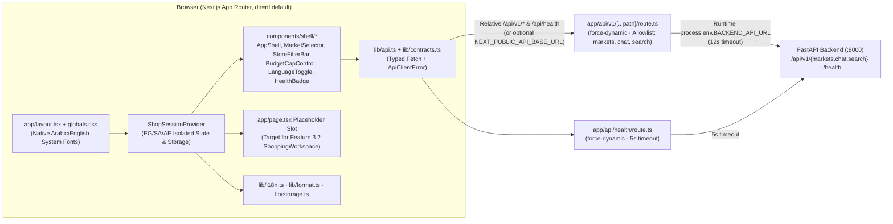

# Plan: Feature 3.1 — Arabic-First RTL App Shell, Selectors & Typed API Client

- **Roadmap ID**: Feature 3.1
- **Folder**: `spec/features/feature-301-rtl-shell-selectors-and-api-client/`
- **Phase branch**: `phase/3-rtl-web-experience`
- **Size**: Medium (4 cohesive execution groups spanning Next.js 15/Vitest toolchain & lockfile, strict TypeScript API contracts + runtime same-origin Route Handler proxies, bilingual dictionary/loss-free formatting/URL guard/isolated storage + `ShopSessionContext`, and Arabic-first RTL shell components + unit/integration tests)
- **Status**: Committed

---

## 1. Objective & Why

Feature 3.1 establishes the frontend foundation for Phase 3 (`spec/roadmap.md` → Phase 3 → `Feature 3.1`) and serves [spec/mission.md](../../mission.md) (§1 API-first Arabic-first RTL web interface, §3 Egypt/Saudi/UAE target shoppers on Noon & Amazon, §7 trusted advisor tone and honest degradation).

Specifically, this feature delivers:
1. **Offline-Safe `Next.js 15` + `Vitest` Tooling & Lockfile (`P2`, `INV-07`)**: Pre-declares all Phase 3 runtime and test dependencies, strict TypeScript (`strict: true`, `noUncheckedIndexedAccess: true`), non-interactive flat ESLint (`eslint src tests`), Tailwind CSS, and Vitest + Testing Library (`jsdom`) configuration, while enforcing a native Arabic/English system font stack with zero `next/font/google` calls so `next build` passes 100% offline.
2. **Exact TypeScript Contracts, Typed API Client & Runtime Same-Origin Proxies (`P3`, `INV-01`, `INV-05`, `INV-08`)**: Mirrors `backend/src/commerce_ai/api/schemas.py` verbatim (including `DecimalString` price preservation and pre-defined Feature 3.2 workspace types), provides typed `api.ts` helpers with `ApiClientError`, and introduces dynamic Next.js Route Handler proxies (`/api/v1/[...path]` and `/api/health`) reading `BACKEND_API_URL` at runtime with strict path/method allowlisting and sanitized `503 backend_unreachable` degradation.
3. **Bilingual Dictionary, Safe Formatting, Strict URL Guard & Market-Isolated State (`P4`, `P7`, `INV-05`, `INV-09`)**: Ships the complete Phase 3 `ar`/`en` dictionary (`src/lib/i18n.ts`), loss-free decimal price formatting & strict `https://` URL validation (`src/lib/format.ts`), SSR-safe corruption-tolerant `localStorage` persistence (`src/lib/storage.ts`), and `ShopSessionContext` managing `EG`/`SA`/`AE` session isolation, instant `RTL`/`LTR` language switching, and market/store/budget preferences.
4. **Arabic-First `RTL` App Shell & Selectors (`P4`, `P7`)**: Implements `<AppShell>`, `<MarketSelector>`, `<StoreFilterBar>`, `<BudgetCapControl>`, `<LanguageToggle>`, `<HealthBadge>`, New Chat reset, and a placeholder workspace slot in `src/app/page.tsx` ready for Feature 3.2 to mount `<ShoppingWorkspace />` without editing any shell, context, proxy, or `src/lib/*` file.

---

## 2. Scope

### In scope
- **Frontend Tooling & Lockfile (`frontend/`)**:
  - `frontend/package.json` & `frontend/package-lock.json` pre-declaring all Phase 3 dependencies (`next ^15`, `react ^19`, `react-dom ^19`, `typescript ^5`, `tailwindcss`, `eslint`, `vitest`, `@vitejs/plugin-react`, `jsdom`, `@testing-library/react`, `@testing-library/jest-dom`, `@testing-library/user-event`, plus required `@types/*`, `@tailwindcss/postcss`/`postcss`, and `eslint-config-next`) and required scripts (`dev`, `build`, `start`, `lint`, `typecheck`, `test`).
  - `frontend/.gitignore`, updated `frontend/.env.example` (`BACKEND_API_URL=http://127.0.0.1:8000`, optional `BACKEND_PROXY_TIMEOUT_MS`, `TRUST_PROXY_HEADERS=false`, and optional commented `NEXT_PUBLIC_API_BASE_URL`), `frontend/next.config.ts` (including defense-in-depth HTTP response `headers()`), `frontend/tsconfig.json`, `frontend/postcss.config.mjs`, `frontend/eslint.config.mjs`, `frontend/vitest.config.ts`, and `frontend/tests/setup.ts`.
- **Root Layout, Styling & Placeholder Entry (`frontend/src/app/`)**:
  - `frontend/src/app/globals.css` (Tailwind CSS + native Arabic/English system font stack, zero Google Font downloads).
  - `frontend/src/app/layout.tsx` (`<html lang="ar" dir="rtl">` Server Component wrapping `<ShopSessionProvider>`).
  - `frontend/src/app/page.tsx` (renders `<AppShell>` with a clean bilingual Feature 3.1 placeholder slot ready for Feature 3.2).
- **Runtime Same-Origin Proxy Routes (`frontend/src/app/api/`, `frontend/src/lib/proxy.ts`)**:
  - `frontend/src/app/api/v1/[...path]/route.ts` (`dynamic = "force-dynamic"` allowlisting ONLY `GET /markets`, `POST /chat`, `POST /search`).
  - `frontend/src/app/api/health/route.ts` (`dynamic = "force-dynamic"` forwarding `GET /health`).
- **Shared Core Libraries (`frontend/src/lib/`)**:
  - `frontend/src/lib/contracts.ts` (strict backend DTO parity + Feature 3.2 workspace UI types).
  - `frontend/src/lib/api.ts` (`ApiClientError`, `fetchMarkets`, `fetchHealth`, `sendChatTurn`, `searchOffers`).
  - `frontend/src/lib/i18n.ts` (complete Phase 3 `ar`/`en` UI dictionary covering Feature 3.1 and Feature 3.2 labels, `match_reasons`, `TurnStatus`, errors, telemetry, and per-market starter prompts).
  - `frontend/src/lib/format.ts` (loss-free `DecimalString` price formatting, budget input validation, rating/latency formatters, strict `https://` URL safety guard).
  - `frontend/src/lib/storage.ts` (SSR-safe `localStorage` persistence & corruption recovery under `commerce_ai.prefs.v1` and `commerce_ai.market_sessions.v1`).
- **Session Context & Shell UI (`frontend/src/context/`, `frontend/src/components/shell/`)**:
  - `frontend/src/context/ShopSessionContext.tsx` (`ShopSessionProvider`, `useShopSession`, `MARKET_REGISTRY_FALLBACK`).
  - `frontend/src/components/shell/{AppShell,MarketSelector,StoreFilterBar,BudgetCapControl,LanguageToggle,HealthBadge}.tsx`.
- **Offline Unit & Integration Tests (`frontend/tests/`)**:
  - `frontend/tests/unit/api.test.ts`
  - `frontend/tests/unit/storage-and-format.test.ts`
  - `frontend/tests/integration/proxy-routes.test.ts`
  - `frontend/tests/integration/app-shell.test.tsx`

### Out of scope (explicit exclusions)
- **Feature 3.2 Workspace Components & Tests (`P7`)**: Must NOT create or modify `frontend/src/components/workspace/**`, `frontend/tests/unit/offer-card-and-banners.test.tsx`, `frontend/tests/integration/shopping-workspace.test.tsx`, or `frontend/tests/integration/phase3-e2e.test.tsx` (reserved for Phase Integration `PI.1`).
- **Backend & Sensitive Areas (`P1`, `spec/sdd-profile.md`)**: Must NOT modify `backend/**`, `infra/aws/**`, `.github/workflows/**`, `backend/src/commerce_ai/config/security*`, or `backend/migrations/**`.
- **Authentication, Checkout, Scraping & Live External Calls (`INV-06`, `INV-07`, `INV-09`)**: No user login walls, no payment/checkout UI, no marketplace HTML scraping, and zero live backend or internet calls inside automated unit/integration tests.

---

## 3. Decisions

| # | Decision | Source | Rationale |
| :--- | :--- | :--- | :--- |
| **D1 (`P2`, `INV-07`)** | **Offline-Safe `Next.js 15` Toolchain, Non-Interactive ESLint & Native Arabic System Fonts**: Initialize `frontend/` with `next ^15`, `react ^19`, `react-dom ^19`, `typescript ^5` (`strict: true`, `noUncheckedIndexedAccess: true`), Tailwind CSS, flat `eslint.config.mjs` (`"lint": "eslint src tests"` instead of interactive `next lint`), and `vitest` + `jsdom` + `@testing-library/{react,jest-dom,user-event}`. NEVER import `next/font/google`; configure `"Segoe UI", "Tahoma", "Noto Sans Arabic", "Geeza Pro", "Arial", sans-serif` in `src/app/globals.css`. | `P2` + `INV-07` + `spec/sdd-profile.md` | Prevents `next lint` interactive wizard hangs in automation, enforces null-safe TypeScript array/record indexing, locks `package-lock.json` upfront for Feature 3.2, and guarantees `next build` passes 100% offline. |
| **D2 (`P3`, `INV-01`, `INV-08`)** | **Runtime Same-Origin Route Handler Proxies (`force-dynamic`)**: Browser requests default to relative `/api/v1/*` and `/api/health`. `src/app/api/v1/[...path]/route.ts` and `src/app/api/health/route.ts` export `dynamic = "force-dynamic"` and resolve `process.env.BACKEND_API_URL` (default `"http://127.0.0.1:8000"`, `http:`/`https:` validated) at request time via shared `src/lib/proxy.ts`. `/api/v1/[...path]` uses Next.js 15 async `await context.params`, allowlists ONLY `GET /markets`, `POST /chat`, `POST /search`, rejects unknown/empty/traversal paths (`..`, encoded slashes, unknown segments) with HTTP `404` `ErrorResponse(error_code="route_not_found")`, rejects wrong HTTP methods with HTTP `405` `ErrorResponse(error_code="method_not_allowed")` + `Allow`, caps `POST` request bodies at `64 KiB` (`65536` UTF-8 bytes -> `413 payload_too_large`), gates `X-Forwarded-For` behind `TRUST_PROXY_HEADERS === "true"` with `node:net` `isIP` hop validation, sets `redirect: "error"`, forwards `Accept`, `Content-Type`, and regex-validated `X-Request-ID` with configurable `BACKEND_PROXY_TIMEOUT_MS` (`12000` default, clamped `1000..60000`; `5000` on `/api/health`) combined with `request.signal` (`AbortSignal.any` with fallback), requires upstream JSON `content-type` (`application/json` or `+json`) + `JSON.parse` success (otherwise emitting sanitized `502 upstream_invalid_response` or `>= 500 backend_unreachable`), always emits `Content-Type: application/json; charset=utf-8` and `X-Content-Type-Options: nosniff` (paired with security `headers()` in `next.config.ts`), and emits HTTP `503` `ErrorResponse(error_code="backend_unreachable", retriable=true)` on upstream network/redirect/timeout errors without leaking `BACKEND_API_URL` or stack traces. | `P3` + `INV-01`, `INV-08` | Eliminates build-time baking of internal backend URLs (critical for Docker/App Runner portability in Phase 4), prevents SSRF/path-traversal/IP-spoofing/oversized-body/non-JSON-reflection proxy abuse, avoids browser CORS issues on default origin, and keeps outage UX structured and secret-free. |
| **D3 (`P3`, `INV-03`, `INV-05`)** | **Verbatim Backend DTO Contracts & `ApiClientError` HTTP Client**: `src/lib/contracts.ts` mirrors `backend/src/commerce_ai/api/schemas.py` and `domain/models.py` (`DecimalString` for `ProductOffer.price` and `SearchIntent.max_budget`; `string \| number \| null` for request `max_budget` `> 0 && <= 10000000.00`), plus pre-defined workspace types (`ChatMessageItem`, `ActiveComparisonState`, `MarketWorkspaceSession`, `UserPreferences`). `src/lib/api.ts` trims trailing `/` from optional `NEXT_PUBLIC_API_BASE_URL` (defaulting to `""` relative `/api/v1/*` and `/api/health`, or `${baseUrl}/health` when an explicit backend origin is set), validates `max_budget` client-side before sending, parses `ErrorResponse` + `Retry-After` into `ApiClientError`, and maps network/abort rejections to retriable `ApiClientError(errorCode="network_error", retriable=true)`. | `P3` + `INV-03`, `INV-05` | Prevents IEEE-754 float precision drift on backend `Decimal` prices, keeps `Feature 3.2` strictly decoupled from `src/lib/*`, and gives UI error banners consistent `errorCode`/`retryAfterSeconds`/`requestId` metadata. |
| **D4 (`P4`, `P7`)** | **Complete Phase 3 Bilingual Dictionary Upfront (`src/lib/i18n.ts`)**: Define all `ar` and `en` UI strings upfront for both Feature 3.1 shell controls and Feature 3.2 workspace (`ModeToggle`, rating/accessories filters, `ChatThread`/`MessageComposer`, all 7 `match_reasons` codes from `domain/ranking.py`, `TurnStatus` banners, `429`/`503` messages, `TelemetryStrip`, and `EG`/`SA`/`AE` starter prompts aligned with seed & live catalogs). | `P4` + `P7` + `agent/templates.py` | Preserves strict `P7` disjoint file ownership so Feature 3.2 only authors `components/workspace/*` and `src/app/page.tsx` without modifying `src/lib/*`. |
| **D5 (`INV-05`, `INV-09`)** | **Loss-Free Price Formatting & Strict `https://` URL Sanitization (`src/lib/format.ts`)**: `formatExactPrice` formats `DecimalString` values via string digit grouping/splitting without converting strings through `Number.toFixed()` (preserving exact backend decimal digits verbatim). `sanitizeHttpsUrl` uses strict `URL` validation rejecting `http:`, `javascript:`, `data:`, `vbscript:`, embedded credentials (`user:pass@`), backslashes, whitespace, and control characters. `validateBudgetInput` enforces finite positive decimals `> 0 && <= 10000000.00`. | `INV-05`, `INV-09` + `config/markets.py` | Guarantees zero price distortion (`INV-05`) and prevents XSS or insecure HTTP link/image rendering (`INV-09`) even if an unexpected URL format reaches the client. |
| **D6 (`P4`)** | **SSR-Safe Per-Market Isolation & `ShopSessionContext`**: `src/lib/storage.ts` persists `{ country, store, language }` under `commerce_ai.prefs.v1` (default `EG`, `both`, `ar`) and `Record<CountryCode, MarketWorkspaceSession>` (`{ sessionId, messages, activeComparison }`) under `commerce_ai.market_sessions.v1`, validating nested `ProductOffer`, `RankedOffer`, `RankingResult`, and `TurnTelemetry` shapes cleanly and guarding against SSR (`typeof window === "undefined"`), storage quota errors, and corrupted JSON payloads. `ShopSessionContext` syncs `document.documentElement.{lang,dir}` immediately on mount/toggle, hydrates `markets`/`health` with `MARKET_REGISTRY_FALLBACK` (and request-sequence/`AbortController` guards on overlapping `refreshHealth()` calls), isolates `EG`/`SA`/`AE` sessions completely with pure state updaters persisted via post-hydration `useEffect`, preserves `sessionId` across `store`/`maxBudget` changes, and resets only the active market on New Chat (`sessionResetNonce`). | `P4` + `spec/mission.md` §7 | Prevents Egypt (`EGP`), Saudi (`SAR`), and UAE (`AED`) sessions or offers from leaking across market switches, prevents React 19 StrictMode duplicate storage writes and out-of-order health races, enables instant zero-reload RTL/LTR toggling, and keeps first paint usable even when the backend is booting or offline. |
| **D7 (`P7`, `P8`)** | **Disjoint File Scope & Offline Vitest/RTL Suite**: Author only `frontend/` root configs, `src/lib/*`, `src/context/ShopSessionContext.tsx`, `src/components/shell/*`, `src/app/{layout.tsx,globals.css,page.tsx,api/**}`, and `tests/{setup.ts,unit/api.test.ts,unit/storage-and-format.test.ts,integration/proxy-routes.test.ts,integration/app-shell.test.tsx}` with mocked `fetch` (`INV-07`), leaving `src/components/workspace/**`, `phase3-e2e.test.tsx`, `backend/**`, and Sensitive Areas untouched. | `P7`, `P8`, `INV-07` | Prevents merge conflicts with Feature 3.2 and guarantees fast, deterministic offline CI execution. |

---

## 4. Relevant Existing Architecture

Feature 3.1 implements the presentation shell and BFF proxy layer of [spec/architecture.md](../../architecture.md) (§1–§2) and [spec/tech.md](../../tech.md) (§1–§3), binding cleanly to Phase 2 backend REST endpoints (`backend/src/commerce_ai/api/routes.py`, `schemas.py`) and regional config (`backend/src/commerce_ai/config/markets.py`, `domain/models.py`, `domain/ranking.py`, `agent/templates.py`).

### Upstream Backend Contracts Consumed (Read-Only)
- **REST Endpoints (`backend/src/commerce_ai/api/routes.py`)**:
  - `GET /api/v1/markets` → `MarketsResponse` (`markets` for `EG`/`EGP`, `SA`/`SAR`, `AE`/`AED` with `noon`/`amazon` bilingual labels & primary domains; `default_country="EG"`, `default_store="both"`, `request_id`).
  - `GET /health` → `HealthResponse` (`status: "ok" | "degraded"`, `app_env`, `catalog_mode`, `llm_mode`, `cache_backend`, `session_backend`, `version`).
  - `POST /api/v1/chat` → `ChatRequest` / `ChatResponse` (`session_id`, `status: TurnStatus`, `reply`, `action: TurnAction`, `active_intent`, `top_offers`, `ranking_result`, `telemetry`, `request_id`).
  - `POST /api/v1/search` → `SearchRequest` / `SearchResponse` (`intent`, `ranking_result`, `source_mode`, `cache_hit`, `latency_ms`, `request_id`).
  - Unified Errors (`backend/src/commerce_ai/api/errors.py`, `middleware.py`): `ErrorResponse` (`error_code`, `message`, `retriable`, `request_id`, `details`), plus `X-Request-ID` and `Retry-After` on HTTP `429`.
- **Domain Constraints (`backend/src/commerce_ai/domain/models.py`, `ranking.py`)**:
  - `MAX_BUDGET_DECIMAL = 10000000.00` (`> 0 && <= 10000000.00`).
  - `SearchRequest.query`: `1..500` non-blank characters without control/bidi/Tag characters.
  - `SearchRequest.min_rating`: `0.0..5.0` or `null`.
  - `ProductOffer.price` and `SearchIntent.max_budget` serialize as decimal strings (`Decimal` JSON mode).
  - Canonical `match_reasons` codes: `best_overall_value`, `lowest_price`, `top_bayesian_rating`, `high_review_confidence`, `within_budget`, `unrated_fallback`, `strong_value_runner_up`.
- **Existing Frontend Repo File**:
  - `frontend/.env.example` (tracked file from Phase 1 scaffold currently containing `NEXT_PUBLIC_API_BASE_URL=http://localhost:8000`; updated in Feature 3.1 to `BACKEND_API_URL=http://127.0.0.1:8000` + optional commented `NEXT_PUBLIC_API_BASE_URL`).

### Invariants Enforced
- `INV-01` (Zero Hardcoded Secrets): Zero secrets in `NEXT_PUBLIC_*`, `src/`, or tests; proxy error payloads never expose `BACKEND_API_URL` or internal stack traces.
- `INV-03` (Deterministic Math): Browser client and `format.ts` never re-rank offers or coerce `DecimalString` prices through floating-point rounding.
- `INV-05` (Strict Grounding): Exact backend `offer.price`, `currency`, `store`, `rating`, `review_count`, and `url` fields are preserved verbatim across API client, storage, and context.
- `INV-07` (100% Offline Deterministic Builds & Tests): Zero `next/font/google` imports; `next build` and `vitest run` execute completely offline with mocked `fetch`.
- `INV-08` (Graceful Degradation): Upstream backend outages map to `503 backend_unreachable`, `ShopSessionContext` falls back to `MARKET_REGISTRY_FALLBACK`, and corrupted `localStorage` resets safely.
- `INV-09` (Zero Payment/PII & Safe Outbound Links): `sanitizeHttpsUrl` enforces strict `https://`-only URLs without credentials or control chars; client storage never collects payment or identity credentials.

---

## 5. Proposed Approach

### Exact Module Contracts

1. **`frontend/package.json` & Tooling Configs**:
   - Required `scripts`: `"dev": "next dev --port 3000"`, `"build": "next build"`, `"start": "next start --port 3000"`, `"lint": "eslint src tests"`, `"typecheck": "tsc --noEmit"`, `"test": "vitest run"`.
   - `tsconfig.json`: `strict: true`, `noUncheckedIndexedAccess: true`, `moduleResolution: "bundler"`, `noEmit: true`, `@/* -> ./src/*`.
   - `eslint.config.mjs`: Non-interactive flat config (`eslint-config-next` + TypeScript) covering `src/**` and `tests/**`.
   - `vitest.config.ts`: `@vitejs/plugin-react`, `environment: "jsdom"`, `setupFiles: ["./tests/setup.ts"]`, `@/` alias.
   - `frontend/.gitignore`: ignores `node_modules/`, `.next/`, `out/`, `coverage/`, `.env*` (except `!.env.example`), `*.tsbuildinfo`, `next-env.d.ts`.

2. **`frontend/src/lib/contracts.ts`**:
   - Enums/unions: `CountryCode` (`"EG" | "SA" | "AE"`), `CurrencyCode` (`"EGP" | "SAR" | "AED"`), `StoreId` (`"noon" | "amazon"`), `StoreFilter` (`"noon" | "amazon" | "both"`), `CatalogSourceMode` (`"seed" | "live"`), `TurnAction` (`"search" | "compare" | "clarify" | "off_topic" | "refuse"`), `TurnStatus` (`"ok" | "clarify" | "off_topic" | "refused" | "degraded"`), `UiLanguage` (`"ar" | "en"`), `MatchReasonCode` (`"best_overall_value" | "lowest_price" | "top_bayesian_rating" | "high_review_confidence" | "within_budget" | "unrated_fallback" | "strong_value_runner_up"`), `DecimalString = string`.
   - Core Domain & API DTOs matching `backend/src/commerce_ai/api/schemas.py` & `domain/models.py`:
     - `ProductOffer`: `offer_id`, `title`, `price: DecimalString`, `currency: CurrencyCode`, `store: StoreId`, `country: CountryCode`, `url`, `rating: number | null`, `review_count: number`, `image_url: string | null`, `in_stock: boolean`.
     - `SearchIntent`: `query`, `country: CountryCode`, `store: StoreFilter`, `max_budget: DecimalString | null`, `min_rating: number | null`, `exclude_keywords: string[]`, `include_accessories: boolean`, `language: UiLanguage`.
     - `RankedOffer`: `rank: number` (`1..3`), `offer: ProductOffer`, `value_score: number`, `price_norm: number`, `bayesian_rating: number`, `match_reasons: string[]`.
     - `RankingResult`: `ranked_offers: RankedOffer[]`, `total_candidates: number`, `filtered_accessories_count: number`, `filtered_outliers_count: number`, `degraded_fewer_than_k: boolean`.
     - `TurnTelemetry`: `llm_calls: number`, `catalog_called: boolean`, `catalog_cache_hit: boolean`, `catalog_source_mode: CatalogSourceMode | null`, `used_rule_intent_fallback: boolean`, `used_template_summary: boolean`, `degraded_reason: string | null`, `latency_ms: number`.
     - `ChatRequest`: `message: string`, `session_id?: string | null`, `country?: CountryCode`, `store?: StoreFilter | null`, `max_budget?: string | number | null` (`> 0 && <= 10000000.00`), `language?: UiLanguage | null`.
     - `ChatResponse`: `session_id`, `status: TurnStatus`, `reply`, `action: TurnAction`, `active_intent: SearchIntent | null`, `top_offers: RankedOffer[]`, `ranking_result: RankingResult | null`, `telemetry: TurnTelemetry`, `request_id`.
     - `SearchRequest`: `query: string`, `country?: CountryCode`, `store?: StoreFilter`, `max_budget?: string | number | null` (`> 0 && <= 10000000.00`), `min_rating?: number | null`, `include_accessories?: boolean`, `language?: UiLanguage`.
     - `SearchResponse`: `intent: SearchIntent`, `ranking_result: RankingResult`, `source_mode: CatalogSourceMode`, `cache_hit: boolean`, `latency_ms: number`, `request_id`.
     - `MarketStoreSchema`: `store_id: StoreId`, `label_en`, `label_ar`, `primary_domain`.
     - `MarketInfoSchema`: `country: CountryCode`, `currency: CurrencyCode`, `name_en`, `name_ar`, `currency_label_en`, `currency_label_ar`, `serper_gl`, `stores: MarketStoreSchema[]`.
     - `MarketsResponse`: `markets: MarketInfoSchema[]`, `default_country: CountryCode`, `default_store: StoreFilter`, `request_id`.
     - `HealthResponse`: `status: "ok" | "degraded"`, `app_env`, `catalog_mode`, `llm_mode`, `cache_backend`, `session_backend`, `version`.
     - `ErrorResponse`: `error_code`, `message`, `retriable: boolean`, `request_id`, `details: Array<Record<string, unknown>> | null`.
   - Workspace UI types pre-defined for Feature 3.2:
     - `WorkspaceMode = "chat" | "search"`
     - `ChatMessageItem`: `id`, `role: "user" | "assistant"`, `content`, `createdAtIso`, `status?: TurnStatus`, `action?: TurnAction`, `requestId?: string`, `telemetry?: TurnTelemetry`, `offerCount?: number`.
     - `ActiveComparisonState`: `mode: WorkspaceMode`, `queryLabel`, `rankedOffers: RankedOffer[]`, `rankingResult: RankingResult | null`, `sourceMode: CatalogSourceMode | null`, `cacheHit: boolean`, `llmCalls: number`, `latencyMs: number`, `requestId`, `degradedReason: string | null`, `status: TurnStatus | "search_ok"`, `updatedAtIso`.
     - `MarketWorkspaceSession`: `sessionId: string | null`, `messages: ChatMessageItem[]`, `activeComparison: ActiveComparisonState | null`.
     - `UserPreferences`: `country: CountryCode`, `store: StoreFilter`, `language: UiLanguage`.

3. **`frontend/src/lib/api.ts`**:
   - `ApiClientError extends Error` exposing `status`, `errorCode`, `retriable`, `requestId`, `retryAfterSeconds`, and `details`.
   - Base URL resolver reading optional `process.env.NEXT_PUBLIC_API_BASE_URL` (trimmed of trailing `/`, defaulting to `""` same-origin):
     - `fetchMarkets(signal?: AbortSignal): Promise<MarketsResponse>` → `GET ${base}/api/v1/markets`
     - `fetchHealth(signal?: AbortSignal): Promise<HealthResponse>` → `GET ${base ? "${base}/health" : "/api/health"}`
     - `sendChatTurn(payload: ChatRequest, signal?: AbortSignal): Promise<ChatResponse>` → `POST ${base}/api/v1/chat`
     - `searchOffers(payload: SearchRequest, signal?: AbortSignal): Promise<SearchResponse>` → `POST ${base}/api/v1/search`
   - Validates `max_budget` (`> 0 && <= 10000000.00`) prior to `POST`, parses `ErrorResponse` + `Retry-After` on `!res.ok`, and wraps fetch/abort failures into retriable `ApiClientError(status: 0, errorCode: "network_error", retriable: true)`.

4. **`frontend/src/lib/proxy.ts` & Runtime Route Handlers**:
   - `frontend/src/app/api/v1/[...path]/route.ts` and `frontend/src/app/api/health/route.ts` both set `export const dynamic = "force-dynamic";` and resolve `process.env.BACKEND_API_URL` at runtime (default `"http://127.0.0.1:8000"`, trimmed of trailing `/`, `http:`/`https:` protocol validated).
   - `/api/v1/[...path]` awaits Next.js 15 `context.params`, allows ONLY `["markets"]` (`GET`), `["chat"]` (`POST`), and `["search"]` (`POST`), rejects traversal (`..`, `.`, encoded delimiters, backslashes) or unknown/empty paths with `404` `ErrorResponse(error_code="route_not_found")`, rejects disallowed methods (`PUT`, `PATCH`, `DELETE`, `HEAD`, wrong `GET`/`POST`) with `405` `ErrorResponse(error_code="method_not_allowed")` + `Allow` header, enforces a `64 KiB` (`65536` UTF-8 byte) cap on `POST` bodies (`413 payload_too_large`), gates `X-Forwarded-For` behind `TRUST_PROXY_HEADERS === "true"` with `node:net` `isIP` validation across comma-separated hops, sets `redirect: "error"`, forwards `Accept`, `Content-Type`, and safe `X-Request-ID` (`^[A-Za-z0-9._:-]{1,128}$` or generated UUID) with configurable `BACKEND_PROXY_TIMEOUT_MS` (`12000` default, clamped `1000..60000`; `5000` on `/api/health`) combined with `request.signal` (`AbortSignal.any` with fallback), requires upstream JSON `content-type` (`application/json` or `+json`) + `JSON.parse` validation (replacing non-JSON or malformed JSON with sanitized `502 upstream_invalid_response` or `>= 500 backend_unreachable`), always emits `Content-Type: application/json; charset=utf-8` and `X-Content-Type-Options: nosniff`, and returns HTTP `503` `ErrorResponse(error_code="backend_unreachable", retriable=true)` without internal URLs or stack traces on upstream failure (`INV-01`, `INV-08`).

5. **`frontend/src/lib/i18n.ts`, `format.ts`, `storage.ts`**:
   - `i18n.ts`: `getDictionary(language: UiLanguage)` + `STARTER_PROMPTS: Record<CountryCode, StarterPrompt[]>` (search-oriented queries avoiding `_COMPARE_PATTERNS`) + `MATCH_REASON_LABELS` covering all 7 domain codes, `TurnStatus` banners, `429`/`503` errors, telemetry labels, and shell/workspace UI copy in `ar` and `en`.
   - `format.ts`: `formatExactPrice(price, currency, language)` (string-based digit grouping preserving exact `DecimalString` fractional digits with zero float conversion), `validateBudgetInput(raw)` (`> 0 && <= 10000000.00`), `formatRatingValue`, `formatBayesianScore`, `formatValueScore`, `formatLatencyMs`, and `sanitizeHttpsUrl(rawUrl)` (strict `https://`-only, no credentials/whitespace/control chars/backslashes).
   - `storage.ts`: `PREFS_STORAGE_KEY = "commerce_ai.prefs.v1"`, `MARKET_SESSIONS_STORAGE_KEY = "commerce_ai.market_sessions.v1"`, SSR-safe `loadPreferences`, `savePreferences`, `loadMarketSessions`, `saveMarketSessions`, `clearMarketSession` with strict nested schema validation (`ProductOffer`, `RankedOffer`, `RankingResult`, `TurnTelemetry`) and silent corruption recovery.

6. **`frontend/src/context/ShopSessionContext.tsx` & `frontend/src/components/shell/*`**:
   - `ShopSessionProvider` / `useShopSession` (`ShopSessionContextValue`): exposes `language` (`"ar"` default), `setLanguage`, `country` (`"EG"` default), `setCountry`, `store` (`"both"` default), `setStore`, `maxBudget` (`""` default), `setMaxBudget`, `parsedMaxBudget` (`string | null`), `budgetError` (`"invalid_number" | "non_positive" | "exceeds_max" | null`), `markets` (hydrated via `fetchMarkets`, seeded immediately by `MARKET_REGISTRY_FALLBACK`), `activeMarket` (`MarketInfoSchema`), `marketsLoading`, `marketsError`, `refreshMarkets`, `health`, `healthStatus` (`"checking" | "ok" | "degraded" | "offline"`), `refreshHealth` (guarded by request-sequence + `AbortController` against overlapping calls), `marketSessions` (`Record<CountryCode, MarketWorkspaceSession>` persisted via post-hydration `useEffect` with pure state updaters), `activeMarketSession`, `sessionResetNonce` (`number`), `appendMarketTurn(payload: { country?: CountryCode; sessionId?: string | null; userMessage?: ChatMessageItem; assistantMessage?: ChatMessageItem; comparison?: ActiveComparisonState | null })`, `setActiveComparison(comparison: ActiveComparisonState | null, country?: CountryCode)`, `resetActiveMarketSession()`, and `t` (active dictionary). Syncs `document.documentElement.lang` and `document.documentElement.dir` (`"rtl"` / `"ltr"`) on mount and language change.
   - Shell components (`AppShell`, `MarketSelector`, `StoreFilterBar`, `BudgetCapControl`, `LanguageToggle`, `HealthBadge`) render accessible RTL/LTR controls + New Chat button (`resetActiveMarketSession`), and `src/app/page.tsx` mounts `<AppShell>` with a bilingual Feature 3.1 workspace placeholder ready for Feature 3.2.

---

## 6. Expected Files / Areas Affected

| Path | Change | Purpose |
| :--- | :--- | :--- |
| `frontend/package.json` | Create | Scripts (`dev`, `build`, `start`, `lint`, `typecheck`, `test`) and upfront Phase 3 deps |
| `frontend/package-lock.json` | Create | Deterministic npm lockfile for `npm --prefix frontend ci` |
| `frontend/.gitignore` | Create | Ignore `.next/`, `node_modules/`, `.env*` (`!.env.example`), `next-env.d.ts`, `coverage/` |
| `frontend/.env.example` | Modify | Document runtime `BACKEND_API_URL`, optional `BACKEND_PROXY_TIMEOUT_MS`, `TRUST_PROXY_HEADERS=false`, and optional `NEXT_PUBLIC_API_BASE_URL` |
| `frontend/next.config.ts` | Create | Next.js 15 TypeScript config (`reactStrictMode: true`, `poweredByHeader: false`, defense-in-depth `headers()`) |
| `frontend/tsconfig.json` | Create | Strict TypeScript config (`strict: true`, `noUncheckedIndexedAccess: true`, `@/*` paths) |
| `frontend/postcss.config.mjs` | Create | Tailwind PostCSS configuration |
| `frontend/eslint.config.mjs` | Create | Non-interactive flat ESLint config covering `src` and `tests` |
| `frontend/vitest.config.ts` | Create | Vitest + React + `jsdom` configuration with `@/*` path resolution |
| `frontend/tests/setup.ts` | Create | Testing Library `jest-dom` setup and test cleanup hooks |
| `frontend/src/app/globals.css` | Create | Tailwind directives and native Arabic/English system font stack (zero `next/font/google`) |
| `frontend/src/app/layout.tsx` | Create | Root `<html lang="ar" dir="rtl">` layout wrapping `<ShopSessionProvider>` |
| `frontend/src/app/page.tsx` | Create | Root route rendering `<AppShell>` and Feature 3.1 workspace slot placeholder |
| `frontend/src/app/api/v1/[...path]/route.ts` | Create | Dynamic runtime allowlisted proxy (`GET /markets`, `POST /chat`, `POST /search`) |
| `frontend/src/app/api/health/route.ts` | Create | Dynamic runtime health proxy (`GET /health` with `5s` timeout and `503` fallback) |
| `frontend/src/lib/contracts.ts` | Create | Strict TypeScript DTOs matching `schemas.py` plus Feature 3.2 workspace types |
| `frontend/src/lib/api.ts` | Create | Typed browser HTTP client and `ApiClientError` |
| `frontend/src/lib/proxy.ts` | Create | Shared server-side proxy forwarding, header sanitization, and `503` builder |
| `frontend/src/lib/i18n.ts` | Create | Complete Phase 3 `ar`/`en` UI dictionary, `match_reasons`, errors, and starter prompts |
| `frontend/src/lib/format.ts` | Create | Loss-free `DecimalString` price formatting, budget validation, and strict `https://` URL guard |
| `frontend/src/lib/storage.ts` | Create | SSR-safe `localStorage` persistence & corruption recovery (`prefs.v1`, `market_sessions.v1`) |
| `frontend/src/context/ShopSessionContext.tsx` | Create | Global market/store/budget/language/session provider (`ShopSessionProvider`, `useShopSession`) |
| `frontend/src/components/shell/AppShell.tsx` | Create | Responsive RTL-first shell header, selector bar, New Chat trigger, and main slot |
| `frontend/src/components/shell/MarketSelector.tsx` | Create | Country selector (`EG` EGP, `SA` SAR, `AE` AED) |
| `frontend/src/components/shell/StoreFilterBar.tsx` | Create | Accessible store filter (`both`, `noon`, `amazon`) |
| `frontend/src/components/shell/BudgetCapControl.tsx` | Create | Currency-labeled optional budget input with inline validation and clear action |
| `frontend/src/components/shell/LanguageToggle.tsx` | Create | Instant zero-reload `ar` (`RTL`) <-> `en` (`LTR`) switcher |
| `frontend/src/components/shell/HealthBadge.tsx` | Create | Non-sensitive backend readiness badge (`ok`, `degraded`, `offline`, `checking`) |
| `frontend/tests/unit/api.test.ts` | Create | Unit & edge tests for `contracts.ts` usage, `api.ts`, and `ApiClientError` |
| `frontend/tests/unit/storage-and-format.test.ts` | Create | Unit & edge tests for `format.ts`, `i18n.ts` completeness, and `storage.ts` |
| `frontend/tests/integration/proxy-routes.test.ts` | Create | Integration & security tests for `/api/v1/[...path]` and `/api/health` Route Handlers |
| `frontend/tests/integration/app-shell.test.tsx` | Create | React Testing Library integration tests for `ShopSessionContext` and `<AppShell>` selectors |

> **Partition Guard (`P7`)**: Feature 3.1 MUST NOT create or modify `frontend/src/components/workspace/**`, `frontend/tests/unit/offer-card-and-banners.test.tsx`, `frontend/tests/integration/shopping-workspace.test.tsx`, `frontend/tests/integration/phase3-e2e.test.tsx`, `backend/**`, or `spec/sdd-profile.md` Sensitive Areas (`infra/aws/**`, `.github/workflows/**`, `config/security*`, `migrations/**`).

---

## 7. Execution Groups

- **Group 1 — Tooling, Lockfile, Strict Configs & Root Arabic-First Layout (`frontend/*` configs + `app/{globals.css,layout.tsx}`)**:
  Initialize `frontend/package.json`, install dependencies and commit-free lockfile (`package-lock.json`), configure `.gitignore`, `.env.example`, `next.config.ts`, `tsconfig.json`, `postcss.config.mjs`, `eslint.config.mjs`, `vitest.config.ts`, `tests/setup.ts`, `globals.css` (native Arabic/English fonts, zero `next/font/google`), and `layout.tsx` (`lang="ar"`, `dir="rtl"`), verifying `tsc --noEmit` and `eslint` cleanly before adding UI components.
- **Group 2 — Exact Contracts, Typed API Client & Runtime Same-Origin Proxies (`src/lib/{contracts,api,proxy}.ts`, `src/app/api/**`)**:
  Implement strict TypeScript DTOs (`contracts.ts`), `ApiClientError` and typed fetch functions (`api.ts`), and dynamic runtime Route Handlers (`/api/v1/[...path]/route.ts`, `/api/health/route.ts`), verified via `frontend/tests/unit/api.test.ts` and `frontend/tests/integration/proxy-routes.test.ts`.
- **Group 3 — Complete Phase 3 i18n Dictionary, Loss-Free Formatting, URL Guard & Isolated Storage (`src/lib/{i18n,format,storage}.ts`)**:
  Implement complete `ar`/`en` Phase 3 dictionary, string-preserving `DecimalString` price formatting, `validateBudgetInput`, strict `https://` `sanitizeHttpsUrl`, and SSR/corruption-safe `EG`/`SA`/`AE` storage persistence, verified via `frontend/tests/unit/storage-and-format.test.ts`.
- **Group 4 — `ShopSessionContext`, RTL Shell Selectors & Full Quality Gates (`src/context/ShopSessionContext.tsx`, `src/components/shell/*.tsx`, `src/app/page.tsx`)**:
  Implement `ShopSessionProvider` / `useShopSession`, `<AppShell>` and all 5 selector/status components, and `src/app/page.tsx` placeholder slot, verified via `frontend/tests/integration/app-shell.test.tsx`, `npm --prefix frontend test`, `npm --prefix frontend run lint`, `npm --prefix frontend run typecheck`, `npm --prefix frontend run build`, backend regression `pytest -v`, and Tier 7 live local full-stack HTTP verification.

---

## 8. Risks & Trade-offs

| Risk / Trade-off | Impact | Mitigation |
| :--- | :--- | :--- |
| **Next.js 15 async `context.params` or build-time route static pre-rendering** | Reading `BACKEND_API_URL` at build time locks `127.0.0.1:8000` into Docker artifacts, or sync `params` fails `tsc --noEmit` | Export `export const dynamic = "force-dynamic";` in both Route Handlers, resolve `process.env.BACKEND_API_URL` inside the handler function, and await `context.params` cleanly per Next.js 15 Route Handler typing. |
| **ESLint `next lint` interactive setup prompt** | Running `next lint` without pre-existing legacy config blocks non-interactive CI / subagents | Configure `eslint.config.mjs` flat config directly and bind `"lint": "eslint src tests"` in `package.json` (`P2`). |
| **`next/font/google` network fetch during `next build`** | Fails in offline build environments (`INV-07`) | Prohibit `next/font/google` imports completely and style native Arabic/English system fonts in `globals.css`. |
| **IEEE-754 floating-point drift on backend `Decimal` prices** | Parsing `"3299.00"` or large currency strings as JS `Number` risks rounding discrepancies (`INV-05`) | Type `ProductOffer.price` and `SearchIntent.max_budget` as `DecimalString` and implement string-preserving integer/fraction grouping in `formatExactPrice`. |
| **Async race or cross-market leakage when switching `EG`/`SA`/`AE`** | An in-flight `/chat` or `/search` response could overwrite the wrong market's `sessionId` or offers | Isolate sessions by `CountryCode` key in `commerce_ai.market_sessions.v1`, accept explicit target `country` in `appendMarketTurn` / `setActiveComparison`, and clear only active market on New Chat. |

---

## 9. Open Questions

None — all Feature 3.1 architecture decisions (`P1`–`P8`, `D1`–`D7`), backend REST contracts, and disjoint file boundaries are resolved and locked for Phase Gate 1.
