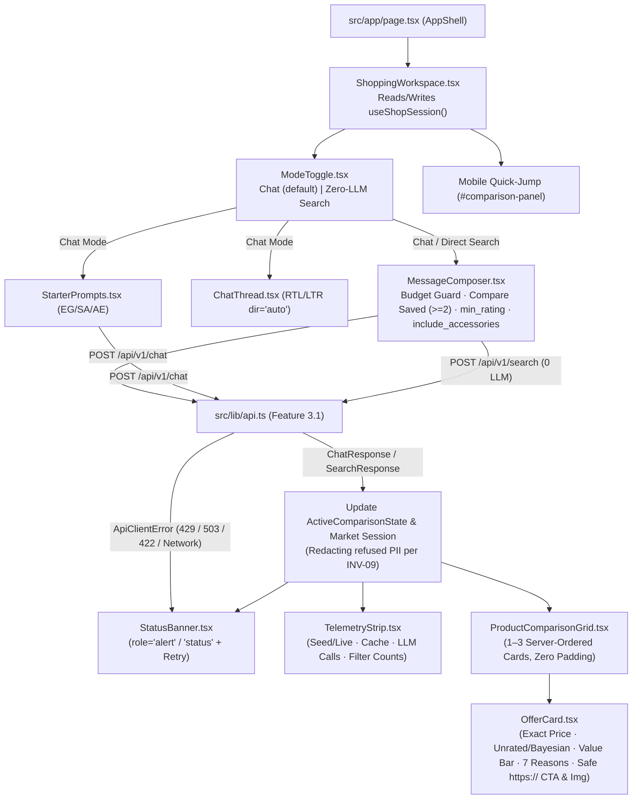

# Plan: Feature 3.2 — Interactive Shopping Chat & Top-3 Comparison Experience

- **Roadmap ID**: Feature 3.2
- **Folder**: `spec/features/feature-302-chat-and-top3-comparison-experience/`
- **Phase branch**: `phase/3-rtl-web-experience`
- **Size**: Medium (4 cohesive execution groups spanning strictly grounded Top-3 card/telemetry/banner primitives, dual-mode chat and zero-LLM direct-search controls, unified workspace orchestration + `page.tsx` mounting, and offline Vitest + Testing Library unit/integration suites)
- **Status**: Committed

---

## 1. Objective & Why

Feature 3.2 delivers the interactive shopper-facing experience for Phase 3 inside the Arabic-first (`RTL`) `Next.js 15` shell established by Feature 3.1, fulfilling [spec/mission.md](../../mission.md) (§1 Arabic/English shopping advisor & Top-3 comparison, §5 MVP UI scope, §7 trusted advisor tone & honest degradation) and [spec/roadmap.md](../../roadmap.md) (`Phase 3` → `Feature 3.2`).

Specifically, this feature delivers:
1. **Unified Dual-Mode Shopping Workspace (`P5`)**: Enables shoppers to seamlessly use **Conversational Assistant (`POST /api/v1/chat`, default)** or switch via `ModeToggle` to **Zero-LLM Direct Search (`POST /api/v1/search`, `0` LLM calls)** with optional `min_rating` (`0..5`) and `include_accessories` controls while binding `country`, `store`, `language`, and validated `maxBudget` from `useShopSession()`.
2. **Bilingual Conversational UX (`ChatThread`, `MessageComposer`, `StarterPrompts`)**: Provides RTL/LTR mixed-script chat bubbles with turn action/status metadata, loading indicators, per-market (`EG`/`SA`/`AE`) localized starter queries aligned with seeded and live catalogs, inline budget validation, duplicate-submit protection, and a **"قارن أفضل العروض / Compare Saved Offers"** quick-action button whenever an active Chat session (`sessionId !== null`) has `>= 2` verified offers saved in the active market session.
3. **Strictly Grounded Top-3 Comparison Grid (`ProductComparisonGrid`, `OfferCard`, `TelemetryStrip`, `INV-03`, `INV-05`, `INV-09`)**: Renders server-returned `RankedOffer` items verbatim in exact rank order (`#1`–`#3`) with zero client-side sorting, price calculation, or synthetic padding—displaying exact decimal prices (`formatExactPrice`), raw & Bayesian ratings (or explicit Unrated badges), visual `value_score` bars, all 7 localized `match_reasons` badges, strict `https://` image fallbacks, safe `rel="noopener noreferrer"` store links, and live cost/cache/filter telemetry.
4. **Accessible Honest Degradation (`StatusBanner`, `INV-08`, `INV-09`)**: Surfaces distinct bilingual `role="status"` / `role="alert"` banners for `clarify`, `off_topic`, `refused` (without echoing or persisting sensitive/PII input), `degraded`, partial `< 3` matches (`degraded_fewer_than_k === true`), `0` qualifying offers, HTTP `429` (`Retry-After` guidance), and HTTP `503`/network failure with one-click Retry recovery.

---

## 2. Scope

### In scope
- **Workspace Components (`frontend/src/components/workspace/`)**:
  - `ShoppingWorkspace.tsx` — Unified dual-mode client orchestrator reading/updating `useShopSession()`, enforcing market isolation, in-flight request guards/cancellation, retry recovery, responsive `lg:grid-cols-12` desktop + `375px` mobile layout with quick-jump anchor, and `INV-09` PII refusal hygiene.
  - `ModeToggle.tsx` — Accessible bilingual segmented switcher toggling between Conversational Assistant (`POST /api/v1/chat`, default) and Zero-LLM Direct Search (`POST /api/v1/search`, `0` LLM calls).
  - `ChatThread.tsx` — Bilingual RTL/LTR (`dir="auto"`) message timeline displaying per-turn `action`/`status` metadata, loading skeleton/indicator, empty-state guidance, and jsdom-safe auto-scroll.
  - `MessageComposer.tsx` — Bilingual composer supporting Enter / Send button submission, inline `maxBudget` validation (`> 0` and `<= 10,000,000.00`) blocking invalid submissions, duplicate-submit disabled guard while in flight, Direct Search controls (`query`, `min_rating` `0..5`, `include_accessories`), and **"قارن أفضل العروض / Compare Saved Offers"** quick action in Chat mode when `sessionId !== null && rankedOffers.length >= 2`.
  - `StarterPrompts.tsx` — Localized per-market (`EG`/`SA`/`AE`) clickable example queries (e.g., Anker earbuds, air fryer, iPhone 15) sourced from `src/lib/i18n.ts`.
  - `ProductComparisonGrid.tsx` — Strictly grounded grid rendering `1–3` `RankedOffer` cards in server-returned rank order (`rank: 1..3`) with zero client-side sorting or placeholder card padding (`INV-03`, `INV-05`).
  - `OfferCard.tsx` — Rich comparison card showing rank badge (`#1`–`#3`), localized store badge (`نون / Noon`, `أمازون / Amazon`), `offer.title`, exact `offer.price` + `offer.currency` via `formatExactPrice`, raw `rating` + `review_count` (or `"غير مُقيّم / Unrated"` badge), `bayesian_rating`, visual `value_score` bar, localized `match_reasons` pills covering all 7 domain codes, safe `https://`-only `` (`loading="lazy"`, `referrerPolicy="no-referrer"`, inline SVG fallback on `null`/unsafe/`onError`), and safe `https://` `<a target="_blank" rel="noopener noreferrer">` store CTA (`INV-09`).
  - `TelemetryStrip.tsx` — Grounded provenance/cost bar showing `CatalogSourceMode` (`بيانات تجريبية / Seed Demo` vs `بحث مباشر / Live Search`, or saved-offer comparison indicator when `null`), `Cache Hit` vs `Miss`, `LLM Calls` (`0` for `/search`, `0–2` for `/chat`), `latency_ms`, `request_id`, and `RankingResult` counts (`total_candidates`, `filtered_accessories_count`, `filtered_outliers_count`).
  - `StatusBanner.tsx` — Accessible bilingual status/error banner (`role="status"` / `role="alert"`) covering `clarify`, `off_topic`, `refused`, `degraded`, `degraded_fewer_than_k === true`, `0` offers, HTTP `429` (`Retry-After` seconds), and HTTP `503`/network failure with Retry button.
- **Root Route Mounting (`frontend/src/app/page.tsx`)**:
  - Update ONLY `frontend/src/app/page.tsx` to render `<ShoppingWorkspace />` inside `<AppShell>` (replacing Feature 3.1's placeholder slot).
- **Offline Deterministic Tests (`P7`, `P8`, `INV-07`)**:
  - `frontend/tests/unit/offer-card-and-banners.test.tsx`
  - `frontend/tests/integration/shopping-workspace.test.tsx`

### Out of scope (explicit exclusions)
- **Disjoint File Partition (`P7`)**: Feature 3.2 MUST NOT create or modify `frontend/package.json`, `frontend/package-lock.json`, `frontend/.gitignore`, `frontend/.env.example`, `frontend/next.config.ts`, `frontend/tsconfig.json`, `frontend/postcss.config.mjs`, `frontend/eslint.config.mjs`, `frontend/vitest.config.ts`, `frontend/tests/setup.ts`, `frontend/src/lib/*`, `frontend/src/context/*`, `frontend/src/components/shell/*`, `frontend/src/app/layout.tsx`, `frontend/src/app/globals.css`, `frontend/src/app/api/*`, `frontend/tests/unit/{api,storage-and-format}.test.ts`, `frontend/tests/integration/{proxy-routes,app-shell,phase3-e2e}.test.*`, or `backend/**`.
- **Sensitive Areas (`spec/sdd-profile.md`)**: MUST NOT touch `infra/aws/**`, `.github/workflows/**`, `backend/src/commerce_ai/config/security*`, or `backend/migrations/**`.
- **Offline Build & Test Discipline (`INV-07`)**: NEVER import `next/font/google`, and NEVER perform live HTTP requests to FastAPI, Serper, or LLM APIs in unit/integration Vitest runs.
- **No Payments, Auth, or Client Ranking (`INV-03`, `INV-05`, `INV-09`)**: Never compute `value_score` or `bayesian_rating` client-side, never sort or pad offers client-side, and never build payment/login forms.

---

## 3. Decisions

| # | Decision | Source | Rationale |
| :--- | :--- | :--- | :--- |
| **D1 (`P5`)** | **Unified Dual-Mode Workspace Feeding One `ActiveComparisonState`**: `ModeToggle` switches between **Conversational Assistant (`"chat"`, default -> `POST /api/v1/chat`)** and **Zero-LLM Direct Search (`"search"` -> `POST /api/v1/search`)** without discarding the active market's `sessionId`, `messages`, or `activeComparison`. Chat `action === "search"` and Direct Search map into `ActiveComparisonState` (`mode`, `queryLabel`, `rankedOffers`, `rankingResult`, `sourceMode`, `cacheHit`, `llmCalls`, `latencyMs`, `requestId`, `degradedReason`, `status`, `updatedAtIso`); Chat `action === "compare"` keeps `rankedOffers` and handles `rankingResult === null` & `sourceMode === null` gracefully (preserving prior filter counts when applicable); `clarify`, `off_topic`, and `refused` preserve prior verified `activeComparison` offers rather than wiping valid results. | `P5` + `backend/src/commerce_ai/agent/graph.py` | Delivers both guided Arabic/English AI conversation and instant `0`-LLM structured filtering inside one cohesive comparison view without losing session context when switching modes. |
| **D2 (`P5`, `INV-08`)** | **Pre-Submit Inline Budget/Query Validation, Duplicate-Submit Guard & Race Cancellation**: Before dispatching `/api/v1/chat` or `/api/v1/search`, `MessageComposer` checks `budgetError` / `parsedMaxBudget` from `useShopSession()` (`validateBudgetInput` in `src/lib/format.ts`: finite positive decimal `> 0` and `<= 10,000,000.00`, matching `MAX_BUDGET_DECIMAL`) and blocks invalid requests inline with an accessible `role="alert"` message (`0` HTTP calls). Direct Search additionally validates `query` (`1..500` trimmed non-blank chars without control/bidi/Tag characters matching `SearchRequest`). While a request is in flight (`isSubmitting === true`), submission controls are disabled/guarded against duplicate triggers, and an `AbortController` + active `(country, sessionResetEpoch)` guard cancels/ignores stale responses if the user switches `country` (`EG`/`SA`/`AE`) or triggers "New Chat" mid-flight. | `P5` + `backend/src/commerce_ai/api/schemas.py` | Prevents avoidable `422` errors, eliminates double-submit race conditions on Enter/clicks, and guarantees offers from Egypt never bleed into Saudi/UAE views during async transitions. |
| **D3 (`P5`, `INV-09`)** | **Guardrail Refusal Privacy & Non-Persistence Hygiene**: When `POST /api/v1/chat` returns `ChatResponse(status="refused", action="refuse")`, `ShoppingWorkspace` and `StatusBanner` display the safe backend `reply` and refusal banner without echoing back the raw user message, and replace any rejected input before storing the turn in `localStorage` (`commerce_ai.market_sessions.v1`) with a localized redacted placeholder. | `P5` + `INV-09` + `backend/src/commerce_ai/agent/graph.py` | Mirrors the backend's `INV-09` refusal behavior (`save_session` skipped on `REFUSED`) so accidentally pasted card numbers or passwords are never stored in browser `localStorage` or echoed in banners. |
| **D4 (`P5`)** | **RTL-First 2-Column Desktop & Overflow-Free `375px` Mobile Layout**: Desktop (`lg:grid-cols-12`) renders the conversation/direct-search column (`lg:col-span-5`) paired with a sticky Top-3 comparison & telemetry column (`lg:col-span-7 lg:sticky lg:top-4`). Narrow viewports (`375px`) stack vertically with `min-w-0` and word-wrapping (`break-words`) to prevent horizontal overflow, plus a localized quick-jump link/button to `#comparison-panel` shown when offers/results are present. | `P5` + `spec/mission.md` §7 | Keeps Top-3 cards immediately visible alongside chat refinements on desktop while giving mobile shoppers effortless one-tap navigation to comparison cards with zero horizontal scrolling. |
| **D5 (`P6`, `INV-03`, `INV-05`, `INV-09`)** | **Strict Server-Order Grounding & Defensive URL/Image Validation**: `ProductComparisonGrid` renders `RankedOffer` items strictly in server-returned order (`rank: 1..3`) with zero client-side re-sorting, price math, or placeholder card generation. `OfferCard` uses `formatExactPrice`, `formatRatingValue`, `formatBayesianScore`, and `formatValueScore` (`src/lib/format.ts`) for loss-free `offer.price` + `offer.currency` and scores, displays `"غير مُقيّم / Unrated"` when `rating === null || review_count === 0`, renders all 7 `MATCH_REASON_LABELS` (`src/lib/i18n.ts`), and validates both `image_url` and outbound `offer.url` through `sanitizeHttpsUrl` (`src/lib/format.ts`: `loading="lazy"`, `referrerPolicy="no-referrer"`, inline SVG fallback for `null`/unsafe/`onError` images, and safe disabled CTA when `offer.url` fails validation; valid CTAs use `target="_blank" rel="noopener noreferrer"`). | `P6` + `INV-03`, `INV-05`, `INV-09` | Guarantees zero hallucinated prices/ratings/cards and prevents `javascript:`/`http:` URL or broken-image XSS/UX regressions even if upstream payloads vary. |
| **D6 (`P6`, `INV-08`)** | **Semantic Accessible Status Banners & Unified Telemetry Strip**: `StatusBanner` assigns `role="alert"` to actionable errors/refusals (`429` with `Retry-After` seconds, `503`/network failure with Retry button, `degraded`, `refused`) and `role="status"` to informational/partial states (`clarify`, `off_topic`, `degraded_fewer_than_k === true`, `0` qualifying offers). `TelemetryStrip` renders `CatalogSourceMode` (`بيانات تجريبية / Seed Demo` vs `بحث مباشر / Live Search` or saved-offer indicator), `Cache Hit`/`Miss`, `LLM Calls`, `latency_ms`, `request_id`, and `RankingResult` filter counts (`total_candidates`, `filtered_accessories_count`, `filtered_outliers_count`). | `P6` + `INV-08` | Gives shoppers transparent feedback on why results are partial/unavailable and gives technical stakeholders clear cost, cache, and anti-accessory filtering visibility. |
| **D7 (`P7`, `P8`, `INV-07`)** | **Disjoint File Ownership & Mocked Vitest/RTL Test Harness**: Restrict edits strictly to `src/components/workspace/*`, `src/app/page.tsx`, `tests/unit/offer-card-and-banners.test.tsx`, and `tests/integration/shopping-workspace.test.tsx`. Mock `src/lib/api.ts` / `global.fetch` in Vitest (`jsdom` + `@testing-library/react` + `@testing-library/user-event`) so all unit and integration suites run 100% offline. | `P7`, `P8`, `INV-07` | Guarantees zero merge conflicts with Feature 3.1 (`src/lib/*`, `src/context/*`, `src/components/shell/*`, `src/app/api/*`) and keeps frontend CI fast and deterministic without a live backend. |

---

## 4. Relevant Existing Architecture

Feature 3.2 builds strictly on top of **Feature 3.1** (must be implemented and committed locally on `phase/3-rtl-web-experience` first) and **Phase 2 backend REST endpoints**, consuming read-only modules without modifying them:

### Upstream Contracts Consumed (Read-Only in Feature 3.2)
- **Typed DTO Contracts (`frontend/src/lib/contracts.ts` mirroring `backend/src/commerce_ai/api/schemas.py` & `domain/models.py`)**:
  - Enums/unions: `CountryCode` (`"EG" | "SA" | "AE"`), `CurrencyCode` (`"EGP" | "SAR" | "AED"`), `StoreId` (`"noon" | "amazon"`), `StoreFilter` (`"noon" | "amazon" | "both"`), `CatalogSourceMode` (`"seed" | "live"`), `TurnAction` (`"search" | "compare" | "clarify" | "off_topic" | "refuse"`), `TurnStatus` (`"ok" | "clarify" | "off_topic" | "refused" | "degraded"`), `UiLanguage` (`"ar" | "en"`), `DecimalString` (`string` for `ProductOffer.price` and `SearchIntent.max_budget`).
  - DTOs: `ProductOffer`, `SearchIntent`, `RankedOffer` (`rank: 1..3`, `offer`, `value_score`, `price_norm`, `bayesian_rating`, `match_reasons` covering all 7 `MatchReasonCode` values from `domain/ranking.py`: `best_overall_value`, `lowest_price`, `top_bayesian_rating`, `high_review_confidence`, `within_budget`, `unrated_fallback`, `strong_value_runner_up`), `RankingResult` (`ranked_offers`, `total_candidates`, `filtered_accessories_count`, `filtered_outliers_count`, `degraded_fewer_than_k`), `TurnTelemetry` (`llm_calls`, `catalog_called`, `catalog_cache_hit`, `catalog_source_mode`, `used_rule_intent_fallback`, `used_template_summary`, `degraded_reason`, `latency_ms`), `ChatRequest`, `ChatResponse`, `SearchRequest`, `SearchResponse`, `ErrorResponse`, plus pre-defined workspace types `WorkspaceMode` (`"chat" | "search"`), `ChatMessageItem`, `ActiveComparisonState` (`mode`, `queryLabel`, `rankedOffers`, `rankingResult`, `sourceMode`, `cacheHit`, `llmCalls`, `latencyMs`, `requestId`, `degradedReason`, `status`, `updatedAtIso`), and `MarketWorkspaceSession`.
- **Typed API Client (`frontend/src/lib/api.ts`)**:
  - `ApiClientError` (`status`, `errorCode`, `retriable`, `requestId`, `retryAfterSeconds`, `details`), `sendChatTurn`, `searchOffers`.
- **Formatting, URL Safety & Bilingual Copy (`frontend/src/lib/format.ts`, `frontend/src/lib/i18n.ts`)**:
  - `formatExactPrice`, `validateBudgetInput`, `formatRatingValue`, `formatBayesianScore`, `formatValueScore`, `formatLatencyMs`, `sanitizeHttpsUrl` (`INV-05`, `INV-09`), and complete Phase 3 bilingual `ar`/`en` UI dictionary (`getDictionary`, `STARTER_PROMPTS`, `MATCH_REASON_LABELS`, `TurnStatus`, errors, telemetry labels).
- **Session Context & Shell (`frontend/src/context/ShopSessionContext.tsx`, `frontend/src/components/shell/AppShell.tsx`)**:
  - `useShopSession()` exposing `language`, `country`, `store`, `maxBudget`, `parsedMaxBudget`, `budgetError`, `markets`, `activeMarket`, `health`, `healthStatus`, `activeMarketSession` (`{ sessionId, messages, activeComparison }`), `appendMarketTurn`, `setActiveComparison`, `resetActiveMarketSession`, and `t` backed by `localStorage` (`commerce_ai.prefs.v1`, `commerce_ai.market_sessions.v1`).

### Invariants Enforced
- `INV-03` (Deterministic Math): Zero client-side scoring, Bayesian weighting, or re-sorting; display server-provided values verbatim.
- `INV-04` (Bounded Execution): Direct Search executes `POST /api/v1/search` (`0` LLM calls) and displays `llm_calls` clearly in `TelemetryStrip`.
- `INV-05` (Zero Hallucinated Offers): Never invent placeholder cards, alter `offer.price`/`rating`/`review_count`/`title`/`url`, or pad `< 3` results.
- `INV-07` (Offline Determinism): Zero `next/font/google`; Vitest suites mock `api.ts` / `fetch` with zero live HTTP calls.
- `INV-08` (Graceful Degradation): Honest banners + retry recovery for `degraded`, `< 3` partial offers, `0` matches, `429`, and `503`/network failure.
- `INV-09` (Security & Zero PII Scope): Safe `https://` validation + `rel="noopener noreferrer"` on store CTAs; non-echoing, non-persisting refusal handling for blocked PII/payment messages.

---

## 5. Proposed Approach

### Component Boundaries & State Flow
1. **`ShoppingWorkspace.tsx` & `src/app/page.tsx`**:
   - Replaces Feature 3.1's placeholder slot in `src/app/page.tsx` with `<ShoppingWorkspace />` inside `<AppShell>`.
   - Coordinates `mode` (`"chat"` default | `"search"`), `isSubmitting`, `activeError` (wrapping `ApiClientError` or network failure + `retryAction`), and an `AbortController` / request sequence token keyed to `(country, sessionResetNonce)` plus unmount cleanup so market switches, "New Chat", or unmount cleanly cancel/ignore stale in-flight responses.
   - Maps `ChatResponse` (`ok`, `clarify`, `off_topic`, `refused`, `degraded`) and `SearchResponse` cleanly into `appendMarketTurn` and `setActiveComparison` while redacting rejected inputs on `status === "refused"` (`INV-09`).
2. **`ModeToggle.tsx`, `StarterPrompts.tsx`, `ChatThread.tsx`, `MessageComposer.tsx`**:
   - Presentational & interaction components consuming localized copy from `t` / `getDictionary` and `STARTER_PROMPTS` (`src/lib/i18n.ts`) and delegating submission callbacks to `ShoppingWorkspace`.
   - `MessageComposer` checks `budgetError` / `validateBudgetInput(maxBudget)` inline before enabling submit; renders **"قارن أفضل العروض / Compare Saved Offers"** in Chat mode only when `activeMarketSession.sessionId !== null && (activeComparison?.rankedOffers.length ?? 0) >= 2`; renders `min_rating` (`0..5`) and `include_accessories` controls in Direct Search mode.
3. **`ProductComparisonGrid.tsx`, `OfferCard.tsx`, `TelemetryStrip.tsx`, `StatusBanner.tsx`**:
   - Pure grounded presentation primitives driven solely by server DTOs (`RankedOffer`, `RankingResult`, `TurnTelemetry`, `TurnStatus`, `ApiClientError`) and `src/lib/format.ts` / `src/lib/i18n.ts`.
   - Zero client-side ranking math (`INV-03`), zero synthetic placeholder offers (`INV-05`), strict `https://` sanitization (`INV-09`), and complete `ar`/`en` accessibility semantics (`role="progressbar"`, `role="status"`, `role="alert"`).

---

## 6. Expected Files / Areas Affected

| Path | Change (Create / Modify / Delete) | Purpose |
| :--- | :--- | :--- |
| `frontend/src/components/workspace/ShoppingWorkspace.tsx` | Create | Unified dual-mode workspace container, session binding, race/retry orchestration, responsive layout |
| `frontend/src/components/workspace/ModeToggle.tsx` | Create | Accessible Chat (`/api/v1/chat`) vs Zero-LLM Direct Search (`/api/v1/search`) mode toggle |
| `frontend/src/components/workspace/ChatThread.tsx` | Create | Bilingual RTL/LTR message history with action/status metadata, loading skeleton, and auto-scroll |
| `frontend/src/components/workspace/MessageComposer.tsx` | Create | Bilingual input/search controls, inline budget guard, duplicate-submit guard, and Compare Saved Offers CTA |
| `frontend/src/components/workspace/StarterPrompts.tsx` | Create | Localized per-market (`EG`/`SA`/`AE`) clickable example queries |
| `frontend/src/components/workspace/ProductComparisonGrid.tsx` | Create | Server-ordered Top-3 `RankedOffer` grid (1–3 cards, zero client math or fake padding) |
| `frontend/src/components/workspace/OfferCard.tsx` | Create | Grounded offer card (rank/store badges, exact price, rating/unrated, Bayesian score, value bar, 7 reasons, safe image/CTA) |
| `frontend/src/components/workspace/TelemetryStrip.tsx` | Create | Seed/Live badge, Cache Hit/Miss, LLM calls, latency, `request_id`, and `RankingResult` filter counts |
| `frontend/src/components/workspace/StatusBanner.tsx` | Create | Bilingual `role="status"`/`role="alert"` banners (`clarify`, `off_topic`, `refused`, `degraded`, `<3`, `0`, `429`, `503` + Retry) |
| `frontend/src/app/page.tsx` | Modify | Mount `<ShoppingWorkspace />` inside `<AppShell>` replacing Feature 3.1 placeholder |
| `frontend/tests/unit/offer-card-and-banners.test.tsx` | Create | Offline Vitest unit tests for `OfferCard`, `ProductComparisonGrid`, `TelemetryStrip`, and `StatusBanner` |
| `frontend/tests/integration/shopping-workspace.test.tsx` | Create | Offline Vitest + RTL integration tests for full dual-mode workspace, market isolation, and degradation flows |

> **Partition Guard (`P7`)**: Feature 3.2 MUST NOT create or modify `frontend/package.json`, `frontend/package-lock.json`, `frontend/next.config.ts`, `frontend/tsconfig.json`, `frontend/eslint.config.mjs`, `frontend/vitest.config.ts`, `frontend/tests/setup.ts`, `frontend/src/lib/*`, `frontend/src/context/*`, `frontend/src/components/shell/*`, `frontend/src/app/layout.tsx`, `frontend/src/app/globals.css`, `frontend/src/app/api/*`, `frontend/tests/unit/{api,storage-and-format}.test.ts`, `frontend/tests/integration/{proxy-routes,app-shell,phase3-e2e}.test.*`, `backend/**`, or any Sensitive Area (`infra/aws/**`, `.github/workflows/**`, `config/security*`, `migrations/**`).

---

## 7. Execution Groups

- **Group 1 — Grounded Comparison Cards, Grid, Telemetry & Status Banners (`OfferCard.tsx`, `ProductComparisonGrid.tsx`, `TelemetryStrip.tsx`, `StatusBanner.tsx`, `tests/unit/offer-card-and-banners.test.tsx`)**:
  Implement the strictly grounded display primitives (`OfferCard` exact price, unrated/Bayesian badges, `value_score` bar, all 7 `match_reasons`, `https://` image fallback + `rel="noopener noreferrer"` CTA guard; server-order `ProductComparisonGrid`; `TelemetryStrip`; and all 8 `StatusBanner` states) and verify every unit & edge behavior in `tests/unit/offer-card-and-banners.test.tsx`.
- **Group 2 — Mode Switcher, Starter Prompts, Thread & Composer (`ModeToggle.tsx`, `StarterPrompts.tsx`, `ChatThread.tsx`, `MessageComposer.tsx`)**:
  Implement `ModeToggle` (`chat` vs `search`), per-market localized `StarterPrompts`, RTL/LTR `ChatThread` with action/status metadata and loading skeleton, and `MessageComposer` with Enter/Send submit, inline `maxBudget` validation (`> 0` and `<= 10,000,000.00`), Direct Search `min_rating` (`0..5`) + `include_accessories` controls, in-flight duplicate-submit guard, and **"قارن أفضل العروض / Compare Saved Offers"** (`sessionId !== null && >= 2` offers).
- **Group 3 — Unified Workspace Orchestrator & Route Wiring (`ShoppingWorkspace.tsx`, `src/app/page.tsx`)**:
  Implement `ShoppingWorkspace.tsx` integrating `useShopSession()`, `/api/v1/chat` & `/api/v1/search` execution, `ActiveComparisonState` synchronization, `INV-09` PII refusal masking, market-switch/New-Chat abort guards, Retry recovery, and responsive `lg:grid-cols-12` + `375px` quick-jump layout, then wire `<ShoppingWorkspace />` into `src/app/page.tsx`.
- **Group 4 — Workspace Integration Tests & Quality Gates (`tests/integration/shopping-workspace.test.tsx`)**:
  Write offline Vitest + Testing Library integration tests covering full Arabic/English Chat, Direct Search (`0` LLM), Compare quick action, market isolation, budget/query inline validation, non-OK chat statuses (`clarify`/`off_topic`/`refused`/`degraded`), partial `< 3` & `0`-offer states, and `429`/`503` + Retry, then run `npm --prefix frontend test`, `npm --prefix frontend run lint`, `npm --prefix frontend run typecheck`, `npm --prefix frontend run build`, `uv run --no-sync --directory backend pytest -v`, and Tier 7 smoke verification.

---

## 8. Risks & Trade-offs

| Risk / Trade-off | Impact | Mitigation |
| :--- | :--- | :--- |
| **Stale async `/chat` or `/search` response landing after user switches `country` (`EG`->`SA`) or clicks New Chat** | Offers or turns from the previous market could overwrite the newly selected market's workspace | Attach an `AbortController` and `(country, resetEpoch)` guard per request in `ShoppingWorkspace.tsx`, cancelling and ignoring responses whose origin no longer matches active state. |
| **Chat `action === "compare"` returns `ranking_result: null` and `catalog_source_mode: null`** | `TelemetryStrip` could crash or hide prior filter metadata after clicking Compare Saved Offers | Handle `rankingResult === null` and `sourceMode === null` explicitly in `TelemetryStrip.tsx` and preserve previously recorded filter counts when merging `compare` turns into `ActiveComparisonState`. |
| **Refused PII/payment inputs persisted in browser `localStorage`** | Raw card numbers or credentials submitted by mistake could remain in `commerce_ai.market_sessions.v1` (`INV-09`) | When `ChatResponse.status === "refused"`, never echo raw text in `StatusBanner` and store a localized redacted placeholder instead of the raw user text in `appendMarketTurn`. |
| **Broken/non-HTTPS `image_url` or malformed `offer.url` from live SERP data** | Broken image icons or unsafe `javascript:`/`http:` outbound links (`INV-09`) | Validate both URLs through `src/lib/format.ts` strict `https://` checks, render inline SVG fallback on invalid/`onError` images, and safely disable CTA if `offer.url` fails validation. |
| **Long mixed Arabic/English titles or URLs overflowing `375px` mobile screens** | Horizontal scrolling and clipped comparison cards on mobile | Apply `min-w-0`, `break-words`, responsive Tailwind grid spans (`lg:grid-cols-12`), and RTL-safe `dir="auto"` isolation across thread bubbles and cards. |

---

## 9. Open Questions

None — all Feature 3.2 design decisions (`P1`–`P8`, `D1`–`D7`) and Feature 3.1 interface boundaries are resolved and locked for Phase Gate 1.
