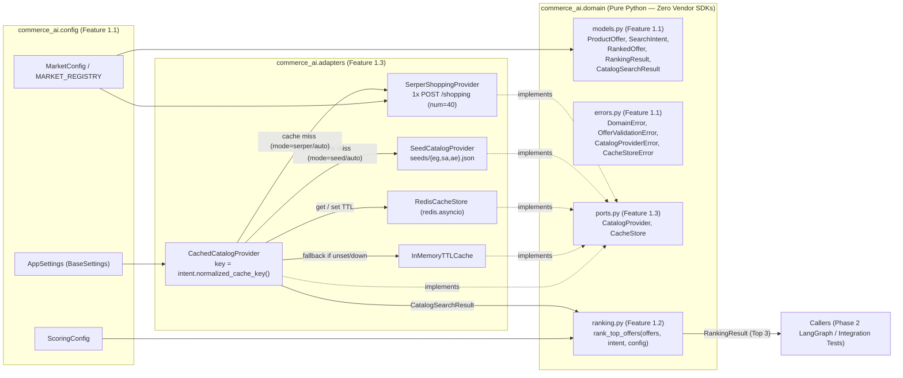

# Phase Overview: Phase 1 — Core Foundation, Deterministic Ranking & Pluggable Catalog Layer

- **Phase branch**: `phase/1-core-foundation`
- **Roadmap section**: `spec/roadmap.md` → Phase 1
- **Execution mode**: Phase mode (no sensitive areas from `spec/sdd-profile.md` are touched in Phase 1)
- **Status**: Validated

---

## 1. Phase Goal & Why

Phase 1 establishes the core backend foundation required by `spec/mission.md` (§1, §4, §6) and `spec/architecture.md` before introducing LLM orchestration or HTTP endpoints in Phase 2. Specifically, this phase delivers:

1. **Hexagonal Backend Scaffold & Typed Marketplace Domain (`Feature 1.1`)**: A clean `uv`-managed Python `3.11+` backend layout (`commerce_ai.config` and `commerce_ai.domain`) enforcing strict `EG`/`SA`/`AE` market-currency pairing, `Decimal` price validation, verified regional Noon/Amazon URL validation, and typed domain/provider errors (`INV-01`, `INV-02`, `INV-05`, `INV-09`).
2. **Deterministic Top-3 Value Scoring Engine (`Feature 1.2`)**: Pure, zero-token Python ranking (`rank_top_offers`) combining normalized price and Bayesian confidence-adjusted ratings with a two-stage bilingual anti-accessory and statistical price-outlier guard (`INV-03`, `INV-05`, `INV-08`).
3. **Pluggable Catalog & Caching Layer (`Feature 1.3`)**: Abstract `CatalogProvider` and `CacheStore` ports paired with `InMemoryTTLCache`, async `RedisCacheStore` (with automatic fallback), rich bilingual offline `SeedCatalogProvider` (`EG`/`SA`/`AE`), and single-call `SerperShoppingProvider` (`~$0.001` per cache miss, within the `<= $0.002` unit-cost ceiling) (`INV-01`, `INV-02`, `INV-05`, `INV-06`, `INV-07`, `INV-08`).

Once Phase 1 is complete, the engine can deterministically search, cache, filter traps from, and rank Top-3 verified offers across Egypt, Saudi Arabia, and the UAE 100% offline in tests/demos and via Serper.dev in live mode, providing rock-solid contracts for Phase 2 (`LangGraph` + `FastAPI`).

---

## 2. Features in This Phase

| Order | Roadmap ID | Folder | Size | Status | Depends on |
|:---|:---|:---|:---|:---|:---|
| 1 | Feature 1.1 | `spec/features/feature-101-backend-scaffold-domain-models/` | M | ✅ Done | — |
| 2 | Feature 1.2 | `spec/features/feature-102-deterministic-value-ranking/` | M | ✅ Done | Feature 1.1 |
| 3 | Feature 1.3 | `spec/features/feature-103-pluggable-catalog-and-cache/` | M | ✅ Done | Feature 1.1 |

**Merge/split decisions made during the interview**: None — the three Phase 1 roadmap items map cleanly to bounded, non-overlapping modules and remain three Medium (`M`) features executed in **Phase mode** (none touch `infra/aws/**`, `.github/workflows/**`, `config/security*`, or `migrations/**`).

**Execution sequence after Phase Gate 1**:
1. Implement, validate, and commit **Feature 1.1** first on `phase/1-core-foundation`, establishing `backend/pyproject.toml`, package `__init__.py` scaffolds, `commerce_ai.config`, `commerce_ai.domain.models`, and `commerce_ai.domain.errors`.
2. Once Feature 1.1 is green and committed locally, implement **Feature 1.2** and **Feature 1.3** **in parallel across isolated workspaces** (`P7` disjoint file partition ensures zero shared file edits and zero merge conflicts).

---

## 3. Shared Decisions (apply to all features)

| # | Decision | Source | Rationale |
|:---|:---|:---|:---|
| **P1** | **Cache Layer (Feature 1.3)**: Implement both `InMemoryTTLCache` (default local/offline cache) and async `RedisCacheStore` (`redis.asyncio`), verified 100% offline via `fakeredis` (no local Docker/Redis required), with automatic fallback to `InMemoryTTLCache` when `REDIS_URL` is unset or unreachable. | Human Interview Q1 + `INV-07` / `INV-08` | Guarantees zero-setup local dev and CI determinism while remaining production-ready for Redis 7 (`< 300 ms` repeat latency) without crashing when Redis is unavailable. |
| **P2** | **Regional Store URL & Decimal Price Validation (Feature 1.1)**: `ProductOffer.price` uses Python `Decimal` (`> 0`, quantized to `0.01`) and enforces strict market-currency pairing (`EG` → `EGP`, `SA` → `SAR`, `AE` → `AED`). `ProductOffer.url` must use `https://` and match either the official regional store host/path (`EG`: `amazon.eg` or `noon.com/egypt*`; `SA`: `amazon.sa` or `noon.com/saudi*`; `AE`: `amazon.ae` or `noon.com/uae*`) OR a verified Google Shopping HTTPS product link (`google.com/shopping/...` or regional `google.com.eg`, `google.com.sa`, `google.ae`) when merchant attribution explicitly identifies that regional Noon/Amazon store. Cross-country store domains (e.g., `amazon.com` when `country="EG"`) and unknown third-party sellers are strictly rejected (`OfferValidationError` / Pydantic `ValidationError`). | Human Interview Q2 + `INV-05` | Eliminates binary floating-point rounding drift in currency math, blocks cross-border/wrong-currency offers at the domain boundary, and supports legitimate Google Shopping redirects returned by Serper while excluding unverified third-party sellers. |
| **P3** | **Unrated / Zero-Review Handling & Single-Item Normalization (Feature 1.2)**: Offers with `rating=None` or `review_count=0` remain eligible when `SearchIntent.min_rating` is `None`, receiving a configurable conservative unrated prior (`ScoringConfig.unrated_prior_rating = 3.4` by default, below `bayesian_prior_mean = 4.0`, assigned directly as `bayesian_rating = config.unrated_prior_rating`). When `SearchIntent.min_rating` is set, unrated/zero-review offers (`rating is None or review_count == 0`) are excluded. When exactly 1 candidate remains (`P_max == P_min`), `P_norm = 1.0`. | Human Interview Q3 + `INV-03` | Prevents returning empty results when legitimate new listings lack reviews, ensures well-reviewed items reliably outrank unrated ones (`3.4 < 4.0`), and avoids division-by-zero when normalizing a single candidate. |
| **P4** | **Two-Stage Anti-Accessory & Price-Outlier Guard (Feature 1.2)**: **Stage 1 (Intent-Aware Bilingual Keyword Filter)** runs FIRST: rejects offers whose title matches bilingual accessory keywords (`case`, `cover`, `protector`, `cable`, `cord`, `charger`, `adapter`, `strap`, `holder`, `mount`, `skin`, `sleeve`, `جراب`, `كفر`, `حافظة`, `شاحن`, `اسكرينة`, `حماية شاشة`, `وصلة`, `كابل`, `سلك`, `حامل`, `سوار`) UNLESS that accessory term appears in `SearchIntent.query` or `SearchIntent.include_accessories` is `True`. **Stage 2 (Statistical Median Price Guard)** runs SECOND on the remaining candidates (active when `len(candidates) >= config.min_candidates_for_outlier_guard`, default `3`): rejects suspiciously cheap outliers (`price < config.price_floor_ratio * median`, default `0.15`) AND extreme upper price anomalies (`price > config.price_ceiling_ratio * median`, default `3.0`, unless explicitly accommodated by `SearchIntent.max_budget`). | Human Interview Q4 + `INV-03` | Filtering obvious accessories before computing the median prevents cheap cases/cables from skewing the median downward; rejecting both ultra-cheap remnants and 3x+ scalper/bundle listings prevents extreme prices from compressing `P_norm` for normal products while honoring explicit accessory searches (e.g., `"جراب آيفون 15"` / `"iPhone 15 case"`). |
| **P5** | **Single-Call `SerperShoppingProvider` Cost Cap (Feature 1.3)**: `SerperShoppingProvider` sends strictly **1** async `POST https://google.serper.dev/shopping` request per cache miss (`num=40`, `gl` mapped to `eg`/`sa`/`ae`, `hl` mapped to `ar`/`en`, adding store hint when `store` is `"noon"` or `"amazon"`, bounded by `AppSettings.serper_timeout_seconds = 2.0`), then deterministically parses and filters results to verified regional `Noon` and `Amazon` `ProductOffer` listings. Raises `CatalogProviderError` on timeout, HTTP error, or malformed payload (`INV-08`). | Human Interview Q5 + `mission.md` §4 + `INV-08` | Caps external search cost to 1 request (`~$0.001`) well inside the `<= $0.002` uncached query budget while yielding sufficient candidates for downstream ranking. |
| **P6** | **Rich Bilingual `SeedCatalogProvider` & Honest Runtime Mode (Feature 1.3)**: Versioned JSON seed files (`eg.json`, `sa.json`, `ae.json`) under `backend/src/commerce_ai/adapters/catalog/seeds/` span 5+ categories across Noon & Amazon with bilingual Arabic/English titles/tags and deliberate test traps (accessories, `5.0`-star `1`-review traps, unrated offers, `4x` overpriced scalper outliers). `CatalogMode` (`"auto"` \| `"seed"` \| `"serper"`, default `"auto"` via `AppSettings.catalog_mode`): `"auto"` selects `SeedCatalogProvider` when `SERPER_API_KEY` is empty (`CatalogSearchResult.source_mode = CatalogSourceMode.SEED`) and `SerperShoppingProvider` when `SERPER_API_KEY` is configured (`CatalogSearchResult.source_mode = CatalogSourceMode.LIVE`). If live `Serper` times out or fails at runtime, raise typed `CatalogProviderError`—never silently serve seed items as live offers. | Human Interview Q6 + `INV-05` / `INV-07` / `INV-08` | Enables realistic offline testing and deterministic B2B demos while guaranteeing strict honesty (`INV-05`): live mode never disguises stale/demo seed items as real marketplace prices. |
| **P7** | **Disjoint File Partition for Parallel Implementation (Feature 1.1 → 1.2 ∥ 1.3)**: Feature 1.1 initializes `backend/pyproject.toml` with ALL Phase 1 runtime & dev dependencies (`pydantic`, `pydantic-settings`, `httpx`, `redis`, `pytest`, `pytest-asyncio`, `fakeredis`, `ruff`, `mypy`) plus `ruff`/`mypy`/`pytest` config (`asyncio_mode = "auto"`, `@pytest.mark.live` marker), package `__init__.py` scaffolding, `config/` (`settings.py`, `markets.py`, `scoring.py`), `domain/models.py`, `domain/errors.py`, and `backend/tests/unit/test_config_and_models.py`. Alongside Feature 1.1, the existing user-authored root `.gitignore` (preserved and augmented with Python cache directories `.pytest_cache/`, `.ruff_cache/`, `.mypy_cache/`, `*.egg-info/` under `# Python`) and existing `frontend/.env.example` are preserved, and the existing `backend/.env.example` template is preserved verbatim (`AppSettings` uses `extra="ignore"` and safely strips inline `#` comments/whitespace when loading `.env` files copied from `backend/.env.example`). **Feature 1.2** touches ONLY `backend/src/commerce_ai/domain/ranking.py` and `backend/tests/unit/test_ranking.py` (never modifying `pyproject.toml` or `domain/__init__.py`). **Feature 1.3** touches ONLY `backend/src/commerce_ai/domain/ports.py`, `backend/src/commerce_ai/adapters/catalog/**`, `backend/src/commerce_ai/adapters/cache/**`, `backend/tests/unit/test_catalog_seed.py`, `backend/tests/unit/test_catalog_serper.py`, `backend/tests/unit/test_cache_stores.py`, and `backend/tests/integration/test_cached_catalog.py` (never modifying `pyproject.toml`, `domain/__init__.py`, or `domain/ranking.py`). | Human Interview Q7 + `INV-02` | Allows Features 1.2 and 1.3 to run concurrently in isolated workspaces after Feature 1.1 lands with zero file overlap or dependency lockfile contention while preserving existing user-authored `.gitignore` and `.env.example` templates. |

---

## 4. Cross-Feature Architecture & Data Flow

### 4.1 Component Interaction & Hexagonal Boundary (`INV-02`)

### 4.2 Exact Shared Contracts & Signatures

All three Phase 1 features build strictly against these shared signatures:

1. **Enums (`commerce_ai.domain.models`, `StrEnum` with uppercase Python member names)** — owned by Feature 1.1:
   - `CountryCode`: `EG = "EG"`, `SA = "SA"`, `AE = "AE"`
   - `CurrencyCode`: `EGP = "EGP"`, `SAR = "SAR"`, `AED = "AED"`
   - `StoreId`: `NOON = "noon"`, `AMAZON = "amazon"`
   - `StoreFilter`: `NOON = "noon"`, `AMAZON = "amazon"`, `BOTH = "both"`
   - `CatalogSourceMode`: `SEED = "seed"`, `LIVE = "live"`

2. **Domain Models (`commerce_ai.domain.models`)** — owned by Feature 1.1:
   - `ProductOffer`:
     - `offer_id: str`
     - `title: str`
     - `price: Decimal` (`> 0`, quantized to `0.01`)
     - `currency: CurrencyCode` (enforces `EG` → `EGP`, `SA` → `SAR`, `AE` → `AED`)
     - `store: StoreId`
     - `country: CountryCode`
     - `url: HttpUrl | str` (validated per `P2` via `commerce_ai.config.markets.validate_regional_offer_url(url, country=..., store=..., merchant_attribution=...)`; callers such as `SerperShoppingProvider` pass Google Shopping merchant attribution via `ProductOffer.model_validate(..., context={"merchant_attribution": ...})`)
     - `rating: float | None = None` (`0.0..5.0`)
     - `review_count: int = 0` (`>= 0`)
     - `image_url: str | None = None`
     - `in_stock: bool = True`
   - `SearchIntent`:
     - `query: str`
     - `country: CountryCode`
     - `store: StoreFilter = StoreFilter.BOTH`
     - `max_budget: Decimal | None = None`
     - `min_rating: float | None = None`
     - `exclude_keywords: tuple[str, ...] = ()`
     - `include_accessories: bool = False`
     - `language: Literal["ar", "en"] = "ar"`
     - `normalized_cache_key(self) -> str`: returns canonical lowercase string `"{country}:{store}:{slug}:{budget}:{min_rating}"`
   - `RankedOffer`:
     - `rank: int` (`1..3` / `1..top_k`)
     - `offer: ProductOffer`
     - `value_score: float` (`0.0..100.0`)
     - `price_norm: float` (`0.0..1.0`)
     - `bayesian_rating: float` (`0.0..5.0`)
     - `match_reasons: tuple[str, ...]`
   - `RankingResult`:
     - `ranked_offers: list[RankedOffer]`
     - `total_candidates: int`
     - `filtered_accessories_count: int`
     - `filtered_outliers_count: int`
     - `degraded_fewer_than_k: bool`
   - `CatalogSearchResult`:
     - `offers: list[ProductOffer]`
     - `source_mode: CatalogSourceMode`
     - `cache_hit: bool = False`

3. **Configuration (`commerce_ai.config`)** — owned by Feature 1.1:
   - `ScoringConfig` (`commerce_ai.config.scoring`):
     - `price_weight: float = 0.55`
     - `rating_weight: float = 0.45`
     - `bayesian_prior_count: int = 25`
     - `bayesian_prior_mean: float = 4.0`
     - `unrated_prior_rating: float = 3.4`
     - `price_floor_ratio: float = 0.15`
     - `price_ceiling_ratio: float = 3.0`
     - `min_candidates_for_outlier_guard: int = 3`
     - `top_k: int = 3`
   - `MarketConfig`, `MARKET_REGISTRY`, & `validate_regional_offer_url` (`commerce_ai.config.markets`):
     - `MarketConfig` exposes `currency: CurrencyCode` and `serper_gl: str` (`"eg"`, `"sa"`, `"ae"`) alongside allowed regional Amazon hostnames, Noon host/path prefix, Google Shopping hosts, and merchant attribution labels.
     - `MARKET_REGISTRY: Mapping[CountryCode, MarketConfig]` maps each `CountryCode` (`EG`, `SA`, `AE`) to its `MarketConfig` (`EG` → `EGP` / `"eg"`, `SA` → `SAR` / `"sa"`, `AE` → `AED` / `"ae"`).
     - `validate_regional_offer_url(url: str, *, country: CountryCode, store: StoreId, merchant_attribution: str | None = None) -> str` enforces `P2` HTTPS regional host/path or attributed Google Shopping link checks and raises `OfferValidationError` (or `ValueError`) on invalid/cross-country/unattributed URLs.
   - `AppSettings(BaseSettings)` (`commerce_ai.config.settings`):
     - Loads `.env` (`INV-01`), exposing `serper_api_key: SecretStr | None = None`, `redis_url: str | None = None`, `catalog_mode: Literal["auto", "seed", "serper"] = "auto"`, `cache_ttl_seconds: int = 1800`, `serper_timeout_seconds: float = 2.0`, and `scoring: ScoringConfig = Field(default_factory=ScoringConfig)` without leaking `SecretStr` values in `repr` or logs.

4. **Domain & Adapter Errors (`commerce_ai.domain.errors`)** — owned by Feature 1.1:
   - `DomainError(Exception)`
   - `OfferValidationError(DomainError, ValueError)`
   - `CatalogProviderError(DomainError)` with exact constructor `CatalogProviderError(provider: str, retriable: bool, reason: str)` (no extra required `message` argument; sets `self.provider`, `self.retriable`, `self.reason` and formats `super().__init__(...)`)
   - `CacheStoreError(DomainError)`

5. **Ranking Entrypoint (`commerce_ai.domain.ranking`)** — owned by Feature 1.2:
   - `rank_top_offers(offers: Sequence[ProductOffer], intent: SearchIntent, config: ScoringConfig | None = None) -> RankingResult`
   - Executes deterministic pipeline:
     1. Hard filters (`in_stock`, positive price, `intent.country`, `intent.store` unless `StoreFilter.BOTH`, `intent.max_budget`, `intent.min_rating` excluding unrated/zero-review offers where `rating is None or review_count == 0` when `min_rating` is set, `intent.exclude_keywords`).
     2. Stage 1 intent-aware bilingual accessory keyword filter (`P4`), counting `filtered_accessories_count`.
     3. Stage 2 statistical median price outlier guard (`P4`), counting `filtered_outliers_count`.
     4. Score calculation: for `rating is None` or `review_count == 0`, set `bayesian_rating = config.unrated_prior_rating` (`3.4` default); for `review_count > 0` with `rating is not None`, compute $R_{\text{adj}} = \frac{v}{v + m} \cdot R + \frac{m}{v + m} \cdot C$. Compute $P_{\text{norm}} = \frac{P_{\max} - P}{P_{\max} - P_{\min}}$ (`1.0` when $P_{\max} == P_{\min}$), $R_{\text{norm}} = R_{\text{adj}} / 5.0$, and $S_{\text{value}} = 100 \times (w_{\text{price}} \cdot P_{\text{norm}} + w_{\text{rating}} \cdot R_{\text{norm}})$. Ties break by higher `review_count`, then lower `price`, then stable `offer_id`. Return up to `config.top_k` (`3`), setting `degraded_fewer_than_k = True` whenever `len(ranked_offers) < config.top_k`.

6. **Ports (`commerce_ai.domain.ports`)** — owned by Feature 1.3:
   - `CatalogProvider`: `async def search_offers(self, intent: SearchIntent) -> CatalogSearchResult`
   - `CacheStore`:
     - `async def get(self, key: str) -> str | None`
     - `async def set(self, key: str, value: str, ttl_seconds: int) -> None`
     - `async def delete(self, key: str) -> None`

### 4.3 Phase-Wide `tech.md` Invariants

| Invariant | How Phase 1 Enforces It |
|:---|:---|
| `INV-01` — Zero Hardcoded Secrets | `AppSettings` loads secrets via `pydantic-settings` / `.env` using `SecretStr`; `backend/.env.example` holds variable names only; zero credentials in code, tests, or logs. |
| `INV-02` — Strict Ports & Adapters | `commerce_ai.domain` and `commerce_ai.config` import zero vendor SDKs (`httpx`, `redis`, etc.); all catalog/cache I/O lives in `commerce_ai.adapters`. |
| `INV-03` — Deterministic Math & Configurable Scoring | `rank_top_offers` executes deterministic Python arithmetic and two-stage filtering configured solely through `ScoringConfig`. |
| `INV-04` — Bounded Agent Execution & Cost Ceiling | `LangGraph` LLM call limits (`<= 2` calls/turn) take effect in Phase 2; Phase 1 enforces the search-side cost cap (`P5`: strictly 1 Serper `/shopping` call per cache miss, `~$0.001 <= $0.002`) and TTL caching (`P1`). |
| `INV-05` — Zero Hallucinated Offers | `ProductOffer` enforces strict `Decimal` price, currency-country parity, and regional Noon/Amazon or attributed Google Shopping HTTPS URLs (`P2`); `rank_top_offers` never invents offers when `< 3` match; `CachedCatalogProvider` / factory never disguise seed items as live offers (`P6`). |
| `INV-06` — Sanctioned Data Acquisition Only | `SerperShoppingProvider` uses the commercial `Serper.dev` Shopping endpoint exclusively—zero HTML scraping, headless browsers, or CAPTCHA circumvention. |
| `INV-07` — 100% Offline Deterministic Test Suite | All default `pytest` unit and integration checks run offline using `SeedCatalogProvider`, `InMemoryTTLCache`, `fakeredis`, and `httpx.MockTransport`; any optional live test carries `@pytest.mark.live`. |
| `INV-08` — Graceful Degradation | Unset/unreachable `REDIS_URL` falls back to `InMemoryTTLCache`; cache failures degrade cleanly to the underlying provider; Serper timeout/errors raise typed `CatalogProviderError`; `0–2` valid candidates return `degraded_fewer_than_k=True`. |
| `INV-09` — Zero Payment or Sensitive PII Scope | Phase 1 schemas accept no payment card details, passwords, or government IDs and expose verified outbound marketplace URLs only. |

---

## 5. Phase-Level Integration Validation

Commands match `spec/sdd-profile.md` exactly:

- [x] **PI.1** — End-to-end offline scenario (`backend/tests/integration/test_phase1_e2e.py`: `SeedCatalogProvider` → `CachedCatalogProvider` using `InMemoryTTLCache` and `fakeredis`-backed `RedisCacheStore` → `rank_top_offers`) across `EG`, `SA`, and `AE` — **Observed (`uv run --no-sync --directory backend pytest tests/integration/test_phase1_e2e.py -v`): `16 passed in 0.94s`**:
  - First query is a cache miss (`cache_hit=False`, `source_mode=CatalogSourceMode.SEED`); repeat normalized query is a cache hit (`cache_hit=True`) returning identical offers without re-invoking the underlying provider.
  - Seed traps (bilingual accessories, `5.0`-star `1`-review trap, unrated offers vs well-reviewed products, and `4x` overpriced scalper outliers) are handled deterministically per `P3` and `P4`, returning Top-3 `RankedOffer` items ordered by descending `value_score`.
- [x] **PI.2** — Full suite (100% offline deterministic pass): `uv run --directory backend pytest -v` — **Observed (`uv run --no-sync --directory backend pytest -v`): `80 passed in 1.72s`** (`60` unit tests [`22` `test_config_and_models.py` + `18` `test_ranking.py` + `6` `test_cache_stores.py` + `5` `test_catalog_seed.py` + `9` `test_catalog_serper.py`] + `20` integration tests [`16` `test_phase1_e2e.py` + `4` `test_cached_catalog.py`]; 0 failed, 0 skipped).
- [x] **PI.3** — Lint / format / type check:
  - `uv run --directory backend ruff check .` — **Observed (`uv run --no-sync --directory backend ruff check .`): `All checks passed!`**
  - `uv run --directory backend ruff format --check .` — **Observed (`uv run --no-sync --directory backend ruff format --check .`): `30 files already formatted`**
  - `uv run --directory backend mypy src` — **Observed (`uv run --no-sync --directory backend mypy src`): `Success: no issues found in 20 source files`**
- [ ] **PI.4** — Extra gates (`uv run --directory backend pytest tests/evals -v`): **Status: Not Applicable** in Phase 1 — *Technical justification*: Per `spec/sdd-profile.md` and `spec/roadmap.md`, `backend/tests/evals/` becomes mandatory from Feature 4.1 onward once the `LangGraph` intent-extraction and explanation workflow exists (Phase 2); Phase 1 contains zero LLM logic and validates all seed catalog traps deterministically via unit and integration suites in `PI.1` and `PI.2`.

---

## 6. Risks & Stop Conditions

| Risk | Mitigation |
|:---|:---|
| Cross-feature signature drift during parallel Feature 1.2 & 1.3 spec/code work | Pin all shared enums, Pydantic models, config fields, errors, ports, and `rank_top_offers` signatures in §4.2 and verify exact alignment across all 3 feature specs at Phase Gate 1 and before parallel implementation. |
| `Serper.dev` Shopping payload variations (missing ratings, currency formatting differences, or Google Shopping redirect URLs lacking direct merchant domains) | Enforce strict defensive parsing in `SerperShoppingProvider`, verify regional Noon/Amazon merchant attribution (`P2`), discard unverifiable third-party items rather than relaxing `OfferValidationError`, and test edge payloads via `httpx.MockTransport`. |
| Bilingual accessory filter false positives or misses on Arabic dialect queries | Maintain curated Arabic + English accessory tokens (`P4`), skip filtering when the matching token appears in `SearchIntent.query` or `include_accessories=True`, and cover both positive accessory queries and device queries in unit tests and seed traps. |
| Local/CI Redis dependency failing offline tests (`INV-07`) | Default to `InMemoryTTLCache` when `REDIS_URL` is unset/unreachable (`P1`, `INV-08`) and run all `RedisCacheStore` contract tests offline against `fakeredis`. |
| `pyproject.toml` or `__init__.py` edit collision during parallel Feature 1.2 & 1.3 implementation | Pre-declare all Phase 1 dependencies and subpackage `__init__.py` files in Feature 1.1 and strictly forbid Features 1.2 and 1.3 from touching them (`P7`). |

Stop and ask the human if: a feature stays red after 2 fix attempts, or a fix needs a change to intent, scope, or a `tech.md` invariant.

---

## 7. Execution Log (filled by the orchestrator)

| Feature | Subagent result | Validation | Local commit | Notes |
|:---|:---|:---|:---|:---|
| Feature 1.1 | ✅ Implemented (`impl-101`) & verified (`verifier`) | ✅ 22 passed (`pytest`), `ruff check`, `ruff format --check`, `mypy src` clean | `feat(domain): implement Feature 1.1 backend scaffold, config, and domain models` | Preserved `backend/.env.example` & `frontend/.env.example`; updated `.gitignore` Python caches; locked `backend/uv.lock` (`P7`) |
| Feature 1.2 | ✅ Implemented (`impl-102`) & verified (`verifier`) | ✅ 18 unit tests + 63/63 full suite (`pytest`), `ruff check .`, `ruff format --check .`, `mypy src` clean | `feat(ranking): implement Feature 1.2 deterministic value scoring and trap filters` | Pure domain ranking engine (`rank_top_offers`), bilingual Stage 1/2 guards, Bayesian prior `3.4`, `P_norm=1.0` (`P3`, `P4`, `P7`) |
| Feature 1.3 | ✅ Implemented (`impl-103`) & verified (`verifier`) | ✅ 23 unit/integration tests + 63/63 full suite (`pytest`), `ruff check .`, `ruff format --check .`, `mypy src` clean | `feat(catalog): implement Feature 1.3 pluggable catalog providers and TTL caching` | Pure `CatalogProvider`/`CacheStore` ports, `InMemoryTTLCache` + `fakeredis`-verified `RedisCacheStore`, `EG`/`SA`/`AE` bilingual seeds, single-call `SerperShoppingProvider` (`P1`, `P2`, `P5`, `P6`, `P7`) |
| Phase Integration & Review Fixes | ✅ Implemented (`test_phase1_e2e.py` + 4-lens deep review fixes) & verified (`verifier`) | ✅ `80 passed` (`60` unit + `20` integration via `pytest -v`), `ruff check .` clean, `ruff format --check .` (`30 files already formatted`), `mypy src` (`20 source files`), `uv lock --check` clean | `84c4821` (`test(phase-1): add end-to-end phase integration tests and PI evidence`), `da37e4a` (`fix(phase-1): resolve security, architecture, spec-drift, and test review findings`) | Added 16-case Phase 1 E2E suite (`test_phase1_e2e.py`) and resolved all High/Medium and targeted Low findings from 4-lens deep review (#49–#52); deferred 3 non-blocking cache/settings follow-ups to `spec/backlog/2026-11-15-phase1-cache-and-settings-followups.md` |
