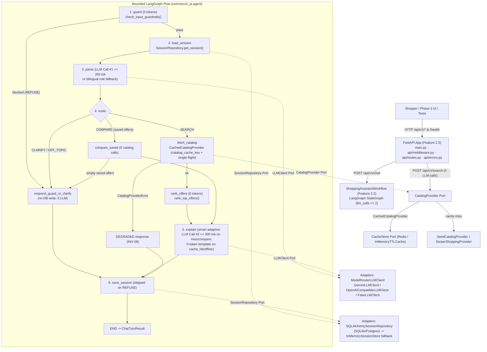

# Phase Overview: Phase 2 — Bounded LangGraph Shopping Agent, Model Routing & FastAPI Service

- **Phase branch**: `phase/2-agent-and-api`
- **Roadmap section**: `spec/roadmap.md` → Phase 2
- **Execution mode**: Phase mode (no sensitive areas from `spec/sdd-profile.md` are touched in Phase 2)
- **Status**: Implementing

---

## 1. Phase Goal & Why

Phase 2 connects Phase 1's deterministic Top-3 value-ranking engine and pluggable catalog/cache layer to natural-language Arabic/English shopping conversations and documented HTTP APIs (`spec/mission.md` §1, §4, §5, §6; `spec/architecture.md`; `spec/tech.md`). Specifically, this phase delivers:

1. **Folded Phase 1 Hardening, Multi-Provider `LLMClient`, Guardrails & Bilingual Intent Extraction (`Feature 2.1`)**: Locks all Phase 2 runtime dependencies and package scaffolding upfront, closes the three Phase 1 follow-ups (`AppSettings` `@field_serializer` credential redaction, `SearchIntent` Arabic orthographic folding & `catalog_cache_key()`, and `CachedCatalogProvider` per-key single-flight coalescing), introduces lightweight async `httpx` LLM adapters (`GeminiLLMClient`, `OpenAICompatibleLLMClient`, `ModelRouterLLMClient`, `FakeLLMClient`) with zero `litellm`/vendor bloat, and enforces zero-token pre-LLM input guardrails plus structured bilingual (`ar`/`en`) intent extraction with rule-based fallback (`INV-01`, `INV-02`, `INV-04`, `INV-07`, `INV-08`, `INV-09`).
2. **Bounded `LangGraph` Workflow & Async Session Memory (`Feature 2.2`)**: Builds the bounded `StateGraph` (`guard -> load_session -> parse -> route -> ... -> save_session -> END`) capped at `<= 2` LLM calls per turn (`INV-04`), supporting multi-turn refinements, `COMPARE` turns against saved offers with 0 catalog calls, smart adaptive `explain` (LLM summary on cache miss/compare; 0-token grounded bilingual templates on cache hits, offline mode, empty results, or provider failure), and `SQLAlchemy 2.0` async persistence (`sqlite+aiosqlite` / `postgresql+asyncpg`) with automatic fallback to `InMemorySessionStore` (`INV-05`, `INV-08`).
3. **Versioned `FastAPI` REST Service & Contracts (`Feature 2.3`)**: Exposes `POST /api/v1/chat`, `POST /api/v1/search`, `GET /api/v1/markets`, and `GET /health` with `X-Request-ID` tracing, `CORSMiddleware`, sliding-window rate limiting (`429` + `Retry-After`), OpenAPI 3.1 schemas ready for Phase 3 Next.js TypeScript client generation, and unified `ErrorResponse` envelopes (`INV-01`, `INV-04`, `INV-08`).

Once Phase 2 is complete, the backend resolves Arabic and English shopping queries end-to-end via REST (`<= 3.0 s` P95 cache miss, `<= 300 ms` P95 cache hit, `<= $0.002` uncached unit cost) while remaining 100% deterministic offline in `pytest`.

---

## 2. Features in This Phase

| Order | Roadmap ID | Folder | Size | Status | Depends on |
|:---|:---|:---|:---|:---|:---|
| 1 | Feature 2.1 | `spec/features/feature-201-llm-routing-guardrails-intent/` | M | ✅ Done | Phase 1 |
| 2 | Feature 2.2 | `spec/features/feature-202-langgraph-workflow-and-session/` | M | ✅ Done | Feature 2.1 |
| 3 | Feature 2.3 | `spec/features/feature-203-fastapi-service-and-contracts/` | M | ✅ Done | Feature 2.1, Feature 2.2 |

**Merge/split decisions made during the interview**: None — the three Phase 2 roadmap features map cleanly to disjoint backend modules (`P7`) and remain three Medium (`M`) features executed in **Phase mode** (`infra/aws/**`, `.github/workflows/**`, `backend/src/commerce_ai/config/security*`, and `backend/migrations/**` from `spec/sdd-profile.md` Sensitive Areas are untouched). All three items in `spec/backlog/2026-11-15-phase1-cache-and-settings-followups.md` were accepted (`interview A1`) and folded into **Feature 2.1** so shared settings, models, and catalog cache behavior are settled before Features 2.2 and 2.3 execute.

**Execution sequence after Phase Gate 1**:
1. Implement, validate, and commit **Feature 2.1** first on `phase/2-agent-and-api`, establishing `backend/pyproject.toml` + `backend/uv.lock`, all Phase 2 `__init__.py` scaffolds, folded Phase 1 hardening, `AppSettings`, `domain/__init__.py` + `domain/{errors,models,ports}.py`, `adapters/catalog/cached_provider.py`, `adapters/llm/**`, and `agent/{guardrails,intent}.py`.
2. Once Feature 2.1 is green and committed locally, implement **Feature 2.2** and **Feature 2.3** in parallel across isolated workspaces (`P7` disjoint file partition; Feature 2.3 wires `ShoppingAssistantWorkflow.run_turn` via `create_app(..., workflow=...)` injection against the locked contract) or sequentially (`2.2` then `2.3`), followed by full integration validation (`tests/integration/test_phase2_e2e.py`) in Step 7.

---

## 3. Shared Decisions (apply to all features)

| # | Decision | Source | Rationale |
|:---|:---|:---|:---|
| **P1** | **Scope, Phase Mode & Folded Phase 1 Backlog Items**: Execute Phase 2 on branch `phase/2-agent-and-api` (branched from `main`) in **Phase mode** (`sdd-phase`) without touching any `spec/sdd-profile.md` Sensitive Areas (`infra/aws/**`, `.github/workflows/**`, `config/security*`, `migrations/**`). Fold all 3 items from `spec/backlog/2026-11-15-phase1-cache-and-settings-followups.md` into **Feature 2.1**: (1) add `@field_serializer("redis_url", "database_url", when_used="always")` on `AppSettings` calling `redact_url_password(...)` so `model_dump()` and `model_dump_json()` mask passwords consistently with `repr()`, `str()`, and `safe_summary()`, while preserving raw `str \| None` / `str` attribute access (`settings.redis_url`, `settings.database_url`) for internal adapter factories; (2) apply Arabic orthographic folding (`أ/إ/آ/ٱ -> ا`, `ة -> ه`, `ى -> ي`) in `SearchIntent` slug normalization (`domain/models.py`), add `SearchIntent.catalog_cache_key(self) -> str` returning `"{country}:{store}:{language}:{slug}"` (used by `CachedCatalogProvider.search_offers()` so budget/rating refinements reuse cached offers with 0 duplicate Serper calls), and update `SearchIntent.normalized_cache_key(self) -> str` to `"{country}:{store}:{language}:{slug}:{budget}:{min_rating}"`; (3) add per-key single-flight request coalescing (`asyncio.Lock` + `_in_flight: dict[str, asyncio.Task[CatalogSearchResult]]` keyed by `cache_key`) inside `CachedCatalogProvider.search_offers()`, cleaning up `_in_flight` in `finally` and never caching `CatalogProviderError`. | Human Interview A1 + `spec/backlog/2026-11-15-phase1-cache-and-settings-followups.md` + `INV-01`, `INV-04`, `INV-08` | Closes all Phase 1 security/cache follow-ups before concurrent FastAPI traffic arrives, keeps `AppSettings` backward-compatible for internal factories, eliminates Arabic spelling and `ar`/`en` cache collisions, and prevents cold-cache stampedes on `$0.001` Serper calls. |
| **P2** | **Lightweight Async `httpx` Multi-Provider `LLMClient` & Model Routing**: Avoid `litellm` or heavy vendor SDKs; implement async `httpx` clients in `commerce_ai.adapters.llm`: `GeminiLLMClient` (`POST https://generativelanguage.googleapis.com/v1beta/models/{model_id}:generateContent` with `x-goog-api-key` header — never query string — `maxOutputTokens`, `temperature`, JSON mode `responseMimeType: "application/json"`, `llm_timeout_seconds`), `OpenAICompatibleLLMClient` (`POST {base_url}/chat/completions`, routing `groq/...` → `https://api.groq.com/openai/v1` and `openai/...` → `https://api.openai.com/v1`, `Authorization: Bearer ...`, `response_format={"type": "json_object"}` when `json_mode=True`, `max_tokens`, `temperature`, `llm_timeout_seconds`), `ModelRouterLLMClient` (invokes primary first and fails over at most once to fallback on `LLMProviderError`, setting `used_fallback_model=True` and counting as 1 logical LLM step per `INV-04`), `FakeLLMClient` (100% offline deterministic `INV-07`), and `create_llm_client(settings: AppSettings, *, http_client: httpx.AsyncClient \| None = None) -> LLMClient \| None` honoring `llm_mode` (`"auto" \| "fake" \| "live"`). | Human Interview + `spec/tech.md` + `INV-01`, `INV-02`, `INV-04`, `INV-07` | Minimizes runtime dependency weight and cold-start latency while keeping strict `httpx.MockTransport` testability, header-only secret transport, and single-step bounded failover. |
| **P3** | **Zero-Token Pre-LLM Guardrails & Bilingual Intent Extraction + Rule-Based Fallback**: `commerce_ai.agent.guardrails.check_input_guardrails(message: str, *, max_chars: int = 1000) -> GuardrailResult` executes before any DB read/write or LLM call (`0` tokens), rejecting empty/whitespace, `> max_chars`, control-char abuse, Arabic/English prompt-injection & system-prompt extraction patterns, and sensitive payment/PII payloads (`INV-09`: 13–19 digit payment cards via Luhn/pattern check, CVV, passwords, national IDs). Blocked messages are never persisted to `SessionRepository` or sent to `LLMClient`. `commerce_ai.agent.intent.extract_turn_intent(...) -> IntentExtractionResult` classifies turns into `TurnAction` (`SEARCH`, `COMPARE`, `CLARIFY`, `OFF_TOPIC`) and produces validated `SearchIntent` (merging `prior_intent` deltas on follow-ups), using LLM Call #1 (`max_tokens <= 350`, JSON mode) when `llm_client` is provided and falling back automatically to a deterministic bilingual (`ar`/`en`) rule-based parser when `llm_client is None`, `LLMProviderError` occurs, or invalid JSON is returned (`INV-08`). | Human Interview + `spec/architecture.md` §4 + `INV-04`, `INV-08`, `INV-09` | Stops abuse and sensitive PII before spending tokens or storing data, while guaranteeing seamless Arabic/English operation offline and during LLM outages. |
| **P4** | **Bounded `LangGraph` Workflow, Multi-Turn Refinement & Smart Adaptive `explain`**: `commerce_ai.agent.graph` compiles a `LangGraph` `StateGraph` (`guard -> load_session -> parse -> route -> [respond_guard_or_clarify \| fetch_catalog -> rank_offers -> explain \| compare_saved -> explain] -> save_session -> END`) enforcing `llm_calls_used <= 2` (`INV-04`). `SessionState` preserves `last_intent`, `last_ranked_offers`, and bounded `turns` (up to `session_max_turns=10`, passing up to last `6` compact turns into `parse`). Refinements merge onto `last_intent`; `COMPARE` answers directly from `last_ranked_offers` with 0 `CatalogProvider` calls (or asks the shopper to search first if `last_ranked_offers` is empty). Smart adaptive `explain` (`explain_mode: Literal["auto", "llm", "template"] = "auto"`): in `"auto"`, runs Tier-1 Call #2 (`max_tokens <= 300`) ONLY when `llm_client is not None` AND `len(offers) > 0` AND `(action == TurnAction.COMPARE or not catalog_cache_hit)`; on cache hits (`cache_hit=True`), offline runs, 0 offers, `"template"` mode, or `LLMProviderError`, uses 0-token deterministic bilingual templates (`commerce_ai.agent.templates`) with strict grounding (`INV-05`). | Human Interview + `spec/architecture.md` §2, §4 + `spec/mission.md` §4, §6 + `INV-04`, `INV-05`, `INV-08` | Keeps cached turns `< 300 ms` with zero extra LLM latency/tokens while delivering rich grounded LLM explanations on fresh misses and comparisons without unbounded loops. |
| **P5** | **`SQLAlchemy 2.0` Async Session Memory + `InMemorySessionStore` Fallback**: Define `SessionRepository` protocol (`domain/ports.py`), `SessionTurn` and `SessionState` (`domain/models.py`), and `SessionStoreError(DomainError)` (`domain/errors.py`). In `commerce_ai.adapters.session`: implement `InMemorySessionStore` (bounded LRU `OrderedDict`, `max_sessions=1024`, monotonic TTL `session_ttl_seconds=86400`, turn cap `session_max_turns=10`), `SQLAlchemySessionRepository` (async SQLAlchemy 2.0 supporting `sqlite+aiosqlite` default and `postgresql+asyncpg`, auto-creating the `commerce_sessions` table via `await repo.initialize()` using `Base.metadata.create_all` during lifespan startup — zero `migrations/**` files — and masking DB credentials in errors/logs per `INV-01`), and `create_session_repository(settings: AppSettings) -> SessionRepository` with automatic fallback to `InMemorySessionStore` (`INV-08`). | Human Interview + `spec/tech.md` §1 + `spec/sdd-profile.md` + `INV-01`, `INV-02`, `INV-08` | Delivers durable SQLite/PostgreSQL session state without touching the `migrations/**` sensitive area while preserving zero-setup local tests and outage resilience. |
| **P6** | **Versioned `FastAPI` JSON REST Contracts, Error Envelope & Rate Limiting**: `commerce_ai.main` exposes `create_app(settings: AppSettings \| None = None, ...) -> FastAPI`, async `lifespan`, and module-level `app = create_app()`. Routes (`commerce_ai.api.routes`): `POST /api/v1/chat` → `ChatResponse` (HTTP 200 across `ok \| clarify \| off_topic \| refused \| degraded`; `CatalogProviderError` inside chat degrades cleanly to `status="degraded"`, `top_offers=[]`), `POST /api/v1/search` → `SearchResponse` (0 LLM calls; direct `CatalogProvider.search_offers` + `rank_top_offers`; `CatalogProviderError` → HTTP 503 `ErrorResponse`), `GET /api/v1/markets` → `MarketsResponse` (`EG`/`EGP`, `SA`/`SAR`, `AE`/`AED`, stores `noon`/`amazon`), `GET /health` → `HealthResponse` (non-sensitive operational modes/readiness, zero secrets `INV-01`). Middleware & errors (`api/middleware.py`, `api/errors.py`): `X-Request-ID`, `CORSMiddleware` (`cors_allowed_origins`), sliding-window per-client rate limiter (`rate_limit_rpm = 60` → HTTP 429 + `Retry-After` + `ErrorResponse`, exempting `/health` & `/api/v1/markets`), unified `ErrorResponse(error_code, message, retriable, request_id, details)` for `422`, `429`, `503`, `500` (and `422`/`400` for `DomainError`/`OfferValidationError`). | Human Interview + `spec/architecture.md` + `INV-01`, `INV-04`, `INV-08` | Provides stable, OpenAPI-documented REST contracts for Phase 3 Next.js UI generation with consistent tracing, CORS, rate protection, and safe error envelopes. |
| **P7** | **Disjoint File Ownership Across Features `2.1 -> 2.2 // 2.3`**: Pre-declare ALL Phase 2 runtime deps (`fastapi`, `uvicorn`, `langgraph`, `sqlalchemy[asyncio]`, `aiosqlite`, `asyncpg`) in `backend/pyproject.toml` + `backend/uv.lock` and create all Phase 2 `__init__.py` markers in **Feature 2.1** (`agent/`, `adapters/llm/`, `adapters/session/`, `api/`). Restrict **Feature 2.2** strictly to `adapters/session/*` and `agent/{prompts,templates,graph}.py` + its tests; restrict **Feature 2.3** strictly to `main.py` and `api/*` + its tests; reserve `tests/integration/test_phase2_e2e.py` for Step 7 Phase Integration (`PI.1`). | `P7` pattern from Phase 1 + `INV-02` | Prevents `pyproject.toml`, `__init__.py`, and model/port edit collisions so Features 2.2 and 2.3 can implement cleanly against locked contracts. |
| **P8** | **100% Offline Deterministic Validation Strategy**: Maintain `addopts = ["-m", "not live"]` and `< 30 s` default `pytest` runtime using `FakeLLMClient`, `httpx.MockTransport`, `SeedCatalogProvider`, `InMemoryTTLCache`/`fakeredis`, `sqlite+aiosqlite`, and `httpx.AsyncClient(transport=ASGITransport(app=app))`. Isolate live provider checks inside opt-in `@pytest.mark.live` `tests/integration/test_live_llm_smoke.py`. | `INV-07` + `spec/sdd-profile.md` | Guarantees reliable, zero-cost CI and local verification while still providing an opt-in smoke harness for real Gemini/Groq/OpenAI keys. |

---

## 4. Cross-Feature Architecture & Data Flow

### 4.1 Component Interaction & Bounded Workflow (`INV-02`, `INV-04`)

### 4.2 Exact Shared Contracts & Signatures

All three Phase 2 features build strictly against these shared signatures:

1. **`AppSettings` Additions & Serialization (`commerce_ai.config.settings`)** — owned by Feature 2.1:
   - Preserves Phase 1 fields (`serper_api_key`, `redis_url`, `catalog_mode`, `cache_ttl_seconds`, `serper_timeout_seconds`, `scoring`) and adds:
     - `app_env: Literal["development", "staging", "production"] = "development"`
     - `log_level: Literal["DEBUG", "INFO", "WARNING", "ERROR"] = "INFO"`
     - `gemini_api_key: SecretStr | None = None`
     - `groq_api_key: SecretStr | None = None`
     - `openai_api_key: SecretStr | None = None`
     - `llm_mode: Literal["auto", "fake", "live"] = "auto"`
     - `explain_mode: Literal["auto", "llm", "template"] = "auto"`
     - `llm_primary_model: str = "gemini/gemini-2.5-flash"`
     - `llm_fallback_model: str | None = "groq/llama-3.3-70b-versatile"`
     - `llm_timeout_seconds: float = Field(default=8.0, gt=0.0, allow_inf_nan=False)`
     - `guardrail_max_chars: int = Field(default=1000, ge=50, le=4000)`
     - `database_url: str = "sqlite+aiosqlite:///./commerce_ai.db"`
     - `session_ttl_seconds: int = Field(default=86400, gt=0)`
     - `session_max_turns: int = Field(default=10, ge=2, le=50)`
     - `cors_allowed_origins: list[str] = Field(default_factory=lambda: ["http://localhost:3000"])` (parses comma-separated env strings or JSON lists while stripping inline `#` comments)
     - `rate_limit_rpm: int = Field(default=60, ge=0)`
     - `trusted_proxy_cidrs: list[str] = Field(default_factory=lambda: ["127.0.0.1/32", "::1/128"])` (validated via `ipaddress.ip_network`)
   - `@field_serializer("redis_url", "database_url", when_used="always")` calling `redact_url_password(...)`: masks credentials and sensitive query params (`password|passwd|pwd|pass|token|secret|api[_-]?key`) in `model_dump()` and `model_dump_json()` consistently with `repr()`, `str()`, and `safe_summary()`, while keeping raw attribute values on `settings.redis_url` and `settings.database_url` for internal adapter factories.
   - Updated `safe_summary()`: masks `gemini_api_key`, `groq_api_key`, `openai_api_key`, `serper_api_key`, `redis_url`, and `database_url` alongside non-secret operational modes (including `trusted_proxy_cidrs`).

2. **Domain & Boundary Errors (`commerce_ai.domain.errors`)** — owned by Feature 2.1:
   - Preserves `DomainError`, `OfferValidationError`, `CatalogProviderError`, `CacheStoreError`, and adds:
     - `LLMProviderError(DomainError)` with exact constructor `LLMProviderError(provider: str, retriable: bool, reason: str)` setting `self.provider`, `self.retriable`, and `self.reason`.
     - `SessionStoreError(DomainError)`.

3. **Domain Enums, Cache Keys & Models (`commerce_ai.domain.models`)** — owned by Feature 2.1:
   - **`SearchIntent` updates (`P1`)**:
     - Enforces `max_budget <= Decimal("10000000.00")` and catches `(InvalidOperation, ValueError, TypeError)` in `_validate_positive_currency_decimal` raising `OfferValidationError`.
     - Applies Arabic orthographic folding (`أ/إ/آ/ٱ -> ا`, `ة -> ه`, `ى -> ي`) and Arabic-Indic digit folding (`٠-٩`/`۰-۹ -> 0-9`) inside query slug normalization.
     - `SearchIntent.catalog_cache_key(self) -> str`: returns `"{country}:{store}:{language}:{slug}"` (used by `CachedCatalogProvider.search_offers()`).
     - `SearchIntent.normalized_cache_key(self) -> str`: updated to `"{country}:{store}:{language}:{slug}:{budget}:{min_rating}"`.
   - **New Phase 2 Enums (`StrEnum`)**:
     - `TurnAction`: `SEARCH = "search"`, `COMPARE = "compare"`, `CLARIFY = "clarify"`, `OFF_TOPIC = "off_topic"`, `REFUSE = "refuse"`
     - `TurnStatus`: `OK = "ok"`, `CLARIFY = "clarify"`, `OFF_TOPIC = "off_topic"`, `REFUSED = "refused"`, `DEGRADED = "degraded"`
   - **New Phase 2 Domain Models**:
     - `LLMMessage`: `role: Literal["system", "user", "assistant"]`, `content: str`
     - `LLMRequest`: `messages: tuple[LLMMessage, ...]`, `max_tokens: int = Field(default=350, ge=1, le=1024)`, `temperature: float = Field(default=0.0, ge=0.0, le=1.0, allow_inf_nan=False)`, `json_mode: bool = False`, `json_schema: dict[str, Any] | None = None`, `task_name: str = "general"`
     - `LLMResponse`: `content: str`, `provider: str`, `model: str`, `input_tokens: int = Field(default=0, ge=0)`, `output_tokens: int = Field(default=0, ge=0)`, `latency_ms: float = Field(default=0.0, ge=0.0, allow_inf_nan=False)`, `used_fallback_model: bool = False`
     - `SessionTurn`: `role: Literal["user", "assistant"]`, `content: str`, `action: TurnAction | None = None`, `created_at_iso: str`
     - `SessionState`: `session_id: str`, `market: CountryCode = CountryCode.EG`, `last_intent: SearchIntent | None = None`, `last_ranked_offers: list[RankedOffer] = Field(default_factory=list)`, `turns: list[SessionTurn] = Field(default_factory=list)`, `updated_at_epoch: float = Field(default=0.0, ge=0.0)` (deserialized with `SessionState.model_validate_json(..., context={"allow_verified_google_shopping_from_cache": True})` so previously verified Google Shopping offers in `last_ranked_offers` round-trip safely across DB/cache persistence)
     - `TurnTelemetry`: `llm_calls: int = Field(default=0, ge=0, le=2)`, `catalog_called: bool = False`, `catalog_cache_hit: bool = False`, `catalog_source_mode: CatalogSourceMode | None = None`, `used_rule_intent_fallback: bool = False`, `used_template_summary: bool = False`, `degraded_reason: str | None = None`, `latency_ms: float = Field(default=0.0, ge=0.0, allow_inf_nan=False)`
     - `ChatTurnResult`: `session_id: str`, `status: TurnStatus`, `reply: str`, `action: TurnAction`, `active_intent: SearchIntent | None = None`, `top_offers: list[RankedOffer] = Field(default_factory=list)`, `ranking_result: RankingResult | None = None`, `telemetry: TurnTelemetry`

4. **Domain Ports (`commerce_ai.domain.ports`)** — owned by Feature 2.1:
   - `@runtime_checkable class LLMClient(Protocol)`:
     - `async def complete(self, request: LLMRequest) -> LLMResponse: ...`
   - `@runtime_checkable class SessionRepository(Protocol)`:
     - `async def get_session(self, session_id: str) -> SessionState | None: ...`
     - `async def save_session(self, state: SessionState, ttl_seconds: int = 86400) -> None: ...`
     - `async def delete_session(self, session_id: str) -> None: ...`

5. **Catalog Single-Flight, HTTP Client Reuse & Key Migration (`commerce_ai.adapters.catalog`)** — owned by Feature 2.1:
   - `CachedCatalogProvider.search_offers(self, intent: SearchIntent) -> CatalogSearchResult` keys cache entries via `intent.catalog_cache_key()` and coordinates concurrent misses via per-key `asyncio.Lock` + `_in_flight: dict[str, asyncio.Task[CatalogSearchResult]]` (closing post-`cache.get()` TOCTOU windows), removing `_in_flight[cache_key]` in `finally` and never caching `CatalogProviderError`.
   - `SerperShoppingProvider` and `create_catalog_provider` accept optional `http_client: httpx.AsyncClient | None = None` for shared pooling without closing caller-owned clients.

6. **LLM Client Adapters (`commerce_ai.adapters.llm`)** — owned by Feature 2.1:
   - `GeminiLLMClient` (`adapters/llm/gemini.py`): `POST {base_url}/models/{model_id}:generateContent`, `x-goog-api-key` header, `maxOutputTokens`, `temperature`, JSON mode, `llm_timeout_seconds`.
   - `OpenAICompatibleLLMClient` (`adapters/llm/openai_compat.py`): `POST {base_url}/chat/completions` (`groq/...` → `https://api.groq.com/openai/v1`, `openai/...` → `https://api.openai.com/v1`), `Authorization: Bearer ...`, `response_format={"type": "json_object"}` when `json_mode=True`.
   - `ModelRouterLLMClient` (`adapters/llm/router.py`): primary + at most 1 fallback on `LLMProviderError` (`used_fallback_model=True`, 1 logical LLM step), closing both primary and fallback via `try ... finally` in `aclose()`.
   - `FakeLLMClient` (`adapters/llm/fake.py`): 100% offline deterministic test/demo `LLMClient`.
   - `create_llm_client(settings: AppSettings, *, http_client: httpx.AsyncClient | None = None) -> LLMClient | None` (`adapters/llm/factory.py`).

7. **Agent Entrypoints (`commerce_ai.agent`)**:
   - **Guardrails (`agent/guardrails.py`, Feature 2.1)**: `GuardrailResult(allowed: bool, sanitized_message: str = "", reason_code: str | None = None, language: Literal["ar", "en"] = "ar")` (`reason_code` in `"empty_message" | "max_length_exceeded" | "control_characters" | "prompt_injection" | "sensitive_pii_payment"`) and `check_input_guardrails(message: str, *, max_chars: int = 1000) -> GuardrailResult` (checks `len(message) > max_chars` before full-string scanning, rejects Unicode Tags `U+E0000..U+E007F`, strips Unicode `Cf`/`Mn`/tatweel during normalization and `Cf` from `sanitized_message`, supports dot-separated Luhn cards).
   - **Intent Extraction (`agent/intent.py`, Feature 2.1)**: `IntentExtractionResult(action: TurnAction, intent: SearchIntent | None = None, language: Literal["ar", "en"] = "ar", clarification_question: str | None = None, used_rule_fallback: bool = False, llm_calls_used: int = 0, degraded_reason: str | None = None)` and `extract_turn_intent(message: str, *, default_country: CountryCode, store_override: StoreFilter | None = None, max_budget_override: Decimal | None = None, language_hint: Literal["ar", "en"] | None = None, prior_intent: SearchIntent | None = None, recent_turns: Sequence[SessionTurn] = (), has_saved_offers: bool = False, llm_client: LLMClient | None = None) -> IntentExtractionResult` (validates overrides via `SearchIntent.model_validate(...)` and catches `(ValidationError, InvalidOperation, ValueError)` around LLM `SearchIntent` parsing).
   - **Prompts & Templates (`agent/prompts.py`, `agent/templates.py`, Feature 2.2)**: Grounded prompt builders (`<= 300` tokens) and 0-token bilingual (`ar`/`en`) deterministic response templates (`render_refused_message(*, language, reason_code=None)`).
   - **Workflow (`agent/graph.py`, Feature 2.2)**: `ShoppingAssistantWorkflow(settings: AppSettings, catalog_provider: CatalogProvider, session_repository: SessionRepository, llm_client: LLMClient | None = None, scoring_config: ScoringConfig | None = None)` exposing `async def run_turn(self, *, message: str, session_id: str | None = None, default_country: CountryCode = CountryCode.EG, store_override: StoreFilter | None = None, max_budget_override: Decimal | None = None, language_hint: Literal["ar", "en"] | None = None) -> ChatTurnResult`; under `explain_mode="auto"`, skips Call #2 when `degraded_reasons` records `llm_provider_error:`.

8. **Session Adapters (`commerce_ai.adapters.session`)** — owned by Feature 2.2:
   - `InMemorySessionStore(clock: Callable[[], float] | None = None, max_sessions: int = 1024, max_turns: int = 10)` (`adapters/session/memory.py`): LRU `OrderedDict`, TTL (`ttl_seconds` in `save_session`), turn window trimming.
   - `SQLAlchemySessionRepository` (`adapters/session/sqlalchemy_repo.py`): async SQLAlchemy 2.0 (`sqlite+aiosqlite` / `postgresql+asyncpg`), explicit `connect_args` timeouts + SQLite `WAL`/`busy_timeout=5000`, `commerce_sessions` table created via `await repo.initialize()` (`Base.metadata.create_all`), dialect-native atomic `ON CONFLICT DO UPDATE` upserts, throttled expired-row cleanup (`<= 1` per `60.0s`), `await repo.close()`, credential masking (`INV-01`).
   - `create_session_repository(settings: AppSettings) -> ResilientSessionRepository` (`adapters/session/factory.py`): returns a sync-constructed `SessionRepository` wrapper around `SQLAlchemySessionRepository` + fallback `InMemorySessionStore` exposing `initialize()`, `close()`, `backend_name: Literal["sqlite", "postgresql", "memory"]`, and `is_degraded: bool` with startup close-on-degrade and `30.0s` runtime cooldown recovery (`INV-08`).

9. **FastAPI Application & REST Contracts (`commerce_ai.main`, `commerce_ai.api`)** — owned by Feature 2.3:
   - `create_app(settings: AppSettings | None = None, *, catalog_provider: CatalogProvider | None = None, llm_client: LLMClient | None = None, session_repository: SessionRepository | None = None, workflow: ShoppingAssistantWorkflow | None = None) -> FastAPI` and `app = create_app()` (`main.py`); async `lifespan` shares one lifespan-owned `httpx.AsyncClient` across owned catalog/LLM clients and closes replaced default resources cleanly.
   - Endpoints (`api/routes.py`): `POST /api/v1/chat` (`ChatRequest` → `ChatResponse`), `POST /api/v1/search` (`SearchRequest` → `SearchResponse`), `GET /api/v1/markets` (`MarketsResponse`), `GET /health` (`HealthResponse`).
   - Middleware & Errors (`api/middleware.py`, `api/errors.py`, `api/dependencies.py`, `api/schemas.py`): `X-Request-ID`, `CORSMiddleware`, sliding-window rate limiter (`429` + `Retry-After`) trusting `X-Forwarded-For` right-to-left untrusted hop only from `settings.trusted_proxy_cidrs`, `max_budget <= Decimal("10000000.00")`, control/bidi/Tag char rejection on `SearchRequest.query`, unified `ErrorResponse(error_code, message, retriable, request_id, details)`.

10. **Disjoint File Partition (`P7`)**:
    - **Feature 2.1**: `backend/pyproject.toml`, `backend/uv.lock`, `__init__.py` scaffolds (`agent/`, `adapters/llm/`, `adapters/session/`, `api/`), `config/settings.py`, `domain/__init__.py`, `domain/{errors,models,ports}.py`, `adapters/catalog/cached_provider.py`, `adapters/llm/{gemini,openai_compat,router,fake,factory}.py`, `agent/{guardrails,intent}.py`, updated `tests/unit/test_config_and_models.py`, `tests/integration/test_cached_catalog.py` & `tests/integration/test_phase1_e2e.py`, new `tests/unit/{test_llm_clients,test_guardrails_and_intent}.py`, `@pytest.mark.live` `tests/integration/test_live_llm_smoke.py`.
    - **Feature 2.2**: `adapters/session/{memory,sqlalchemy_repo,factory}.py`, `agent/{prompts,templates,graph}.py`, `tests/unit/{test_session_stores,test_agent_graph}.py`, `tests/integration/test_langgraph_session.py`.
    - **Feature 2.3**: `main.py`, `api/{schemas,dependencies,middleware,errors,routes}.py`, `tests/unit/test_api_middleware_and_schemas.py`, `tests/integration/test_fastapi_endpoints.py`.
    - **Step 7 Phase Integration**: `tests/integration/test_phase2_e2e.py`.

### 4.3 Phase-Wide `tech.md` Invariants

| Invariant | How Phase 2 Enforces It |
|:---|:---|
| `INV-01` — Zero Hardcoded Secrets | `AppSettings` loads `GEMINI_API_KEY`, `GROQ_API_KEY`, `OPENAI_API_KEY` as `SecretStr`; `@field_serializer("redis_url", "database_url", when_used="always")` masks URL credentials across `model_dump()`/`model_dump_json()`/`repr()`/`str()`/`safe_summary()`; `GeminiLLMClient` uses `x-goog-api-key` header (never query params); `HealthResponse`, `ErrorResponse`, and `SessionStoreError` never leak keys or DB URLs. |
| `INV-02` — Strict Ports & Adapters | `commerce_ai.domain` imports zero vendor libraries, and `commerce_ai.agent` (orchestrated with `langgraph`) imports zero vendor HTTP/DB/LLM SDKs (`httpx`, `sqlalchemy`, `redis`, `google`, `openai`, `groq`); all LLM/session/catalog I/O stays inside `commerce_ai.adapters` behind `LLMClient`, `SessionRepository`, `CatalogProvider`, and `CacheStore` protocols. |
| `INV-03` — Deterministic Math & Configurable Scoring | `rank_top_offers` (`domain/ranking.py`) remains sole owner of price normalization, Bayesian confidence scoring, and two-stage accessory/outlier filtering; LLM calls never compute prices or scores. |
| `INV-04` — Bounded Agent Execution & Cost Ceiling | `ShoppingAssistantWorkflow` enforces `llm_calls_used <= 2` (`<= 350` tokens Call #1 `parse`, `<= 300` tokens Call #2 `explain` skipped on cache hits/offline/0 offers), `ModelRouterLLMClient` counts primary+fallback as 1 logical call, `POST /api/v1/search` uses 0 LLM calls, and `CachedCatalogProvider` single-flight + `catalog_cache_key()` prevents duplicate `$0.001` Serper calls. |
| `INV-05` — Zero Hallucinated Offers | `top_offers` come unmodified from `rank_top_offers` over `CatalogProvider` offers; `prompts.py` and `templates.py` embed only verified `RankedOffer` facts; `COMPARE` reads exclusively from persisted `state.last_ranked_offers`. |
| `INV-06` — Sanctioned Data Acquisition Only | Zero scraping or browser automation added; catalog retrieval continues solely via `SeedCatalogProvider` and single-call `SerperShoppingProvider`. |
| `INV-07` — 100% Offline Deterministic Test Suite | Default `pytest` (`addopts = ["-m", "not live"]`) runs 100% offline in `< 30 s` via `FakeLLMClient`, `httpx.MockTransport`, `SeedCatalogProvider`, `InMemoryTTLCache`/`fakeredis`, `sqlite+aiosqlite`, and `ASGITransport`; live tests require `@pytest.mark.live`. |
| `INV-08` — Graceful Degradation | `extract_turn_intent` falls back to bilingual rule parsing on `LLMProviderError`/invalid JSON; `explain` falls back to 0-token bilingual templates; `create_session_repository` falls back to `InMemorySessionStore` on DB failures; `CatalogProviderError` yields `TurnStatus.DEGRADED` in `/api/v1/chat` and structured `503` `ErrorResponse` in `/api/v1/search`. |
| `INV-09` — Zero Payment or Sensitive PII Scope | Pre-LLM `check_input_guardrails` blocks payment card numbers (Luhn/13–19 digits), CVV, passwords, and national IDs at 0 tokens; blocked turns are never written to `SessionRepository` or sent to `LLMClient`. |

---

## 5. Phase-Level Integration Validation

Commands match `spec/sdd-profile.md` exactly:

- [x] **PI.1** — End-to-end FastAPI + LangGraph + Session + Catalog + Ranking offline flow (`backend/tests/integration/test_phase2_e2e.py`) using `create_app` with `httpx.AsyncClient(transport=ASGITransport(app=app))`, `FakeLLMClient` / `ModelRouterLLMClient` (`MockTransport`) / rule fallback, `SeedCatalogProvider` + `CachedCatalogProvider` (`FakeRedis` / `InMemoryTTLCache`), and `SQLAlchemySessionRepository` (`sqlite+aiosqlite`) across `EG`, `SA`, and `AE` → verifies multi-turn Arabic/English search (`cache_hit=False` → `cache_hit=True` skipping Call #2 on repeat/budget refinement), `COMPARE` with 0 catalog calls, SQLite persistence across separate app lifecycles + `ResilientSessionRepository` startup/mid-flight fallback, single-flight cache deduplication & error recovery, guardrail PII/injection `REFUSE` at 0 DB/LLM/catalog calls, `/api/v1/search` 0-LLM flow & `503` `CatalogProviderError` envelope, `/api/v1/markets`, `/health` (zero secrets), `X-Request-ID`, CORS headers, and `422`/`429` (`Retry-After`) envelopes. *Observed*: `uv run --no-sync --directory backend pytest tests/integration/test_phase2_e2e.py -v` → `13 passed, 1 warning in 7.26s`.
- [x] **PI.2** — Full suite (100% offline deterministic in `< 30 s`): `uv run --no-sync --directory backend pytest -v` (with `addopts = ["-m", "not live"]`, zero skipped or relaxed assertions). *Observed*: `163 passed, 1 deselected, 1 warning in 18.37s` (deselected item is opt-in `@pytest.mark.live` `tests/integration/test_live_llm_smoke.py`).
- [x] **PI.3** — Lint / format / type / lock checks:
  - `uv run --no-sync --directory backend ruff check .` → `All checks passed!`
  - `uv run --no-sync --directory backend ruff format --check .` → `62 files already formatted`
  - `uv run --no-sync --directory backend mypy src` → `Success: no issues found in 43 source files`
  - `uv lock --directory backend --check` → `Resolved 70 packages in 2ms`
- [ ] **PI.4** — Extra gates (`uv run --directory backend pytest tests/evals -v`): **Status: Not Applicable** in Phase 2 — *Technical justification*: `spec/sdd-profile.md` makes `backend/tests/evals/` mandatory from **Feature 4.1** onward; Phase 2 delivers the bounded `LangGraph` workflow, session stores, and `FastAPI` REST contracts, verified deterministically offline through unit, integration, and Phase 2 E2E suites (`PI.1`, `PI.2`).

---

## 6. Risks & Stop Conditions

| Risk | Mitigation |
|:---|:---|
| Cross-feature signature or dependency drift across Features `2.1`, `2.2`, and `2.3` | Lock all shared models, settings, ports, errors, agent entrypoints, and API contracts in §4.2, declare all Phase 2 deps + `__init__.py` files upfront in Feature 2.1 (`P7`), and enforce `spec-verifier` parity checks at Phase Gate 1 and per-feature validation. |
| Arabic dialect / English follow-up intent merging regressions or LLM malformed JSON | Pair JSON-mode `LLMClient` Call #1 (`<= 350` tokens) with deterministic bilingual rule-based parsing + `prior_intent` delta merging (`P3`), testing dialectal Egyptian/Gulf queries, Arabic-Indic numerals, and malformed LLM responses offline. |
| Latency or cost budget breach (`> 3.0 s`, `> $0.002`, or `> 2` LLM calls) | Enforce `llm_calls <= 2`, smart adaptive `explain` skipping Call #2 on cache hits (`P4`), single-flight `CachedCatalogProvider` on `catalog_cache_key()` (`P1`), and per-client sliding-window rate limiting (`P6`). |
| Accidental credential or DB URL leakage across `AppSettings`, `ErrorResponse`, or `/health` | Enforce `@field_serializer("redis_url", "database_url", when_used="always")`, header-only Gemini auth (`x-goog-api-key`), `HealthResponse` without connection URLs, and dedicated secret-redaction assertions across unit/integration suites (`INV-01`). |
| Unintentional modification of `spec/sdd-profile.md` Sensitive Areas (`migrations/**`, `config/security*`, `.github/workflows/**`, `infra/aws/**`) | Auto-create `commerce_sessions` via `SQLAlchemySessionRepository.initialize()` (`Base.metadata.create_all`) without Alembic files (`P5`) and verify `git diff --stat` excludes all Sensitive Areas. |

Stop and ask the human if: a feature stays red after 2 fix attempts, or a fix needs a change to intent, scope, or a `tech.md` invariant.

---

## 7. Execution Log (filled by the orchestrator)

| Feature | Subagent result | Validation | Local commit | Notes |
|:---|:---|:---|:---|:---|
| Feature 2.1 | ✅ Implemented (`impl-201`) & verified (`verifier`, #27) | ✅ `102 passed, 1 deselected in 1.87s` (`pytest -v`; `64 passed` targeted; `1 skipped` `-m live`), `ruff check` & `ruff format --check` clean (`44` files), `mypy src` clean (`31` files), `uv lock --check` clean | `feat(agent): implement Feature 2.1 LLM routing, guardrails, and bilingual intent extraction` | Folded Phase 1 cache/settings follow-ups (`P1`), upfront Phase 2 deps/scaffolds (`P7`), async `httpx` multi-provider `LLMClient` (`P2`), pre-LLM guardrails & bilingual intent extraction (`P3`) |
| Feature 2.2 | ✅ Implemented (`impl-202`) & verified (`verifier`, #39) | ✅ `28 passed` targeted; `130 passed, 1 deselected` (`pytest -v`, `7.18s`), `ruff check` & `ruff format --check` (`53` files) clean, `mypy src` (`37` files) clean, `uv lock --check` clean | `feat(workflow): implement Feature 2.2 bounded LangGraph workflow and session memory` | Bounded `LangGraph` `StateGraph` (`<= 2` LLM calls/turn), `InMemorySessionStore` + `SQLAlchemySessionRepository` + `ResilientSessionRepository` fallback, grounded prompts & zero-token bilingual templates (`P4`, `P5`, `P7`) |
| Feature 2.3 | ✅ Implemented (`impl-203`, #43) & verified (`verifier`, #44) | ✅ `16 passed` targeted; `146 passed, 1 deselected` (`pytest -v`, `12.78s`), `ruff check` & `ruff format --check` (`61` files) clean, `mypy src` (`43` files) clean, `uv lock --check` clean, Tier 7 ASGI smoke (`T7.1 OK: ok 3 3 ok 3.1.0`) | `feat(api): implement Feature 2.3 FastAPI service, middleware, and REST contracts` | Versioned OpenAPI 3.1 REST routes (`/api/v1/chat`, `/api/v1/search` 0-LLM, `/api/v1/markets`, `/health`), `X-Request-ID`, `CORSMiddleware`, sliding-window rate limiter (`429`), unified `ErrorResponse` (`P6`, `P7`) |
| Phase Integration & Deep Review | ✅ `PI.1`–`PI.3` implemented (`impl-e2e`, #48) & verified (`verifier`, #49); 🔧 4-lens deep review fixes applied (`fix-lead`, awaiting `@verifier`) | ✅ `65 passed` (`F2.1`, `1.10s`), `31 passed` (`F2.2`, `5.70s`), `16 passed` (`F2.3`, `6.64s`), `13 passed` (`PI.1`, `7.26s`), `163 passed, 1 deselected` (`PI.2`, `18.37s`), `T7.1 OK: ok 3 3 ok 3.1.0`, `ruff`, `mypy src`, `uv lock --check` clean | `test(phase-2): add end-to-end phase integration tests and PI evidence` | 4-lens deep review (`#56`–`#59`) fixes + specs/backlog synced in working tree |

- **Dependency unblocking (`fix(deps)`)**: `fix(deps): declare sqlalchemy[asyncio] extra for async session runtime` — added `sqlalchemy[asyncio]>=2.0,<3.0` (`greenlet==3.5.6`) to `backend/pyproject.toml` + `backend/uv.lock` and synced Phase 2 spec refs (#33, verified in #34: `uv lock --check` `Resolved 70 packages`, `102 passed, 1 deselected in 1.61s`, `ruff` & `mypy src` clean).
- **Phase Integration (`PI.1`–`PI.3`)**: `test(phase-2): add end-to-end phase integration tests and PI evidence` — added 13 offline E2E runs across 8 functions in `backend/tests/integration/test_phase2_e2e.py` (#48) and independently verified in #49.
- **4-Lens Deep Review Remediation (`#56`–`#59`)**: Applied security/guardrail hardening (`NFKD`+`Cf`/`Mn`/tatweel/Tag normalization, dot-Luhn, `max_budget <= 10,000,000`, `InvalidOperation` -> `422`, `trusted_proxy_cidrs` right-to-left hop parsing, aligned `_QUERY_SECRET_RE`), architecture/resilience (`ON CONFLICT DO UPDATE`, SQLite `WAL`/`busy_timeout`/60s cleanup, `ResilientSessionRepository` 30s cooldown recovery, Call #2 outage skip in `"auto"`, shared lifespan `httpx.AsyncClient`, per-key cache lock), flake & coverage fixes, spec syncs across Features `1.1`/`1.3`/`2.1`–`2.3`, and Phase 4 backlog capture (`2026-11-15-phase2-post-llm-and-distributed-rate-limit-followups.md`).
