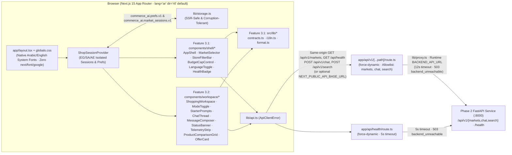

# Phase Overview: Phase 3 — Arabic-First (RTL) Next.js Web Experience

- **Phase branch**: `phase/3-rtl-web-experience`
- **Roadmap section**: `spec/roadmap.md` → Phase 3
- **Execution mode**: Phase mode (no sensitive areas from `spec/sdd-profile.md` are touched in Phase 3)
- **Status**: Implementing

---

## 1. Phase Goal & Why

Phase 3 delivers the shopper- and stakeholder-facing **Arabic-first (`RTL`) `Next.js 15` Web Interface** defined in `spec/mission.md` (§1, §3, §5, §7), `spec/architecture.md` (§1–§2), and `spec/tech.md` (§1, §3, §4), connecting directly to Phase 2's versioned `FastAPI` REST service (`/api/v1/chat`, `/api/v1/search`, `/api/v1/markets`, `/health`). Specifically, this phase delivers:

1. **Arabic-First `RTL` App Shell, Selectors, Runtime BFF Proxy & Typed API Client (`Feature 3.1`)**: Initializes the `Next.js 15` + `React 19` + `TypeScript` (`strict`, `noUncheckedIndexedAccess`) + `Tailwind CSS` + `Vitest` frontend toolchain with offline-safe native Arabic/English typography (zero `next/font/google` per `INV-07`), exact TypeScript contracts mirroring `backend/src/commerce_ai/api/schemas.py`, runtime `force-dynamic` same-origin Route Handler proxies (`/api/v1/[...path]`, `/api/health`) resolving `BACKEND_API_URL` at request time (`INV-01`, `INV-08`), complete Phase 3 `ar`/`en` UI dictionary (`src/lib/i18n.ts`), loss-free decimal price formatting & strict `https://` URL sanitization (`src/lib/format.ts`), SSR-safe per-market `localStorage` isolation (`EG`/`SA`/`AE`), instant zero-reload `RTL` (`ar`) ↔ `LTR` (`en`) switching, and accessible market/store/budget/health shell controls (`P2`–`P4`, `P7`).
2. **Unified Dual-Mode Shopping Workspace & Strictly Grounded Top-3 Comparison Experience (`Feature 3.2`)**: Mounts `<ShoppingWorkspace />` inside `<AppShell>`, pairing **Conversational Assistant (`POST /api/v1/chat`, default)** with **Zero-LLM Direct Search (`POST /api/v1/search`, `0` LLM calls, optional `min_rating` and `include_accessories`)** inside one responsive `lg:grid-cols-12` RTL-first workspace (`P5`). Renders server-ordered Top-3 `OfferCard` items verbatim with zero client-side sorting, price math, or synthetic placeholder items (`INV-03`, `INV-05`), visual `value_score` bars, Bayesian rating / Unrated badges, all 7 localized `match_reasons`, strict `https://` image fallback + `rel="noopener noreferrer"` outbound store CTAs (`INV-09`), live cost/cache/filter `TelemetryStrip`, and accessible bilingual `StatusBanner` degradation/retry states (`clarify`, `off_topic`, `refused`, `degraded`, `< 3` partial offers, `0` matches, `429`, `503`) (`P6`, `INV-08`).

Once Phase 3 is complete, shoppers in Egypt (`EGP`), Saudi Arabia (`SAR`), and the UAE (`AED`) and B2B stakeholders can converse in Arabic or English, switch markets/stores without session bleed, run zero-LLM structured searches, compare Top-3 verified Noon & Amazon offers side by side, and inspect full provenance and degradation transparency—with 100% offline deterministic tests and builds (`INV-07`).

---

## 2. Features in This Phase

| Order | Roadmap ID | Folder | Size | Status | Depends on |
|:---|:---|:---|:---|:---|:---|
| 1 | Feature 3.1 | `spec/features/feature-301-rtl-shell-selectors-and-api-client/` | M | ✅ Done | Phase 2 (`Feature 2.3` REST API) |
| 2 | Feature 3.2 | `spec/features/feature-302-chat-and-top3-comparison-experience/` | M | ✅ Done | Feature 3.1 |

**Merge/split decisions made during the interview**: Keep separate **Feature 3.1 → Feature 3.2** per `spec/roadmap.md`, executed sequentially in **Phase mode**. Neither feature touches `backend/**` or any `spec/sdd-profile.md` Sensitive Area (`infra/aws/**`, `.github/workflows/**`, `backend/src/commerce_ai/config/security*`, `backend/migrations/**`).

**Execution sequence after Phase Gate 1**:
1. Implement, validate, and commit **Feature 3.1** locally first on `phase/3-rtl-web-experience`, establishing `frontend/package.json` + `frontend/package-lock.json`, tooling configs, `src/app/api/**`, `src/lib/*`, `src/context/ShopSessionContext.tsx`, `src/components/shell/*`, `src/app/{layout.tsx,globals.css,page.tsx}`, and Feature 3.1 unit/integration tests.
2. Once Feature 3.1 is green and committed locally, implement, validate, and commit **Feature 3.2** (`src/components/workspace/*`, updating ONLY `src/app/page.tsx`, and adding `tests/unit/offer-card-and-banners.test.tsx` + `tests/integration/shopping-workspace.test.tsx`) strictly against Feature 3.1's locked contracts (`P7`).
3. Run Step 7 Phase Integration (`PI.1` `frontend/tests/integration/phase3-e2e.test.tsx`, `PI.2`–`PI.4`, Tier 7 live local full-stack smoke) and the 4-lens Deep Review ahead of Phase Gate 2.

---

## 3. Shared Decisions (apply to all features)

| # | Decision | Source | Rationale |
|:---|:---|:---|:---|
| **P1** | **Clean-Slate Git Prep, Phase Branch & Zero Sensitive/Backend Edits**: Commit `.agents/skills/my_method_for_explaining/SKILL.md` cleanly on `main` (`d9cb3fd`, `docs(skills): fix typo in explaining skill`), execute Phase 3 on branch `phase/3-rtl-web-experience` in **Phase mode** (`sdd-phase`), and make zero modifications to `backend/**` or `spec/sdd-profile.md` Sensitive Areas (`infra/aws/**`, `.github/workflows/**`, `backend/src/commerce_ai/config/security*`, `backend/migrations/**`). | Phase Interview + `spec/sdd-profile.md` | Ensures clean git lineage on `main` before frontend work begins and keeps backend contracts/security boundaries untouched during UI delivery. |
| **P2** | **Verified `Node.js LTS` Toolchain & Offline-Safe `Next.js 15` Stack**: Use official `Node.js` LTS installed in user scope at `$env:LOCALAPPDATA\Programs\nodejs` (`C:\Users\sadim\AppData\Local\Programs\nodejs`, added to persistent Windows `User` `Path`; parent-session shells prepend `$env:LOCALAPPDATA\Programs\nodejs` to `$env:Path`): **`node -v` = `v24.22.3`**, **`npm.cmd -v` / `cmd /c "npm -v"` = `11.19.1`** (noting Windows PowerShell `ExecutionPolicy` `Restricted` requires `npm.cmd` / `cmd /c npm` in PowerShell shells while preserving canonical `npm --prefix frontend ...` commands in `spec/sdd-profile.md`). Pre-declare upfront in `frontend/package.json` + `frontend/package-lock.json`: `next ^15`, `react ^19`, `react-dom ^19`, `typescript ^5` (`strict: true`, `noUncheckedIndexedAccess: true`), `tailwindcss`, non-interactive flat `eslint.config.mjs`, and `vitest` + `@vitejs/plugin-react` + `jsdom` + `@testing-library/react` + `@testing-library/jest-dom` + `@testing-library/user-event` (plus `@types/*`, `@tailwindcss/postcss`/`postcss`, `eslint-config-next`). Required scripts: `dev` (`next dev --port 3000`), `build` (`next build`), `start` (`next start --port 3000`), `lint` (`eslint src tests`), `typecheck` (`tsc --noEmit`), `test` (`vitest run`). **Offline build invariant (`INV-07`)**: NEVER import `next/font/google`; configure native Arabic/English system fonts in `frontend/src/app/globals.css` (`"Segoe UI", "Tahoma", "Noto Sans Arabic", "Geeza Pro", "Arial", sans-serif`). | Phase Interview + `@env-git` (`#12`) + `INV-07` + `spec/sdd-profile.md` | Prevents UAC/interactive installer stalls, avoids interactive `next lint` prompts, locks dependencies upfront for Feature 3.2, and guarantees `next build` passes with zero internet access. |
| **P3** | **Runtime Same-Origin Route Handler Proxies & Typed `api.ts` Client**: Browser calls relative same-origin paths (`/api/v1/*`, `/api/health`; optional `NEXT_PUBLIC_API_BASE_URL` trimmed of trailing `/` routes to `${baseUrl}/api/v1/*` and `${baseUrl}/health`). Both `frontend/src/app/api/v1/[...path]/route.ts` and `frontend/src/app/api/health/route.ts` export `dynamic = "force-dynamic"` and resolve `process.env.BACKEND_API_URL` at request runtime (default `"http://127.0.0.1:8000"`, trailing `/` trimmed, documented in `frontend/.env.example`). `/api/v1/[...path]` awaits Next.js 15 `context.params`, allowlists ONLY `["markets"]` `GET`, `["chat"]` `POST`, and `["search"]` `POST` (rejecting other paths/traversal with HTTP `404` `ErrorResponse(error_code="route_not_found")` and wrong methods with HTTP `405` `ErrorResponse(error_code="method_not_allowed")` + `Allow`), forwards `Accept`, `Content-Type`, safe `X-Request-ID`, and `X-Forwarded-For` with `AbortSignal.timeout(12_000)` (`5_000` on `/api/health`), passes upstream status, `X-Request-ID`, `Retry-After`, and JSON body through untouched, and returns HTTP `503` `ErrorResponse(error_code="backend_unreachable", retriable=true)` without leaking `BACKEND_API_URL` or stack traces (`INV-01`, `INV-08`). `frontend/src/lib/contracts.ts` mirrors `backend/src/commerce_ai/api/schemas.py` & `domain/models.py` verbatim (`DecimalString` for `ProductOffer.price` and `SearchIntent.max_budget`; `string \| number \| null` on request `max_budget` `> 0 && <= 10000000.00`), paired with `frontend/src/lib/api.ts` (`ApiClientError`, `fetchMarkets`, `fetchHealth`, `sendChatTurn`, `searchOffers`). | Phase Interview + `backend/src/commerce_ai/api/{schemas,routes}.py` + `INV-01`, `INV-08` | Avoids baking build-time backend hostnames into Next.js production bundles (Docker/App Runner ready in Phase 4), blocks proxy SSRF/traversal, prevents browser CORS failures on default origin, and preserves backend `Decimal` precision. |
| **P4** | **Arabic-First (`RTL`) Layout, Instant `ar`/`en` Toggle & Isolated `localStorage` Sessions**: Single `/` route defaults to Arabic (`lang="ar"`, `dir="rtl"`), `country="EG"`, `store="both"`, `maxBudget=""`. Toggling to `en` (`dir="ltr"`, `lang="en"`) updates `document.documentElement.{lang,dir}` and UI copy immediately without page reload. `frontend/src/lib/storage.ts` provides SSR-safe, corruption-tolerant `localStorage` persistence under `commerce_ai.prefs.v1` (`{ country, store, language }`) and `commerce_ai.market_sessions.v1` (`Record<CountryCode, MarketWorkspaceSession>` holding `{ sessionId, messages, activeComparison }`), completely isolating `EG`, `SA`, and `AE` sessions and offers while preserving `sessionId` across `store` and `maxBudget` changes; **New Chat** resets the active market only. | Phase Interview + `spec/mission.md` §7 | Matches MENA Arabic-first shoppers without blocking English switching, keeps `EGP`/`SAR`/`AED` offers/threads isolated across markets, and prevents SSR hydration or corrupted storage crashes. |
| **P5** | **Unified Dual-Mode Workspace (`AppShell` + `ShoppingWorkspace`)**: `AppShell` selectors (`MarketSelector`, `StoreFilterBar`, `BudgetCapControl`, `LanguageToggle`, `HealthBadge`, New Chat) frame `ShoppingWorkspace`, where `ModeToggle` defaults to **Conversational Assistant (`POST /api/v1/chat`)** and switches seamlessly to **Zero-LLM Direct Search (`POST /api/v1/search`, `0` LLM calls, exposing optional `min_rating` `0..5` selector and `include_accessories` checkbox)** inside one unified workspace updating one `ActiveComparisonState`. Responsive `lg:grid-cols-12` desktop layout pairs chat/search (`col-span-5`) with a sticky Top-3 comparison panel (`col-span-7`) and stacks cleanly at `375px` mobile width with zero horizontal overflow and a `#comparison-panel` quick-jump trigger. Includes per-market `STARTER_PROMPTS`, inline budget/query validation, duplicate-submit + market-switch/New-Chat race cancellation guards, and **"قارن أفضل العروض / Compare Saved Offers"** quick action visible in Chat mode whenever `>= 2` verified offers exist. | Phase Interview + `spec/mission.md` §1, §5 + `INV-04` | Gives shoppers and stakeholders both natural-language Arabic/English refinement and instant `0`-LLM deterministic search within one consistent layout. |
| **P6** | **Rich Grounded `OfferCard`, `TelemetryStrip` & Honest `StatusBanner`**: `ProductComparisonGrid` renders `1–3` `RankedOffer` items strictly in server-returned order (`rank: 1..3`) with zero client sorting, math, or synthetic padding (`INV-03`, `INV-05`). `OfferCard` renders rank/store badges (`نون / Noon`, `أمازون / Amazon`), `offer.title`, exact decimal `offer.price` + `offer.currency` via `formatExactPrice`, raw `rating` + `review_count` or explicit `"غير مُقيّم / Unrated"` badge (`rating === null \|\| review_count === 0`), `bayesian_rating` (`X.XX / 5.0`), visual `value_score` progress bar (`XX.X / 100`), localized `match_reasons` pills covering all 7 domain codes (`best_overall_value`, `lowest_price`, `top_bayesian_rating`, `high_review_confidence`, `within_budget`, `unrated_fallback`, `strong_value_runner_up`), strict `https://` `image_url` validation (`loading="lazy"`, `referrerPolicy="no-referrer"`, inline SVG fallback on `null`/unsafe/`onError`), and strict `https://` outbound `<a target="_blank" rel="noopener noreferrer">` (`INV-09`, disabled safely if invalid). `TelemetryStrip` displays `CatalogSourceMode` (`بيانات تجريبية / Seed Demo` vs `بحث مباشر / Live Search`, or saved comparison label when `null`), `Cache Hit` vs `Miss`, `LLM Calls`, `latency_ms`, `request_id`, and `RankingResult` filter counts. `StatusBanner` surfaces accessible `role="status"` / `role="alert"` banners for `clarify`, `off_topic`, `refused` (without echoing or persisting sensitive/PII input per `INV-09`), `degraded`, `< 3` partial matches (`degraded_fewer_than_k === true`), `0` qualifying offers, HTTP `429` (`Retry-After`), and HTTP `503`/network failure with Retry (`INV-08`). | Phase Interview + `domain/ranking.py` + `agent/templates.py` + `INV-03`, `INV-05`, `INV-08`, `INV-09` | Enforces strict price/rating/link grounding, surfaces ranking transparency and cost/cache telemetry, and ensures honest degradation without fake cards or PII exposure. |
| **P7** | **Disjoint File Partition (`Feature 3.1 -> Feature 3.2 -> PI.1`)**: **Feature 3.1** owns `frontend/` root configs (`package.json`, `package-lock.json`, `.gitignore`, `.env.example`, `next.config.ts`, `tsconfig.json`, `postcss.config.mjs`, `eslint.config.mjs`, `vitest.config.ts`, `tests/setup.ts`), `src/lib/*` (`contracts.ts`, `api.ts`, `proxy.ts`, `i18n.ts`, `format.ts`, `storage.ts`), `src/context/ShopSessionContext.tsx`, `src/components/shell/*`, `src/app/{layout.tsx,globals.css,page.tsx}`, `src/app/api/{health/route.ts,v1/[...path]/route.ts}`, `tests/unit/{api,storage-and-format}.test.ts`, and `tests/integration/{proxy-routes.test.ts,app-shell.test.tsx}`. **Feature 3.2** owns `src/components/workspace/*`, updating ONLY `src/app/page.tsx` to mount `<ShoppingWorkspace />` inside `<AppShell>`, plus `tests/unit/offer-card-and-banners.test.tsx` and `tests/integration/shopping-workspace.test.tsx`. **Step 7 (`PI.1`)** reserves `frontend/tests/integration/phase3-e2e.test.tsx`. | Phase Interview + `P7` convention | Guarantees zero file conflicts between Feature 3.1, Feature 3.2, and Step 7 integration tests by locking `src/lib/*`, `src/context/*`, and `package.json` in Feature 3.1. |
| **P8** | **100% Offline Deterministic Verification & Non-Interactive Full-Stack Smoke**: All Vitest/Testing Library unit and integration suites mock `api.ts` / `fetch` with zero live HTTP calls; `eslint`, `tsc`, and `next build` run offline; backend regression `uv run --no-sync --directory backend pytest -v` remains green; and non-interactive Tier 7 smoke tests start FastAPI (`SeedCatalogProvider`, `FakeLLMClient`) + built Next.js server (`npm --prefix frontend run start`) to verify real HTTP round-trips and `503` degradation. | Phase Interview + `INV-07` + `spec/sdd-profile.md` | Ensures fast, zero-cost deterministic CI while validating true end-to-end Next.js ↔ FastAPI integration before Gate 2. |

---

## 4. Cross-Feature Architecture & Data Flow

### 4.1 Component Interaction & Data Flow (`P3`–`P7`, `INV-01`, `INV-05`, `INV-08`)

### 4.2 Exact Shared Contracts & Signatures

Feature 3.1 and Feature 3.2 build strictly against these shared Phase 3 contracts:

1. **Frontend Tooling, Scripts & Offline Typography (`P2`, `INV-07`)** — owned by Feature 3.1:
   - `frontend/package.json` scripts matching `spec/sdd-profile.md`:
     - `"dev": "next dev --port 3000"`
     - `"build": "next build"`
     - `"start": "next start --port 3000"`
     - `"lint": "eslint src tests"`
     - `"typecheck": "tsc --noEmit"`
     - `"test": "vitest run"`
   - Pre-declared dependencies: `next ^15`, `react ^19`, `react-dom ^19`, `typescript ^5`, `tailwindcss`, `eslint`, `vitest`, `@vitejs/plugin-react`, `jsdom`, `@testing-library/react`, `@testing-library/jest-dom`, `@testing-library/user-event` (plus `@types/*`, `@tailwindcss/postcss`/`postcss`, `eslint-config-next`) with committed `frontend/package-lock.json`.
   - `frontend/tsconfig.json`: `"strict": true`, `"noUncheckedIndexedAccess": true`, `"noEmit": true`, `"moduleResolution": "bundler"`, `"@/*": ["./src/*"]`.
   - `frontend/eslint.config.mjs`: non-interactive flat config covering `src` and `tests` (never interactive `next lint`).
   - `frontend/src/app/globals.css`: Tailwind CSS + native system font stack `"Segoe UI", "Tahoma", "Noto Sans Arabic", "Geeza Pro", "Arial", sans-serif`; **zero** imports of `next/font/google` anywhere in `frontend/`.

2. **TypeScript API & Workspace Contracts (`frontend/src/lib/contracts.ts`)** — owned by Feature 3.1, consumed read-only by Feature 3.2:
   - Mirrors `backend/src/commerce_ai/api/schemas.py` and `backend/src/commerce_ai/domain/models.py` verbatim:
     - Enums / string unions:
       - `CountryCode = "EG" | "SA" | "AE"`
       - `CurrencyCode = "EGP" | "SAR" | "AED"`
       - `StoreId = "noon" | "amazon"`
       - `StoreFilter = "noon" | "amazon" | "both"`
       - `CatalogSourceMode = "seed" | "live"`
       - `TurnAction = "search" | "compare" | "clarify" | "off_topic" | "refuse"`
       - `TurnStatus = "ok" | "clarify" | "off_topic" | "refused" | "degraded"`
       - `UiLanguage = "ar" | "en"`
       - `MatchReasonCode = "best_overall_value" | "lowest_price" | "top_bayesian_rating" | "high_review_confidence" | "within_budget" | "unrated_fallback" | "strong_value_runner_up"`
       - `DecimalString = string` (preserving backend `Decimal` strings for `ProductOffer.price` and `SearchIntent.max_budget`)
       - `MAX_BUDGET_LIMIT = 10000000` (`10000000.00`)
     - Backend DTO interfaces:
       - `ProductOffer`: `{ offer_id: string; title: string; price: DecimalString; currency: CurrencyCode; store: StoreId; country: CountryCode; url: string; rating: number | null; review_count: number; image_url: string | null; in_stock: boolean }`
       - `SearchIntent`: `{ query: string; country: CountryCode; store: StoreFilter; max_budget: DecimalString | null; min_rating: number | null; exclude_keywords: string[]; include_accessories: boolean; language: UiLanguage }`
       - `RankedOffer`: `{ rank: number; offer: ProductOffer; value_score: number; price_norm: number; bayesian_rating: number; match_reasons: string[] }`
       - `RankingResult`: `{ ranked_offers: RankedOffer[]; total_candidates: number; filtered_accessories_count: number; filtered_outliers_count: number; degraded_fewer_than_k: boolean }`
       - `TurnTelemetry`: `{ llm_calls: number; catalog_called: boolean; catalog_cache_hit: boolean; catalog_source_mode: CatalogSourceMode | null; used_rule_intent_fallback: boolean; used_template_summary: boolean; degraded_reason: string | null; latency_ms: number }`
       - `ChatRequest`: `{ message: string; session_id?: string | null; country?: CountryCode; store?: StoreFilter | null; max_budget?: string | number | null; language?: UiLanguage | null }`
       - `ChatResponse`: `{ session_id: string; status: TurnStatus; reply: string; action: TurnAction; active_intent: SearchIntent | null; top_offers: RankedOffer[]; ranking_result: RankingResult | null; telemetry: TurnTelemetry; request_id: string }`
       - `SearchRequest`: `{ query: string; country?: CountryCode; store?: StoreFilter; max_budget?: string | number | null; min_rating?: number | null; include_accessories?: boolean; language?: UiLanguage }`
       - `SearchResponse`: `{ intent: SearchIntent; ranking_result: RankingResult; source_mode: CatalogSourceMode; cache_hit: boolean; latency_ms: number; request_id: string }`
       - `MarketStoreSchema`: `{ store_id: StoreId; label_en: string; label_ar: string; primary_domain: string }`
       - `MarketInfoSchema`: `{ country: CountryCode; currency: CurrencyCode; name_en: string; name_ar: string; currency_label_en: string; currency_label_ar: string; serper_gl: string; stores: MarketStoreSchema[] }`
       - `MarketsResponse`: `{ markets: MarketInfoSchema[]; default_country: CountryCode; default_store: StoreFilter; request_id: string }`
       - `HealthResponse`: `{ status: "ok" | "degraded"; app_env: string; catalog_mode: string; llm_mode: string; cache_backend: string; session_backend: string; version: string }`
       - `ErrorResponse`: `{ error_code: string; message: string; retriable: boolean; request_id: string; details: Array<Record<string, unknown>> | null }`
     - Pre-defined Feature 3.2 UI state types:
       - `WorkspaceMode = "chat" | "search"`
       - `ChatMessageItem`: `{ id: string; role: "user" | "assistant"; content: string; createdAtIso: string; status?: TurnStatus; action?: TurnAction; requestId?: string; telemetry?: TurnTelemetry; offerCount?: number }`
       - `ActiveComparisonState`: `{ mode: WorkspaceMode; queryLabel: string; rankedOffers: RankedOffer[]; rankingResult: RankingResult | null; sourceMode: CatalogSourceMode | null; cacheHit: boolean; llmCalls: number; latencyMs: number; requestId: string; degradedReason: string | null; status: TurnStatus | "search_ok"; updatedAtIso: string }`
       - `MarketWorkspaceSession`: `{ sessionId: string | null; messages: ChatMessageItem[]; activeComparison: ActiveComparisonState | null }`
       - `UserPreferences`: `{ country: CountryCode; store: StoreFilter; language: UiLanguage }`

3. **Runtime Same-Origin Proxy Routes (`frontend/src/lib/proxy.ts`, `src/app/api/**`)** — owned by Feature 3.1:
   - Both `src/app/api/v1/[...path]/route.ts` and `src/app/api/health/route.ts` declare `export const dynamic = "force-dynamic";` and resolve `process.env.BACKEND_API_URL` at request runtime (default `"http://127.0.0.1:8000"`).
   - `/api/v1/[...path]` awaits `context.params`, enforces strict allowlist: `GET` `["markets"]`, `POST` `["chat"]`, `POST` `["search"]`. Rejects traversal/unknown paths with HTTP `404` `ErrorResponse(error_code="route_not_found", retriable=false)` and disallowed HTTP methods with HTTP `405` `ErrorResponse(error_code="method_not_allowed", retriable=false)` + `Allow` header.
   - Forwards `Accept`, `Content-Type`, regex-sanitized `X-Request-ID`, and `X-Forwarded-For` with `AbortSignal.timeout(12_000)` (`5_000` on `/api/health`); passes upstream status, `X-Request-ID`, `Retry-After`, and JSON body through untouched; maps network/timeout errors to HTTP `503` `ErrorResponse(error_code="backend_unreachable", retriable=true)` without leaking `BACKEND_API_URL` or stack traces (`INV-01`, `INV-08`).

4. **Typed Browser HTTP Client (`frontend/src/lib/api.ts`)** — owned by Feature 3.1, consumed read-only by Feature 3.2:
   - Optional `NEXT_PUBLIC_API_BASE_URL` trimmed of trailing `/` (defaulting to `""` same-origin relative `/api/v1/*` and `/api/health`; when set, `/health` targets `${baseUrl}/health`).
   - Exports `ApiClientError` (`status`, `errorCode`, `retriable`, `requestId`, `retryAfterSeconds`, `details`), `fetchMarkets(signal?)`, `fetchHealth(signal?)`, `sendChatTurn(payload, signal?)`, and `searchOffers(payload, signal?)`.
   - Validates `max_budget` (`> 0 && <= 10000000.00`) prior to `POST`, parses `ErrorResponse` + `Retry-After` header, and converts fetch/abort rejections into retriable `ApiClientError(status=0, errorCode="network_error", retriable=true)`.

5. **Complete Phase 3 `i18n.ts`, `format.ts` & `storage.ts` (`frontend/src/lib/`)** — owned by Feature 3.1, consumed read-only by Feature 3.2:
   - `src/lib/i18n.ts`: exports `getDictionary(language: UiLanguage)`, `STARTER_PROMPTS: Record<CountryCode, StarterPrompt[]>` (localized `EG`/`SA`/`AE` queries aligned with seeded & live catalogs such as Anker earbuds, air fryer, and iPhone 15), and `MATCH_REASON_LABELS` covering all 7 `MatchReasonCode` values in both `ar` and `en`, plus every Feature 3.1 shell and Feature 3.2 workspace label (`ModeToggle`, `min_rating`, `include_accessories`, `Compare Saved Offers`, `TurnStatus` banners, `429`/`503` notices, PII redaction placeholder, and `TelemetryStrip` labels).
   - `src/lib/format.ts`: exports `formatExactPrice(price, currency, language)` (string-preserving decimal formatting with zero floating-point drift per `INV-05`), `validateBudgetInput(raw)` (`> 0 && <= 10000000.00`), `formatRatingValue`, `formatBayesianScore`, `formatValueScore`, `formatLatencyMs`, and `sanitizeHttpsUrl(rawUrl)` (strict `https://`-only check rejecting `http:`, `javascript:`, `data:`, `vbscript:`, embedded credentials, backslashes, whitespace, and control chars per `INV-09`).
   - `src/lib/storage.ts`: exports `PREFS_STORAGE_KEY = "commerce_ai.prefs.v1"`, `MARKET_SESSIONS_STORAGE_KEY = "commerce_ai.market_sessions.v1"`, `loadPreferences`, `savePreferences`, `loadMarketSessions`, `saveMarketSessions`, and `clearMarketSession` with SSR safety and silent corrupted-JSON recovery.

6. **`ShopSessionContext` API (`frontend/src/context/ShopSessionContext.tsx`)** — owned by Feature 3.1, consumed read-only by Feature 3.2:
   - Exports `ShopSessionProvider`, `useShopSession`, and `MARKET_REGISTRY_FALLBACK` (static `EG`/`SA`/`AE` market metadata mirroring `backend/src/commerce_ai/config/markets.py` and `api/routes.py` for instant first paint and offline fallback).
   - Context value (`ShopSessionContextValue`):
     - Preferences & filters: `language` (`"ar"` default), `setLanguage`, `country` (`"EG"` default), `setCountry`, `store` (`"both"` default), `setStore`, `maxBudget` (`""` default), `setMaxBudget`, `parsedMaxBudget` (`string | null`), `budgetError` (`"invalid_number" | "non_positive" | "exceeds_max" | null`), `t` (active dictionary).
     - Hydration state: `markets`, `activeMarket`, `marketsLoading`, `marketsError`, `refreshMarkets`, `health`, `healthStatus` (`"checking" | "ok" | "degraded" | "offline"`), `refreshHealth`.
     - Isolated market session state & mutators: `marketSessions` (`Record<CountryCode, MarketWorkspaceSession>`), `activeMarketSession`, `appendMarketTurn(payload: { country?: CountryCode; sessionId?: string | null; userMessage?: ChatMessageItem; assistantMessage?: ChatMessageItem; comparison?: ActiveComparisonState | null })`, `setActiveComparison(comparison: ActiveComparisonState | null, country?: CountryCode)`, and `resetActiveMarketSession()`.
   - Synchronizes `document.documentElement.lang` (`"ar"` | `"en"`) and `document.documentElement.dir` (`"rtl"` | `"ltr"`) on mount and language change; preserves `sessionId` across `store`/`maxBudget` changes; isolates `EG`/`SA`/`AE` sessions and offers.

7. **Shell & Workspace UI Components (`P5`–`P7`)**:
   - **Feature 3.1 (`src/components/shell/*`, `src/app/page.tsx`)**: `<AppShell>`, `<MarketSelector>`, `<StoreFilterBar>`, `<BudgetCapControl>`, `<LanguageToggle>`, `<HealthBadge>`, New Chat control, and a placeholder workspace slot in `page.tsx`.
   - **Feature 3.2 (`src/components/workspace/*`, `src/app/page.tsx`)**: `<ShoppingWorkspace>`, `<ModeToggle>`, `<ChatThread>`, `<MessageComposer>`, `<StarterPrompts>`, `<ProductComparisonGrid>`, `<OfferCard>`, `<TelemetryStrip>`, and `<StatusBanner>`, updating ONLY `src/app/page.tsx` to render `<ShoppingWorkspace />` inside `<AppShell>`.

8. **Disjoint File Partition (`P7`)**:
   - **Feature 3.1**: `frontend/package.json`, `frontend/package-lock.json`, `frontend/.gitignore`, `frontend/.env.example`, `frontend/next.config.ts`, `frontend/tsconfig.json`, `frontend/postcss.config.mjs`, `frontend/eslint.config.mjs`, `frontend/vitest.config.ts`, `frontend/tests/setup.ts`, `frontend/src/app/{globals.css,layout.tsx,page.tsx}`, `frontend/src/app/api/{health/route.ts,v1/[...path]/route.ts}`, `frontend/src/lib/{contracts,api,proxy,i18n,format,storage}.ts`, `frontend/src/context/ShopSessionContext.tsx`, `frontend/src/components/shell/{AppShell,MarketSelector,StoreFilterBar,BudgetCapControl,LanguageToggle,HealthBadge}.tsx`, `frontend/tests/unit/{api,storage-and-format}.test.ts`, `frontend/tests/integration/{proxy-routes.test.ts,app-shell.test.tsx}`.
   - **Feature 3.2**: `frontend/src/components/workspace/{ShoppingWorkspace,ModeToggle,ChatThread,MessageComposer,StarterPrompts,ProductComparisonGrid,OfferCard,TelemetryStrip,StatusBanner}.tsx`, `frontend/src/app/page.tsx` (mount `<ShoppingWorkspace />` inside `<AppShell>`), `frontend/tests/unit/offer-card-and-banners.test.tsx`, `frontend/tests/integration/shopping-workspace.test.tsx`.
   - **Step 7 Phase Integration (`PI.1`)**: `frontend/tests/integration/phase3-e2e.test.tsx`.

### 4.3 Phase-Wide `tech.md` Invariants

| Invariant | How Phase 3 Enforces It |
|:---|:---|
| `INV-01` — Zero Hardcoded Secrets | Zero API keys or credentials anywhere in `frontend/`; `BACKEND_API_URL` stays server-only inside `force-dynamic` Route Handlers; `NEXT_PUBLIC_API_BASE_URL` is optional non-secret origin override; `503 backend_unreachable` envelopes scrub internal URLs and stack traces. |
| `INV-02` — Strict Ports & Adapters | Frontend consumes only Phase 2's versioned HTTP REST API (`/api/v1/*`, `/health`) via `src/lib/api.ts` and Route Handler proxies without bypassing backend ports or duplicating marketplace/ranking adapters. |
| `INV-03` — Deterministic Math & Configurable Scoring | Browser UI never calculates `value_score` or `bayesian_rating`, never re-sorts `RankedOffer` arrays, and uses string-based `formatExactPrice` on `DecimalString` prices. |
| `INV-04` — Bounded Agent Execution & Cost Ceiling | `ModeToggle` exposes **Zero-LLM Direct Search (`POST /api/v1/search`, `0` LLM calls)** alongside bounded `/api/v1/chat`, and `TelemetryStrip` surfaces `llm_calls` and `cache_hit` transparently on every result. |
| `INV-05` — Zero Hallucinated Offers | `ProductComparisonGrid` and `OfferCard` render verified server-returned `RankedOffer` fields verbatim (`price`, `currency`, `title`, `rating`, `review_count`, `url`, `match_reasons`) and render `0–2` cards honestly when `degraded_fewer_than_k === true` without synthetic padding. |
| `INV-06` — Sanctioned Data Acquisition Only | Frontend introduces zero scraping, headless browser calls, or third-party marketplace requests; all product data originates strictly from Phase 2's `/api/v1/chat` and `/api/v1/search`. |
| `INV-07` — 100% Offline Deterministic Test Suite | Zero `next/font/google` imports anywhere in `frontend/`; `next build` and all Vitest/Testing Library suites (`vitest run`) run 100% offline with mocked `fetch`/`api.ts` while keeping `backend/` `pytest -v` green. |
| `INV-08` — Graceful Degradation | Upstream outages return `503 backend_unreachable` with Retry; `ShopSessionContext` falls back to `MARKET_REGISTRY_FALLBACK` and recovers cleanly from corrupted `localStorage`; `StatusBanner` handles `clarify`, `off_topic`, `refused`, `degraded`, `< 3` partial offers, `0` matches, `429` (`Retry-After`), and `503`. |
| `INV-09` — Zero Payment or Sensitive PII Scope | Frontend introduces zero checkout, payment, or login forms; `sanitizeHttpsUrl` restricts images and outbound CTAs to strict `https://` with `rel="noopener noreferrer"`; `StatusBanner` and `storage.ts` never echo or store guardrail-refused PII/payment inputs. |

---

## 5. Phase-Level Integration Validation

Commands match `spec/sdd-profile.md` (in Windows PowerShell where `ExecutionPolicy` is `Restricted`, prepend `$env:LOCALAPPDATA\Programs\nodejs` to `$env:Path` and invoke `npm.cmd --prefix frontend ...` / `cmd /c npm --prefix frontend ...`):

- [x] **PI.1** — End-to-end Phase 3 cross-feature offline integration flow (`frontend/tests/integration/phase3-e2e.test.tsx`) wiring `<ShopSessionProvider>`, `<AppShell>`, `<ShoppingWorkspace />`, `storage.ts`, `format.ts`, `i18n.ts`, and `api.ts` (plus Route Handler `/api/v1/[...path]` & `/api/health` round-trips with mocked upstream `fetch`, zero live network calls) → verifies default Arabic `RTL` (`EG`/`both`/`ar`) hydration, Chat `search -> refine -> compare` (`COMPARE` quick action with `>= 2` offers, `0` catalog re-fetch, `rankingResult === null` / `sourceMode === null`), Direct Search (`0` LLM calls with `min_rating` & `include_accessories`), instant `ar` ↔ `en` (`dir="rtl"` ↔ `dir="ltr"`) switching without reload, strict `EG`/`SA`/`AE` session/storage isolation, `New Chat` active-market-only reset, `REFUSE` PII non-persistence (`INV-09`), `< 3` partial & `0`-offer honest degradation (`INV-05`), and `429` (`Retry-After`) / `503 backend_unreachable` Retry recovery (`INV-08`). *Observed*: `npm.cmd --prefix frontend test -- tests/integration/phase3-e2e.test.tsx` → `Test Files 1 passed (1)`, `Tests 4 passed (4)` in `8.06s` (`5697ms` test execution: `1183ms`, `1584ms`, `2364ms`, `564ms`; zero skipped/relaxed assertions).
- [x] **PI.2** — Full suites (`100%` offline deterministic, zero skipped or relaxed assertions):
  - `npm --prefix frontend test` (`vitest run` covering Feature 3.1, Feature 3.2, and `PI.1`) → *Observed*: `npm.cmd --prefix frontend test` → `Test Files 7 passed (7)`, `Tests 35 passed (35)` in `10.56s` (`api.test.ts` `4` `40ms`, `storage-and-format.test.ts` `4` `69ms`, `proxy-routes.test.ts` `4` `82ms`, `offer-card-and-banners.test.tsx` `6` `625ms`, `app-shell.test.tsx` `3` `1304ms`, `phase3-e2e.test.tsx` `4` `5651ms`, `shopping-workspace.test.tsx` `10` `7338ms`).
  - `uv run --no-sync --directory backend pytest -v` (verifying zero backend regressions) → *Observed*: `163 passed, 1 deselected, 1 warning in 74.86s` (`@pytest.mark.live` deselected).
  - `npm --prefix frontend ci` (verifying reproducible `frontend/package-lock.json` install) → *Observed*: `npm.cmd --prefix frontend ci` → `added 465 packages, and audited 472 packages in 3m` (exit 0).
- [x] **PI.3** — Lint / type / build & non-interactive Tier 7 smoke:
  - `npm --prefix frontend run lint && npm --prefix frontend run typecheck` (`eslint src tests` + `tsc --noEmit` with `strict: true` and `noUncheckedIndexedAccess: true`) → *Observed*: `npm.cmd --prefix frontend run lint` exit 0 (0 errors, 0 warnings); `npm.cmd --prefix frontend run typecheck` exit 0.
  - `npm --prefix frontend run build` (`next build` 100% offline, zero `next/font/google` per `INV-07`) → *Observed*: `Next.js 15.5.29` `Compiled successfully in 2.6s` (exit 0; `/` `9.02 kB` / `122 kB` First Load JS, `/_not-found` `993 B`, `/api/health` `127 B`, `/api/v1/[...path]` `127 B`; `ZERO_NEXT_FONT_GOOGLE_HITS`).
  - Tier 7 full-stack HTTP smoke: FastAPI (`CATALOG_MODE=seed`, `LLM_MODE=fake`, temp `DATABASE_URL` `$env:TEMP\phase3_tier7_e2e.db` on `:8000`) + Next.js (`BACKEND_API_URL=http://127.0.0.1:8000`, `npm.cmd --prefix frontend run start -- --port 3000`) → *Observed*: `GET /` `200` (`lang_ar=True`, `dir_rtl=True`, `workspace=True`), `GET /api/health` `200` (`status=ok`, `catalog=seed`, `llm=fake`), `GET /api/v1/markets` `200` (`markets=EG,SA,AE`), `POST /api/v1/search` (`"air fryer"`, `min_rating=4.5`, `include_accessories=false`, `en`) `200` (`source=seed`, `degraded_fewer_than_k=True`, `offers=2`, `top1_price=6799.00`), `POST /api/v1/chat` (`"سماعة بلوتوث أنكر"`, `EG`, `ar`) `200` (`status=ok`, `action=search`, `offers=3`, `top1_price=1199.00`), `GET /api/v1/unknown` `404` (`error_code=route_not_found`), FastAPI stopped → `GET /api/health` `503` (`error_code=backend_unreachable`, `retriable=True`, `url_leak=False`); `PORTS_8000_3000_FREE`, `ZERO_STRAY_BACKEND_DB`.
  - Tier 6 manual browser checks (`feature-301/validation.md` & `feature-302/validation.md` `T6.1`–`T6.2`) preserved unchecked `[ ]` for human visual verification at Gate 2.
- [ ] **PI.4** — Extra gates (`uv run --directory backend pytest tests/evals -v`): **Status: Not Applicable** in Phase 3 — *Technical justification*: `spec/sdd-profile.md` makes `backend/tests/evals/` mandatory from **Feature 4.1** onward once the golden Arabic/English backend evaluation suite is introduced; Phase 3 delivers only the Next.js Arabic-first RTL web frontend and same-origin Route Handlers (`frontend/**`) against locked Phase 2 REST contracts without modifying `backend/` LLM prompts, ranking math, or evaluation suites.

---

## 6. Risks & Stop Conditions

| Risk | Mitigation |
|:---|:---|
| Windows PowerShell `ExecutionPolicy` (`Restricted`) or missing parent-shell `PATH` blocking `npm` commands (`@env-git` `#12`) | Prepend `$env:LOCALAPPDATA\Programs\nodejs` to `$env:Path` and execute via `npm.cmd --prefix frontend ...` (or `cmd /c npm --prefix frontend ...`) while keeping `spec/sdd-profile.md` canonical command forms unchanged. |
| `Next.js 15` pre-rendering or `next/font/google` breaking offline builds or baking `BACKEND_API_URL` (`INV-07`) | Export `export const dynamic = "force-dynamic";` in both Route Handlers, read `process.env.BACKEND_API_URL` per request, use native Arabic/English system fonts in `globals.css`, and verify offline `next build` in Feature 3.1 and `PI.3`. |
| IEEE-754 floating-point drift or client-side offer re-ordering violating `INV-03`/`INV-05` | Use `DecimalString` in `contracts.ts`, string-preserving digit grouping in `formatExactPrice`, and render server `RankedOffer` order (`rank: 1..3`) with zero client sorting or placeholder padding. |
| Cross-market session bleed or stale async responses across `EG`/`SA`/`AE` switches and New Chat | Partition `commerce_ai.market_sessions.v1` strictly by `CountryCode`, tag requests with `(country, resetEpoch)` + `AbortController`, and mask/avoid persisting PII inputs on `status === "refused"` (`INV-09`). |
| Unintended edits across `P7` partitions or `spec/sdd-profile.md` Sensitive Areas | Enforce Feature 3.1 → Feature 3.2 sequential commits, validate `git diff --stat` against `P7` boundaries and `backend/**` / `infra/aws/**` / `.github/workflows/**` / `config/security*` / `migrations/**` exclusions at each feature check and Phase Gate 2. |

Stop and ask the human if: a feature stays red after 2 fix attempts, or a fix needs a change to intent, scope, or a `tech.md` invariant.

---

## 7. Execution Log (filled by the orchestrator)

| Feature | Subagent result | Validation | Local commit | Notes |
|:---|:---|:---|:---|:---|
| Feature 3.1 | ✅ Implemented (`impl-301`, `#21`) & verified (`verifier`, `#22`) | ✅ `npm.cmd --prefix frontend ci` clean, `15 passed (15)` across `4` Vitest files (`3.63s`), `eslint` & `tsc --noEmit` clean, offline `next build` `15.5.29` clean, `163 passed` backend `pytest -v`, `T7.1` full-stack HTTP smoke `200`/`404`/`503` | `feat(frontend): implement Feature 3.1 RTL shell, selectors, and typed API client` | `Next.js 15` + `Vitest` toolchain, `force-dynamic` runtime proxies (`/api/v1/[...path]`, `/api/health`), `src/lib/*` contracts/i18n/format/storage, `ShopSessionContext` (`EG`/`SA`/`AE` isolation), Arabic-first RTL `AppShell` & selectors (`INV-07` zero `next/font/google`) |
| Feature 3.2 | ✅ Implemented (`impl-302`, `#26`) & verified (`verifier`, `#28`) | ✅ `16 passed (16)` targeted (`10.21s`), `31 passed (31)` across `6` Vitest files (`11.14s`), `eslint` & `tsc --noEmit` clean, offline `next build` `15.5.29` clean (`1871ms`), `163 passed` backend `pytest -v`, `T7.1` full-stack HTTP smoke `200`/`404`/`503` | `feat(frontend): implement Feature 3.2 chat and Top-3 comparison experience` | Unified dual-mode `ShoppingWorkspace` (Chat + `0`-LLM Direct Search), `StarterPrompts`, `Compare Saved Offers`, strictly grounded Top-3 `OfferCard` (`INV-03`/`05`/`09`), `TelemetryStrip`, accessible `StatusBanner` degradation (`INV-08`) |
| Phase Integration (`PI.1`–`PI.3`) | ✅ Executed (`impl-e2e`) | ✅ `npm.cmd --prefix frontend ci` clean (`465` added, `472` audited), `4 passed (4)` targeted `phase3-e2e.test.tsx` (`8.06s`), `35 passed (35)` across `7` Vitest files (`10.56s`), `eslint` & `tsc --noEmit` clean, offline `next build` `15.5.29` clean (`2.6s`), `163 passed, 1 deselected` backend `pytest -v` (`74.86s`), Tier 7 full-stack HTTP smoke `200`/`404`/`503` | — (pending verification & commit) | Cross-feature offline E2E (`frontend/tests/integration/phase3-e2e.test.tsx`) wiring `<ShopSessionProvider>`, `<AppShell>`, `<ShoppingWorkspace />`, `src/lib/*`, and real Route Handlers (`/api/v1/[...path]`, `/api/health`) over mocked upstream `fetch`; `PI.4` `tests/evals` remains Not Applicable until Feature 4.1; Tier 6 manual checks left `[ ]` |
